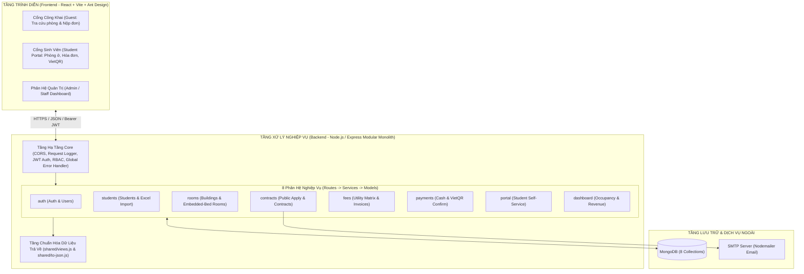

# System Architecture — HaUI - DMS Backend

- **Kiến trúc tổng thể:** Client–Server tách rời (SPA Frontend + RESTful JSON API Backend)
- **Kiến trúc Backend:** **Modular Monolith** theo phân hệ nghiệp vụ (Vertical Slice)
- **Nền tảng kỹ thuật:** Node.js (`>= 18 LTS`) · Express 5 · MongoDB (`>= 6.0`) · Mongoose 9 · JWT · Bcryptjs · Nodemailer

---

## 1. Sơ Đồ Kiến Trúc Tổng Thể 3 Tầng



---

## 2. Cấu Trúc Thư Mục & Trách Nhiệm Từng Tầng

```text
src/
├── app.js                         # Khởi tạo Express, CORS, gắn router 8 modules, bắt 404 & lỗi tập trung
├── server.js                      # Kết nối MongoDB trước khi mở cổng HTTP + Graceful Shutdown
├── core/                          # Hạ tầng kỹ thuật dùng chung (không chứa nghiệp vụ riêng lẻ)
│   ├── config/
│   │   ├── index.js               # Đọc & chuẩn hóa toàn bộ biến môi trường (.env)
│   │   └── database.js            # Kết nối Mongoose tới MongoDB
│   ├── email/
│   │   └── email.service.js       # Gửi email cấp tài khoản & thông báo từ chối đơn (Nodemailer)
│   ├── errors/
│   │   └── api-error.js           # Lớp ngoại lệ nghiệp vụ chuẩn ApiError(statusCode, errorCode, message, data)
│   ├── logger/
│   │   └── logger.js              # Ghi log kèm tự động che giấu trường nhạy cảm (password, token...)
│   ├── middlewares/
│   │   ├── auth.js                # Xác thực JWT, kiểm tra khóa TK, chặn mustChangePassword & phân quyền RBAC
│   │   ├── error-handler.js       # Chuẩn hóa mọi lỗi (ApiError, CastError, E11000, JWT) về envelope chuẩn
│   │   └── request-logger.js      # Ghi nhận thời gian phản hồi HTTP request
│   └── utils/
│       ├── async-handler.js       # Bọc hàm bất đồng bộ cho middleware
│       ├── code-generator.js      # Sinh mã nghiệp vụ chống trùng (HD-YYYY-NNNN, INV-..., PAY-...)
│       ├── dates.js               # Xử lý ngày tháng theo múi giờ Việt Nam UTC+7 (YYYY-MM-DD, YYYY-MM)
│       ├── http.js                # Wrapper respond(), fieldErrors(), fail(), paginate(), matches()
│       ├── jwt.js                 # Ký và xác thực JSON Web Token (hạn 7 ngày)
│       └── response.js            # Chuẩn hóa phản hồi thành công { code: 'OK', message, data }
├── shared/                        # Thành phần nghiệp vụ dùng chung giữa các modules
│   ├── constants/
│   │   ├── enums.js               # Toàn bộ hằng số enum chữ thường dùng chung cho Model & Service
│   │   └── error-codes.js         # Danh mục mã lỗi tiếng Anh dạng máy đọc
│   ├── to-json.js                 # Transform Mongoose document: _id -> id (string), ẩn __v & passwordHash
│   └── views.js                   # Chuyển đổi dữ liệu .lean() sang DTO chuẩn trả cho Frontend (loadCtx)
├── modules/                       # 8 phân hệ nghiệp vụ độc lập
│   ├── auth/                      # auth.routes, auth.service, user.model, user.routes, user.service
│   ├── students/                  # student.model, student.rules, student.routes, student.service
│   ├── rooms/                     # building.model, room.model, room.routes, room.service
│   ├── contracts/                 # contract.model, contract.routes, public.routes, contract.service
│   ├── fees/                      # utility-reading.model, invoice.model, fee.routes, fee.service
│   ├── payments/                  # payment.model, payment.routes, payment.service
│   ├── portal/                    # portal.routes, portal.service
│   └── dashboard/                 # dashboard.routes, dashboard.service
└── scripts/
    ├── seed.js                    # Dựng toàn bộ dữ liệu mẫu 8 collections phục vụ kiểm thử
    ├── test-db.js                 # Kiểm tra kết nối MongoDB
    └── test-haui-dms.js           # Bộ kiểm thử tích hợp tự động toàn bộ luồng REST API
```

### Luồng đi của một Request trong Module (`Routes -> Services -> Views`)
Dự án loại bỏ lớp `Controller` trung gian rỗng để giữ mã nguồn súc tích:
1. **`*.routes.js`:** Khai báo đường dẫn, gắn middleware `authenticate` / `authorize(...)`, và bọc lời gọi service qua hàm `respond((req) => service.action(...))`.
2. **`*.service.js`:** Kiểm tra dữ liệu đầu vào (trả lỗi gắn đúng tên trường qua `fieldErrors([...])`), thực thi quy tắc nghiệp vụ, truy vấn CSDL bằng `.lean()` để tối ưu tốc độ.
3. **`shared/views.js`:** Gom các bảng tham chiếu bằng `loadCtx()` (tránh lỗi truy vấn lặp *N+1 query*) và định dạng đầu ra đồng nhất cho Frontend (`contract.student`, `invoice.room`, v.v.).

---

## 3. Năm Quy Tắc Kỹ Thuật Cốt Lõi (Core Engineering Rules)

### 3.1. Khóa giường nguyên tử bằng `$elemMatch` (Chống Race Condition — BR-05)
Giường được nhúng trực tiếp trong `Room.beds[]`. Khi cán bộ duyệt đơn, hệ thống tuyệt đối không dùng `find` rồi `save`, và **bắt buộc dùng `$elemMatch`** để khóa đúng phần tử giường đang trống trong một bước duy nhất:

```javascript
const locked = await Room.findOneAndUpdate(
  { _id: room._id, beds: { $elemMatch: { bedNumber: bedNo, status: 'available' } } },
  { $set: { 'beds.$.status': 'occupied', 'beds.$.studentId': st._id } },
  { returnDocument: 'after' }
);
if (!locked) fail(409, 'BED_ALREADY_OCCUPIED', 'Giường vừa có người nhận');
```
*(Lưu ý: Không viết `{ 'beds.bedNumber': bedNo, 'beds.status': 'available' }` rời rạc vì MongoDB sẽ khớp nhầm khi phòng có giường khác đang trống).*

### 3.2. Hoàn tác bù trừ không phụ thuộc Replica Set Transaction
Để chạy mượt trên cả MongoDB cài cục bộ đơn lẻ (Standalone) lẫn MongoDB Atlas mà không đòi hỏi Replica Set Transaction, các thao tác nhiều bước (`approve`, `publish`, `collect`) đều khóa tài nguyên đầu tiên bằng `findOneAndUpdate` có điều kiện và có khối `catch` hoàn tác tường minh nếu bước sau gặp sự cố.

### 3.3. Trạng thái hết hạn hợp đồng (`expired`) suy ra lúc đọc
Trong CSDL, `Contract.status` chỉ lưu 4 giá trị: `'pending' | 'active' | 'terminated' | 'rejected'`. Hợp đồng `'active'` có `endDate < today()` được hàm `contractStatusOf()` trả ra cho Frontend là `'expired'`, nhưng **vẫn giữ khóa giường trong phòng** cho tới khi cán bộ kiểm tra sạch nợ và bấm thanh lý (`terminate` — `BR-04`). Không dùng Cron Job tự động nhả giường.

### 3.4. Chuẩn ngày tháng giờ Việt Nam (`UTC+7`) và Tiền tệ số nguyên
- Ngày không kèm giờ (`dob`, `startDate`, `endDate`, `terminatedAt`, `dueDate`) lưu chuỗi `'YYYY-MM-DD'` tính theo `UTC+7` (`core/utils/dates.js`), tránh lệch lùi 1 ngày khi server chạy giờ UTC buổi sáng.
- Tháng chốt điện nước (`monthYear`) lưu chuỗi `'YYYY-MM'`.
- Mọi trường tiền tệ (`pricePerMonth`, `depositAmount`, `totalRoomFee`, `amount`, `unitPrice`) lưu **số nguyên VND** (`Integer >= 0`).

### 3.5. Chống truy cập trái phép chéo (Anti-IDOR) và Cưỡng bức đổi mật khẩu
- Ở toàn bộ phân hệ `/api/portal/*`, danh tính sinh viên luôn lấy từ `req.user.studentId` truy vấn trực tiếp từ DB qua JWT, tuyệt đối không nhận `studentId` từ query/body của client.
- Khi `user.mustChangePassword === true`, middleware `authenticate` chặn mọi API trả về `403 MUST_CHANGE_PASSWORD`, ngoại trừ 3 đường dẫn: `/api/auth/me`, `/api/auth/logout`, `/api/auth/change-password`.
