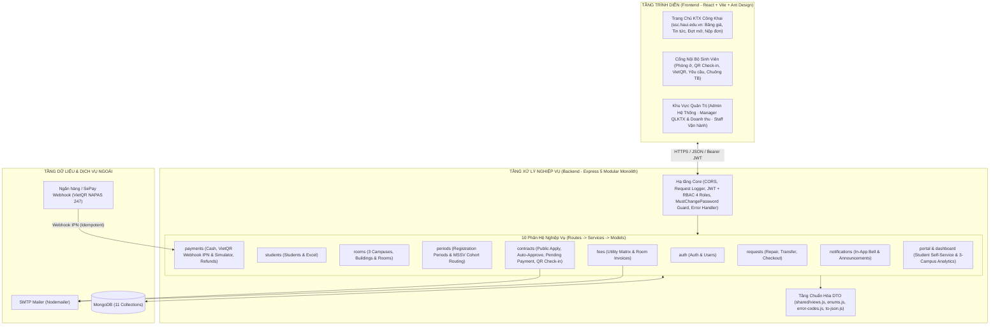

# System Architecture — HaUI - DMS Backend (v3.0)

- **Kiến trúc tổng thể:** Client–Server tách rời (SPA React + Vite + Ant Design ↔ RESTful JSON API Node.js + Express 5)
- **Kiến trúc Backend:** **Modular Monolith** (10 phân hệ nghiệp vụ độc lập, 11 Collections MongoDB/Mongoose, không phụ thuộc Redis hay WebSocket)

---

## 1. Sơ Đồ Kiến Trúc 3 Tầng v3.0

---

## 2. Cấu Trúc 10 Phân Hệ (`src/modules/`)

1. `auth/` — `/api/auth`, `/api/users` (Xác thực JWT 7 ngày, 4 vai trò `admin | manager | staff | student`)
2. `students/` — `/api/students` (Hồ sơ SV, trích xuất `enrollmentYear` từ 4 số đầu MSSV, diện ưu tiên, tình trạng sức khỏe, Import Excel)
3. `rooms/` — `/api/buildings`, `/api/rooms` (3 cơ sở địa giới 2026, bảng giá 2026–2027, quản lý sức chứa `capacity` & `occupiedCount` đến cấp Phòng — bỏ theo dõi vị trí giường lẻ)
4. `periods/` — `/api/periods` (Quản lý Đợt đăng ký, phân luồng theo khóa/ngành)
5. `contracts/` — `/api/public`, `/api/contracts` (Trang chủ công khai, nộp/hủy đơn `pending`, duyệt đơn + tự động xếp phòng ưu tiên tầng thấp, `pending_payment` + hủy quá hạn, quét QR Check-in, thanh lý + hoàn cọc khấu trừ)
6. `fees/` — `/api/utility-readings`, `/api/invoices` (Bảng lưới điện nước nối tiếp chỉ số, chốt 01 hóa đơn/phòng + bắn Thông báo & Email đồng loạt)
7. `payments/` — `/api/payments` (Thu tiền mặt, **Webhook VietQR tự động + Simulator**, tự kích hoạt `pending_payment -> active`, lưu phiếu chi hoàn cọc)
8. `requests/` — `/api/requests` (Xử lý phiếu Báo hỏng `repair`, Chuyển phòng nguyên tử `transfer`, Trả phòng `checkout`)
9. `notifications/` — `/api/notifications` (Đăng bảng tin công khai & quản lý chuông thông báo)
10. `portal/` & `dashboard/` — `/api/portal`, `/api/dashboard` (Cổng tự phục vụ SV gồm gia hạn/đăng ký nội bộ, QR Check-in, yêu cầu, thông báo; Thống kê 3 cơ sở & Doanh thu dành riêng cho `manager`)

---

## 3. Quy Tắc Kỹ Thuật Bắt Buộc

- **Khóa chỗ & Chuyển phòng nguyên tử cấp Phòng:** Luôn dùng `{ _id, status: 'active', $expr: { $lt: ['$occupiedCount', '$capacity'] } }` + `{ $inc: { occupiedCount: 1 } }` trên `Room.findOneAndUpdate` cho cả duyệt đơn lẫn duyệt chuyển phòng (`transfer`), tránh hoàn toàn vượt sức chứa phòng.
- **Tự kích hoạt Hợp đồng qua Payment Hook:** Hàm gạch nợ chung trong `payment.service.js` (dùng cho cả `webhook/vietqr`, `webhook/simulate`, `vietqr/confirm` và `cash`) tự kiểm tra nếu hợp đồng đang ở `pending_payment` và không còn hóa đơn `deposit` / `room_semester` nào `unpaid` → nâng hợp đồng sang `active`, sinh `checkinCode`, gửi Thông báo & Email mời nhận phòng!
- **Hoàn tác bù trừ không cần Replica Set Transaction:** Giữ khả năng chạy mượt trên mọi máy dev MongoDB Standalone lẫn Atlas.
- **Chuẩn giờ Việt Nam (`UTC+7`) & Anti-IDOR:** Mọi ngày nghiệp vụ dùng `core/utils/dates.js`; mọi API `/api/portal/*` luôn lấy `req.user.studentId` từ JWT + DB.
