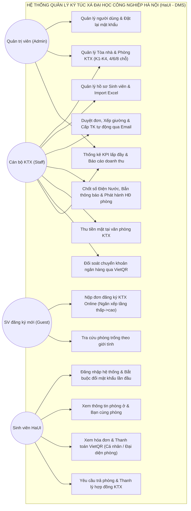

# CHƯƠNG 2: KHẢO SÁT HIỆN TRẠNG VÀ PHÂN TÍCH YÊU CẦU HỆ THỐNG (HaUI - DMS)

---

## 1.1 Mô tả bài toán
Trường Đại học Công nghiệp Hà Nội (HaUI) là cơ sở giáo dục đại học quy mô lớn với nhiều cơ sở đào tạo (Cơ sở 1 - Bắc Từ Liêm, Cơ sở 2 - Tây Tựu, Cơ sở 3 - Hà Nam). Hệ thống Ký túc xá (KTX) của nhà trường gồm các dãy tòa nhà cao tầng hiện đại (như K1, K2, K3, K4...) đáp ứng nhu cầu nội trú cho hàng ngàn sinh viên mỗi năm học. Tuy nhiên, trong công tác vận hành thực tế, Ban Quản lý KTX đang đối mặt với nhiều khó khăn và bất cập lớn: vào đầu mỗi học kỳ, áp lực thu nhận hàng ngàn hồ sơ đăng ký qua giấy tờ hoặc các biểu mẫu trực tuyến tự do dễ gây rác dữ liệu, quá tải tiếp nhận và nguy cơ tài khoản ảo, mạo danh sinh viên; việc phân bổ phòng/giường thủ công khi nhiều cán bộ cùng thao tác dễ dẫn đến xung đột xếp trùng giường (Overbooking) hoặc nhầm lẫn giới tính nam/nữ giữa các phòng; việc chốt số điện nước và chia tiền lẻ gửi từng hóa đơn đến từng cá nhân khiến sinh viên nợ đọng kéo dài, cán bộ khó đối soát và dễ thất thoát tài chính. Từ đó, nhóm đề xuất xây dựng **Website Quản lý Ký túc xá Đại học Công nghiệp Hà Nội (HaUI - DMS)**, tạo ra một môi trường quản lý trực tuyến tập trung, số hóa toàn diện quy trình tiếp nhận hồ sơ, điều phối phòng ở và quản lý tài chính minh bạch.

Website hướng tới ba nhóm tác nhân người dùng chính gồm: Quản trị viên (Admin), Cán bộ KTX (Staff), Sinh viên nội trú (Student) và một nhóm đối tượng vãng lai là Sinh viên đăng ký mới (Guest). Với sinh viên chưa có tài khoản, cổng tiếp nhận công khai cho phép tra cứu số chỗ trống theo đúng giới tính và nộp đơn đăng ký trực tuyến theo quy tắc ngăn xếp (ưu tiên tầng thấp, số phòng nhỏ trước) cùng kỳ hạn thuê 6 tháng hoặc 12 tháng mà không cần tạo tài khoản trước. Khi cán bộ KTX phê duyệt đơn thành công, hệ thống tự động khóa giường nguyên tử chống trùng lặp, tự sinh tài khoản người dùng và gửi thông tin qua email sinh viên. Khi đăng nhập vào hệ thống, sinh viên bắt buộc phải đổi mật khẩu khởi tạo ở lần đầu tiên trước khi được sử dụng các dịch vụ Portal như: theo dõi hồ sơ cá nhân, xem thông tin phòng ở, danh sách bạn cùng phòng, nhận thông báo hóa đơn và lịch sử thanh toán.

Điểm nhấn nổi bật của hệ thống là cơ chế quản lý hóa đơn điện nước theo đơn vị Phòng và giải pháp chống xung đột giường tuyệt đối. Thay vì chia nhỏ hóa đơn lẻ cho từng cá nhân, mỗi tháng hệ thống chốt đúng 01 hóa đơn điện nước duy nhất cho cả phòng và tự động gửi thông báo đồng loạt đến toàn bộ thành viên kèm mức tiền gợi ý chia bình quân. Một sinh viên đại diện bất kỳ trong phòng có thể đứng ra quét mã VietQR động tích hợp sẵn thông tin hoặc nộp tiền mặt tại KTX để gạch nợ dứt điểm cho toàn bộ thành viên. Đồng thời, cơ chế khóa giường nguyên tử một bước (`findOneAndUpdate`) trực tiếp tại CSDL MongoDB giúp loại bỏ hoàn toàn nguy cơ trùng giường (Zero Overbooking) trong các đợt cao điểm xét duyệt. Đối với cán bộ và quản trị viên, hệ thống cung cấp đầy đủ chức năng quản lý tòa nhà, cấu hình phòng tự động sinh giường, nhập liệu sinh viên hàng loạt bằng Excel, duyệt đơn, đối soát tài chính và bảng điều khiển (Dashboard) thống kê tỷ lệ lấp đầy cùng doanh thu theo thời gian thực.

Tóm lại, website HaUI - DMS được xây dựng với mục tiêu trở thành một nền tảng quản trị ký túc xá hiện đại, trực quan, hỗ trợ sinh viên và cán bộ quản lý thực hiện các thủ tục nội trú thuận tiện, chính xác và an toàn hơn. Hệ thống được tổ chức tinh gọn và chuẩn hóa, sẵn sàng mở rộng quy mô tích hợp thêm các dịch vụ tiện ích khác trong tương lai.

---

## 1.2 Yêu cầu của Website

### 1.2.1 Yêu cầu chức năng
- **Đăng nhập:** Cho phép người dùng (Admin, Staff, Student) đăng nhập vào hệ thống bằng Email/MSSV và mật khẩu; cấp mã JWT phiên làm việc; tự động nhận diện và điều hướng bắt buộc đổi mật khẩu nếu là lần đăng nhập đầu tiên.
- **Bắt buộc đổi mật khẩu:** Cho phép sinh viên cập nhật mật khẩu mới ở lần đăng nhập đầu tiên và tự động tắt cờ `mustChangePassword` sau khi đổi thành công.
- **Đăng xuất:** Cho phép người dùng hủy phiên làm việc hiện tại trên hệ thống.
- **Xem hồ sơ cá nhân:** Cho phép người dùng xem thông tin chi tiết tài khoản của mình, bao gồm mã sinh viên, họ tên, khoa/viện, lớp và phòng đang ở (đối với sinh viên).
- **Đặt lại mật khẩu tạm thời:** Cho phép Quản trị viên và Cán bộ KTX đặt lại mật khẩu tạm cho người dùng khi quên mật khẩu và kích hoạt lại cờ bắt buộc đổi mật khẩu.
- **Quản lý danh sách tài khoản:** Cho phép Quản trị viên xem danh sách người dùng, lọc theo vai trò (Admin, Staff, Student), kích hoạt hoặc khóa tài khoản.
- **Tra cứu phòng trống:** Cho phép người dùng vãng lai và sinh viên tra cứu danh sách phòng còn giường trống theo tòa nhà, số tầng và lọc theo giới tính (`male`/`female`).
- **Nộp đơn đăng ký KTX trực tuyến:** Cho phép sinh viên chưa có tài khoản nộp hồ sơ xin nội trú trên cổng công khai, chọn phòng theo quy tắc ngăn xếp (tầng thấp, số nhỏ trước) và chọn gói thời hạn thuê (6 tháng hoặc 12 tháng).
- **Xem danh sách đơn đăng ký KTX:** Cho phép Cán bộ KTX xem danh sách các đơn đăng ký, lọc theo trạng thái (`pending`, `active`, `expired`, `terminated`).
- **Xét duyệt đơn đăng ký & Khóa giường nguyên tử:** Cho phép Cán bộ KTX duyệt hồ sơ, thực hiện khóa giường nguyên tử chống trùng lặp, chuyển hợp đồng sang hiệu lực, tự động sinh tài khoản gửi qua email và tạo 02 hóa đơn (tiền cọc & tiền phòng).
- **Từ chối đơn đăng ký:** Cho phép Cán bộ KTX từ chối hồ sơ không hợp lệ, ghi rõ lý do và tự động gửi email thông báo từ chối cho sinh viên.
- **Quản lý danh sách sinh viên:** Cho phép Cán bộ KTX xem danh sách sinh viên phân trang, tìm kiếm theo MSSV, họ tên, lọc theo khoa/viện và giới tính.
- **Xem chi tiết hồ sơ sinh viên:** Cho phép Cán bộ KTX xem thông tin lý lịch, phòng ở hiện tại, lịch sử hợp đồng và công nợ của sinh viên.
- **Thêm mới và cập nhật sinh viên:** Cho phép Cán bộ KTX tạo mới hoặc cập nhật thông tin hồ sơ sinh viên, kiểm tra trùng lặp mã số sinh viên HaUI.
- **Nhập sinh viên hàng loạt từ Excel:** Cho phép Cán bộ KTX tải file mẫu Excel, điền dữ liệu và tải lên hệ thống để thêm mới đồng loạt hồ sơ sinh viên.
- **Vô hiệu hóa sinh viên:** Cho phép Cán bộ KTX vô hiệu hóa hồ sơ sinh viên khi đã hoàn thành hoặc rời trường (chặn xóa nếu còn nợ tiền hoặc hợp đồng đang hoạt động).
- **Quản lý danh mục Tòa nhà KTX:** Cho phép Quản trị viên và Cán bộ KTX xem danh sách các tòa (K1, K2, K3, K4...), thêm mới, chỉnh sửa thông tin mô tả và trạng thái hoạt động của tòa nhà.
- **Quản lý danh sách phòng KTX:** Cho phép quản lý phòng theo tòa, tầng, phân loại giới tính (`male`/`female`), theo dõi sức chứa và số giường trống thực tế.
- **Thêm mới và cập nhật phòng KTX:** Cho phép thiết lập số phòng, tầng, sức chứa (4, 6, 8 chỗ), đơn giá thuê, tiền cọc và tự động sinh mảng giường nhúng tương ứng ở trạng thái trống (`available`).
- **Ghi chỉ số điện nước bảng lưới:** Cho phép Cán bộ KTX nhập nhanh chỉ số điện và nước mới của các phòng dạng bảng lưới (Matrix Grid), tự động tính sản lượng tiêu thụ và thành tiền.
- **Chốt số và phát hành hóa đơn điện nước theo phòng:** Cho phép Cán bộ KTX phát hành 01 hóa đơn điện nước duy nhất cho cả phòng, tự động bắn thông báo và chia bình quân tiền cho tất cả thành viên trong phòng.
- **Xem thông tin phòng ở và bạn cùng phòng:** Cho phép sinh viên xem chi tiết tòa nhà, số phòng, số giường của mình và danh sách thông tin liên lạc của các bạn cùng phòng.
- **Xem danh sách và chi tiết hóa đơn:** Cho phép sinh viên và cán bộ tra cứu chi tiết hóa đơn tiền cọc, tiền phòng kỳ và hóa đơn điện nước chung của phòng kèm trạng thái nợ/đã trả.
- **Thanh toán hóa đơn qua VietQR:** Cho phép sinh viên quét mã VietQR động được tạo tự động với đúng số tiền và cú pháp chuẩn để thanh toán tiền phòng hoặc đại diện thanh toán điện nước cho phòng.
- **Thu tiền mặt tại văn phòng KTX:** Cho phép Cán bộ KTX tiếp nhận tiền mặt trực tiếp từ sinh viên (cá nhân hoặc đại diện phòng), xác nhận gạch nợ hóa đơn sang `paid` và lưu biên lai thu tiền.
- **Đối soát chuyển khoản ngân hàng:** Cho phép Cán bộ KTX kiểm tra sao kê chuyển khoản và bấm xác nhận hoàn tất thanh toán cho hóa đơn.
- **Trả phòng và thanh lý hợp đồng:** Cho phép Cán bộ KTX kiểm tra điều kiện sạch nợ của cá nhân và phòng, kiểm kê tài sản, thu hồi chìa khóa, giải phóng giường về trạng thái trống (`available`) và thanh lý hợp đồng.
- **Xem báo cáo KPI và tỷ lệ lấp đầy:** Cho phép Quản trị viên và Cán bộ KTX theo dõi tổng số chỗ, số chỗ đang ở, số chỗ trống và biểu đồ tỷ lệ lấp đầy theo từng tòa nhà.
- **Thống kê doanh thu KTX:** Cho phép Quản trị viên xem biểu đồ và bảng số liệu doanh thu tài chính theo tháng/kỳ, phân tách doanh thu tiền phòng và doanh thu điện nước.

---

### 1.2.2 Yêu cầu phi chức năng
- **Hiệu năng:** Hệ thống phải đảm bảo thời gian phản hồi nhanh: 95% các tác vụ tra cứu phòng trống, hóa đơn và thông tin sinh viên phản hồi dưới **1.0 giây**; các chức năng tổng hợp báo cáo và thống kê hoàn thành dưới **3.0 giây**. Hệ thống có khả năng xử lý đồng thời tối thiểu **500 sinh viên nộp đơn trực tuyến** trong ngày đầu mở cổng đăng ký KTX mà không bị nghẽn giao dịch.
- **Tính an toàn và bảo mật:** Toàn bộ mật khẩu người dùng phải được mã hóa một chiều bằng thuật toán `bcrypt` (với 10 salt rounds). Hệ thống áp dụng cơ chế xác thực dựa trên JSON Web Token (JWT) và phân quyền chặt chẽ theo vai trò (RBAC 3 cấp: Admin, Staff, Student). Tuyệt đối không mở đăng ký tài khoản tự do trên giao diện để tránh spam tài khoản ảo. Ràng buộc bảo mật trích xuất từ chữ ký JWT ngăn chặn triệt để lỗ hổng truy cập trái phép dữ liệu của người khác (IDOR).
- **Tính toàn vẹn và chống xung đột dữ liệu:** Hệ thống phải áp dụng cơ chế truy vấn nguyên tử một bước (`findOneAndUpdate`) trực tiếp tại cơ sở dữ liệu MongoDB khi cán bộ duyệt đơn, đảm bảo **Zero Overbooking** (tuyệt đối không bao giờ xếp 2 sinh viên vào cùng 1 vị trí giường). Chỉ số điện nước mới phải luôn đảm bảo lớn hơn hoặc bằng chỉ số cũ.
- **Tính chính xác:** Hệ thống phải đảm bảo tính toán chính xác 100% doanh thu, tiền điện nước phòng theo đơn giá quy định và số tiền chia bình quân cho các thành viên; đảm bảo gạch nợ chính xác, đồng bộ cho toàn bộ thành viên trong phòng khi sinh viên đại diện thanh toán.
- **Tính dễ sử dụng:** Giao diện website thiết kế theo chuẩn Responsive Web bằng Ant Design, hiển thị tối ưu trên máy tính để bàn, máy tính bảng và điện thoại thông minh. Bố cục bảng biểu, lưới nhập dữ liệu điện nước và thao tác nộp đơn trực quan, rõ ràng; toàn bộ thông báo hệ thống và email hướng dẫn sử dụng tiếng Việt có dấu chuẩn mực.
- **Tính ổn định và độ tin cậy:** Hệ thống phải duy trì hoạt động liên tục với độ sẵn sàng (Uptime) tối thiểu đạt **99.5%** trong suốt đợt đăng ký và kỳ vận hành KTX; có cơ chế bắt lỗi tập trung (Global Error Handler) và thông báo thân thiện khi gặp sự cố mạng hoặc cơ sở dữ liệu.
- **Khả năng bảo trì và mở rộng:** Mã nguồn hệ thống được tổ chức phân tầng rõ ràng theo mô-đun (Routes - Controllers - Services - Models). Cơ sở dữ liệu tối ưu với 7 collection cốt lõi, dễ dàng bảo trì, cập nhật đơn giá, thêm tòa nhà mới và tích hợp thêm cổng thanh toán tự động trong tương lai.

---

## 1.3 Mô hình hóa chức năng

### 1.3.1 Biểu đồ mô tả chức năng chính

Dưới đây là Biểu đồ Use Case tổng quát mô tả các khối chức năng chính của Hệ thống Quản lý Ký túc xá HaUI - DMS và sự tương tác của 4 nhóm tác nhân:



---

### 1.3.4 Mô tả Use case

#### 1.3.4.1 Mô tả Use case “Nộp đơn đăng ký KTX Online công khai”

| **Mã Use case: UC01** | **Tên Usecase: Nộp đơn đăng ký KTX Online công khai** |
|---|---|
| **Tác nhân** | Sinh viên đăng ký mới (Guest / Sinh viên HaUI) |
| **Mô tả** | Use case này cho phép sinh viên chưa có tài khoản truy cập vào Cổng tiếp nhận KTX công khai để tra cứu phòng trống theo giới tính, chọn phòng theo quy tắc ngăn xếp và nộp hồ sơ xin nội trú. |
| **Sự kiện kích hoạt chức năng** | Sinh viên kích chọn nút “Đăng ký ở KTX” trên màn hình đăng nhập công khai. |
| **Tiền điều kiện** | Sinh viên truy cập vào Cổng KTX HaUI, chưa cần có tài khoản đăng nhập hệ thống. |

**Luồng sự kiện chính:**

| STT | Thực hiện bởi | Hành động |
|:---:|:---:|---|
| 1 | Sinh viên | Kích chọn nút "Đăng ký ở KTX" trên màn hình cổng thông tin công khai |
| 2 | Hệ thống | Hiển thị Biểu mẫu đăng ký trực tuyến kèm các trường thông tin nhân thân và tiêu chí chọn phòng |
| 3 | Sinh viên | Nhập đầy đủ thông tin cá nhân: MSSV HaUI, Họ và tên, Giới tính, Số điện thoại, Email, Khoa/Viện, Lớp |
| 4 | Sinh viên | Chọn giới tính (`male` hoặc `female`) |
| 5 | Hệ thống | Tự động lọc danh sách các phòng còn giường trống (`status === 'available'`) đúng theo giới tính đã chọn |
| 6 | Hệ thống | Áp dụng quy tắc ngăn xếp: sắp xếp ưu tiên hiển thị các phòng từ tầng thấp nhất và số phòng nhỏ nhất trước |
| 7 | Sinh viên | Chọn phòng, chọn vị trí giường mong muốn trong danh sách gợi ý và chọn gói thời hạn thuê (6 hoặc 12 tháng) |
| 8 | Sinh viên | Kích vào nút "Gửi đơn đăng ký" |
| 9 | Hệ thống | Kiểm tra tính hợp lệ dữ liệu, kiểm tra tính duy nhất của MSSV (chưa có đơn pending hoặc hợp đồng đang active) |
| 10 | Hệ thống | Lưu hồ sơ sinh viên vào collection `students` và tạo bản ghi hợp đồng mới với trạng thái `pending` |
| 11 | Hệ thống | Hiển thị thông báo gửi đơn thành công và hướng dẫn sinh viên kiểm tra email thường xuyên để nhận kết quả xét duyệt. Use case kết thúc |

**Luồng sự kiện thay thế:**

| STT | Thực hiện bởi | Hành động |
|:---:|:---:|---|
| 9a.1 | Hệ thống | Nếu phát hiện MSSV đã có đơn đăng ký đang chờ duyệt hoặc đang lưu trú tại KTX, hiển thị thông báo lỗi trùng lặp |
| 9a.2 | Sinh viên | Kiểm tra lại thông tin MSSV hoặc liên hệ Ban Quản lý KTX để được hỗ trợ |
| 7a.1 | Hệ thống | Nếu vị trí giường vừa được người khác đăng ký chọn trước, hiển thị thông báo giường không còn trống |
| 7a.2 | Sinh viên | Quay lại bước 7 để chọn vị trí giường khác trong danh sách ngăn xếp gợi ý |
| 9b.1 | Hệ thống | Nếu phát hiện bỏ trống các trường bắt buộc hoặc sai định dạng số điện thoại/email, hiển thị cảnh báo lỗi tương ứng trên biểu mẫu |
| 9b.2 | Sinh viên | Quay lại bước 3 để chỉnh sửa, bổ sung thông tin chính xác |
| -- | Hệ thống | Tại bất kỳ thời điểm nào nếu không kết nối được với cơ sở dữ liệu, hệ thống hiển thị thông báo lỗi hệ thống và use case kết thúc |

- **Hậu điều kiện:** Nếu use case thành công, hồ sơ sinh viên và đơn đăng ký KTX được lưu vào cơ sở dữ liệu với trạng thái `pending`. Trạng thái phòng và giường chưa bị khóa cho đến khi được cán bộ phê duyệt. Nếu không thành công, trạng thái hệ thống không đổi.
- **Điểm mở rộng:** Không có.

● **Cấu trúc bảng dữ liệu liên quan của chức năng Nộp đơn đăng ký KTX Online:**

*Bảng `students` (Hồ sơ Sinh viên)*:
| Tên trường | Kiểu dữ liệu | Ràng buộc | Diễn giải |
|---|---|---|---|
| `_id` | ObjectId | PK | Khóa chính tự sinh |
| `studentCode` | String | required, unique | Mã số sinh viên HaUI (MSSV) |
| `fullName` | String | required | Họ và tên sinh viên |
| `gender` | String | required, enum: `['male', 'female']` | Giới tính (dùng lọc phòng nam/nữ) |
| `phone` | String | required | Số điện thoại liên lạc |
| `email` | String | required | Email cá nhân nhận thông báo |
| `faculty` | String | optional | Khoa/Viện đào tạo tại HaUI |
| `className` | String | optional | Lớp sinh hoạt |
| `status` | String | default: `'active'` | Trạng thái hồ sơ |

*Bảng `contracts` (Đơn đăng ký & Hợp đồng KTX)*:
| Tên trường | Kiểu dữ liệu | Ràng buộc | Diễn giải |
|---|---|---|---|
| `_id` | ObjectId | PK | Khóa chính tự sinh |
| `contractCode` | String | required, unique | Mã hợp đồng (vd: `HD-2026-0001`) |
| `studentId` | ObjectId | FK, ref: `'Student'` | Tham chiếu hồ sơ sinh viên |
| `roomId` | ObjectId | FK, ref: `'Room'` | Tham chiếu phòng đăng ký |
| `bedNumber` | Number | required | Vị trí số giường chọn |
| `term` | String | enum: `['6_months', '12_months']` | Thời hạn hợp đồng đăng ký |
| `status` | String | default: `'pending'` | Trạng thái đơn (chờ duyệt) |

*Hình 1.3.4.1. Cấu trúc bảng dữ liệu của chức năng Nộp đơn đăng ký KTX Online*

---

#### 1.3.4.2 Mô tả Use case “Xét duyệt đơn KTX & Cấp tài khoản tự động”

| **Mã Use case: UC02** | **Tên Usecase: Xét duyệt đơn KTX & Cấp tài khoản tự động** |
|---|---|
| **Tác nhân** | Cán bộ KTX (Staff) |
| **Mô tả** | Use case này cho phép cán bộ KTX kiểm tra hồ sơ đăng ký, phê duyệt đơn, thực hiện khóa giường nguyên tử chống trùng lặp, tự động tạo tài khoản gửi qua email sinh viên và phát hành hóa đơn tiền cọc cùng tiền phòng. |
| **Sự kiện kích hoạt chức năng** | Cán bộ kích chọn mục “Duyệt đơn đăng ký” và bấm nút “Phê duyệt”. |
| **Tiền điều kiện** | Đăng nhập hệ thống với quyền Cán bộ KTX (Staff) hoặc Quản trị viên (Admin); tồn tại đơn đăng ký ở trạng thái `pending`. |

**Luồng sự kiện chính:**

| STT | Thực hiện bởi | Hành động |
|:---:|:---:|---|
| 1 | Cán bộ KTX | Chọn mục "Quản lý Đơn đăng ký" trên thanh điều hướng |
| 2 | Hệ thống | Hiển thị danh sách các đơn đăng ký đang chờ duyệt (`status === 'pending'`) |
| 3 | Cán bộ KTX | Chọn một đơn đăng ký trong danh sách và xem chi tiết thông tin sinh viên, phòng và giường đăng ký |
| 4 | Cán bộ KTX | Kích vào nút "Phê duyệt" trên màn hình chi tiết đơn |
| 5 | Hệ thống | Thực thi câu lệnh nguyên tử một bước (`findOneAndUpdate`) khóa vị trí giường: chuyển `status` sang `occupied` và gắn `studentId` |
| 6 | Hệ thống | Chuyển trạng thái hợp đồng sang `active`, ghi nhận thời gian bắt đầu và kết thúc |
| 7 | Hệ thống | Tự động tạo bản ghi tài khoản người dùng mới: `username` = MSSV, mật khẩu khởi tạo = MSSV (băm bcrypt), vai trò = `student`, kích hoạt cờ `mustChangePassword = true` |
| 8 | Hệ thống | Tự động gửi Email thông báo trúng tuyển KTX kèm tên đăng nhập, mật khẩu tạm thời và hướng dẫn đổi mật khẩu lần đầu cho sinh viên |
| 9 | Hệ thống | Tự động phát hành 02 hóa đơn ở trạng thái `unpaid`: 01 hóa đơn tiền cọc phòng và 01 hóa đơn tiền phòng cả kỳ (6 hoặc 12 tháng) |
| 10 | Hệ thống | Hiển thị thông báo duyệt đơn thành công và làm mới danh sách đơn đăng ký. Use case kết thúc |

**Luồng sự kiện thay thế:**

| STT | Thực hiện bởi | Hành động |
|:---:|:---:|---|
| 5a.1 | Hệ thống | Nếu giường vừa bị người khác duyệt chiếm chỗ trước (trả về null), hệ thống rollback giao dịch, báo lỗi xung đột giường `409 BED_ALREADY_OCCUPIED` |
| 5a.2 | Cán bộ KTX | Điều phối chọn vị trí giường trống khác cho sinh viên và thực hiện duyệt lại |
| 4a.1 | Cán bộ KTX | Chọn bấm nút "Từ chối", nhập lý do từ chối đơn vào hộp thoại xác nhận |
| 4a.2 | Hệ thống | Cập nhật hợp đồng sang `terminated`, lưu lý do từ chối, gửi email thông báo từ chối cho sinh viên và không thực hiện khóa giường |
| -- | Hệ thống | Tại bất kỳ thời điểm nào nếu lỗi kết nối CSDL hoặc dịch vụ gửi mail gặp sự cố, hệ thống hiển thị thông báo lỗi và hủy bỏ thao tác |

- **Hậu điều kiện:** Giường được khóa sang `occupied`, hợp đồng chuyển sang `active`, tài khoản người dùng được tạo mới kèm cờ `mustChangePassword = true`, email được gửi đi và 02 hóa đơn được tạo lập.
- **Điểm mở rộng:** Không có.

● **Cấu trúc bảng dữ liệu liên quan của chức năng Xét duyệt đơn KTX & Cấp tài khoản tự động:**

*Bảng `users` (Tài khoản Đăng nhập)*:
| Tên trường | Kiểu dữ liệu | Ràng buộc | Diễn giải |
|---|---|---|---|
| `_id` | ObjectId | PK | Khóa chính tự sinh |
| `email` | String | required, unique | Email đăng nhập của sinh viên |
| `passwordHash` | String | required | Mật khẩu khởi tạo băm bcrypt |
| `fullName` | String | required | Họ tên sinh viên |
| `role` | String | required, enum: `['student']` | Vai trò sinh viên |
| `isActive` | Boolean | default: `true` | Trạng thái tài khoản |
| `mustChangePassword`| Boolean | default: `true` | Bắt buộc đổi mật khẩu ở lần đầu đăng nhập |

*Bảng `rooms` (Mảng giường nhúng `beds`)*:
| Tên trường | Kiểu dữ liệu | Ràng buộc | Diễn giải |
|---|---|---|---|
| `beds.bedNumber` | Number | required | Số thứ tự giường trong phòng |
| `beds.status` | String | enum: `['available', 'occupied', 'maintenance']` | Trạng thái giường (chuyển sang `occupied`) |
| `beds.studentId` | ObjectId | FK, ref: `'Student'` | Tham chiếu sinh viên đang chiếm giường |

*Hình 1.3.4.2. Cấu trúc bảng dữ liệu của chức năng Xét duyệt đơn KTX*

---

#### 1.3.4.3 Mô tả Use case “Chốt chỉ số điện nước & Phát hành hóa đơn theo phòng”

| **Mã Use case: UC03** | **Tên Usecase: Chốt chỉ số điện nước & Phát hành hóa đơn theo phòng** |
|---|---|
| **Tác nhân** | Cán bộ KTX (Staff) |
| **Mô tả** | Use case này cho phép cán bộ KTX nhập số điện và nước mới hàng tháng theo bảng lưới cho từng phòng, tính sản lượng tiêu thụ, phát hành 01 hóa đơn điện nước duy nhất cho cả phòng và tự động gửi thông báo chia đều cho các thành viên. |
| **Sự kiện kích hoạt chức năng** | Cán bộ chọn mục “Quản lý Điện Nước” và bấm “Chốt & Phát hành hóa đơn”. |
| **Tiền điều kiện** | Đăng nhập hệ thống với quyền Cán bộ KTX; đến kỳ chốt số điện nước định kỳ hàng tháng. |

**Luồng sự kiện chính:**

| STT | Thực hiện bởi | Hành động |
|:---:|:---:|---|
| 1 | Cán bộ KTX | Chọn mục "Điện Nước KTX" trên thanh điều hướng |
| 2 | Cán bộ KTX | Chọn Tòa nhà (ví dụ: Tòa K1) và Tháng chốt số (định dạng `YYYY-MM`) |
| 3 | Hệ thống | Hiển thị bảng lưới ma trận (Matrix Grid) toàn bộ danh sách phòng trong tòa kèm chỉ số cũ đã điền sẵn |
| 4 | Cán bộ KTX | Nhập các chỉ số điện mới và nước mới cho từng phòng trực tiếp trên bảng lưới |
| 5 | Hệ thống | Kiểm tra tính hợp lệ: đảm bảo chỉ số mới $\ge$ chỉ số cũ |
| 6 | Cán bộ KTX | Kích vào nút "Chốt & Phát hành hóa đơn Điện Nước" |
| 7 | Hệ thống | Tính sản lượng tiêu thụ điện nước và tính tổng tiền của từng phòng theo đơn giá cấu hình |
| 8 | Hệ thống | Lưu bản ghi chỉ số chốt vào collection `utility_readings` |
| 9 | Hệ thống | Phát hành 01 hóa đơn điện nước duy nhất cho cả phòng (`type: 'utility'`, `status: 'unpaid'`) liên kết với `roomId`, mã hóa đơn chuẩn có kèm mã tòa: `INV-UTIL-<Mã Tòa>-<Số Phòng>-<YYYYMM>` (ví dụ: `INV-UTIL-K1-302-202610`, chống trùng phòng 302 giữa các tòa K1, K2) |
| 10 | Hệ thống | Đếm số lượng sinh viên đang ở thực tế trong phòng và tính số tiền gợi ý chia bình quân mỗi người |
| 11 | Hệ thống | Tự động bắn Email và Thông báo Portal đến toàn bộ sinh viên trong phòng kèm tổng tiền và mức chia bình quân |
| 12 | Hệ thống | Hiển thị thông báo phát hành hóa đơn thành công và làm mới bảng dữ liệu. Use case kết thúc |

**Luồng sự kiện thay thế:**

| STT | Thực hiện bởi | Hành động |
|:---:|:---:|---|
| 5a.1 | Hệ thống | Nếu phát hiện chỉ số mới nhỏ hơn chỉ số cũ, hệ thống tô đỏ cảnh báo lỗi tại ô nhập liệu tương ứng |
| 5a.2 | Cán bộ KTX | Kiểm tra lại công tơ thực tế và nhập lại chỉ số mới hợp lệ |
| 6a.1 | Hệ thống | Nếu tháng này phòng đã được chốt chỉ số trước đó, hiển thị cảnh báo trùng lặp bản ghi |
| 6a.2 | Cán bộ KTX | Chọn xem lại bản ghi đã chốt hoặc cập nhật lại chỉ số nếu có điều chỉnh |
| -- | Hệ thống | Bất kỳ thời điểm nào mất kết nối CSDL, hệ thống hiển thị thông báo lỗi và không phát hành hóa đơn |

- **Hậu điều kiện:** Bản ghi chỉ số điện nước được lưu vào `utility_readings`, 01 hóa đơn điện nước chung của phòng được tạo trong `invoices` với trạng thái `unpaid`, toàn bộ sinh viên trong phòng nhận được thông báo.
- **Điểm mở rộng:** Không có.

● **Cấu trúc bảng dữ liệu liên quan của chức năng Chốt chỉ số điện nước & Phát hành hóa đơn:**

*Bảng `utility_readings` (Chỉ số Điện Nước chốt hàng tháng)*:
| Tên trường | Kiểu dữ liệu | Ràng buộc | Diễn giải |
|---|---|---|---|
| `_id` | ObjectId | PK | Khóa chính tự sinh |
| `roomId` | ObjectId | FK, ref: `'Room'` | Phòng chốt chỉ số |
| `monthYear` | String | required, format `YYYY-MM` | Tháng năm ghi số (vd: `2026-10`) |
| `electricity` | Object | required | `{ oldIndex, newIndex, usage, unitPrice, amount }` |
| `water` | Object | required | `{ oldIndex, newIndex, usage, unitPrice, amount }` |
| `totalAmount` | Number | required | Tổng tiền điện + nước cả phòng (VNĐ) |
| `occupantsCount`| Number | required | Số sinh viên đang ở thực tế tại thời điểm chốt |
| `perStudentAmount`| Number | required | Mức tiền gợi ý chia bình quân mỗi sinh viên |
| `isBilled` | Boolean | default: `false` | Cờ trạng thái đã xuất hóa đơn |
| `recordedBy` | ObjectId | FK, ref: `'User'` | Cán bộ thực hiện ghi số |

*Hình 1.3.4.3. Cấu trúc bảng dữ liệu của chức năng Chốt điện nước theo phòng*

---

#### 1.3.4.4 Mô tả Use case “Đăng nhập & Bắt buộc đổi mật khẩu khởi tạo”

| **Mã Use case: UC04** | **Tên Usecase: Đăng nhập & Bắt buộc đổi mật khẩu khởi tạo** |
|---|---|
| **Tác nhân** | Sinh viên HaUI (Student) / Mọi người dùng |
| **Mô tả** | Use case này cho phép người dùng đăng nhập hệ thống; kiểm tra cờ bắt buộc đổi mật khẩu và chuyển hướng sinh viên sang màn hình đổi mật khẩu nếu là lần đăng nhập đầu tiên. |
| **Sự kiện kích hoạt chức năng** | Người dùng nhập thông tin đăng nhập và kích chọn nút “Đăng nhập”. |
| **Tiền điều kiện** | Người dùng đã được cấp tài khoản (sinh viên nhận tài khoản qua email sau khi duyệt đơn KTX). |

**Luồng sự kiện chính:**

| STT | Thực hiện bởi | Hành động |
|:---:|:---:|---|
| 1 | Người dùng | Nhập Tên đăng nhập (Email hoặc MSSV) và Mật khẩu vào biểu mẫu đăng nhập |
| 2 | Người dùng | Kích vào nút "Đăng nhập" |
| 3 | Hệ thống | Kiểm tra tính chính xác của tài khoản và mật khẩu thông qua hàm so khớp `bcrypt.compare` |
| 4 | Hệ thống | Kiểm tra giá trị cờ `mustChangePassword`: nếu mang giá trị `true`, khóa các menu chức năng và chuyển hướng đến màn hình "Đổi mật khẩu lần đầu" |
| 5 | Người dùng | Nhập mật khẩu hiện tại (mật khẩu khởi tạo MSSV), nhập mật khẩu mới và xác nhận lại mật khẩu mới |
| 6 | Người dùng | Kích vào nút "Xác nhận đổi mật khẩu" |
| 7 | Hệ thống | Kiểm tra mật khẩu mới: độ dài tối thiểu, hai lần nhập khớp nhau và không trùng mật khẩu mặc định |
| 8 | Hệ thống | Băm mật khẩu mới bằng `bcrypt` và cập nhật vào CSDL, đồng thời cập nhật `mustChangePassword = false` |
| 9 | Hệ thống | Cấp mã xác thực JWT phiên làm việc chính thức và chuyển hướng người dùng vào trang chủ Portal. Use case kết thúc |

**Luồng sự kiện thay thế:**

| STT | Thực hiện bởi | Hành động |
|:---:|:---:|---|
| 3a.1 | Hệ thống | Nếu tên đăng nhập hoặc mật khẩu không chính xác, hiển thị thông báo lỗi "Thông tin đăng nhập không hợp lệ" |
| 3a.2 | Người dùng | Nhập lại tên đăng nhập và mật khẩu tại bước 1 |
| 3b.1 | Hệ thống | Nếu tài khoản đang bị khóa (`isActive === false`), hiển thị thông báo tài khoản bị khóa và liên hệ Admin |
| 4a.1 | Hệ thống | Nếu cờ `mustChangePassword === false`, hệ thống cấp ngay JWT và chuyển thẳng vào trang chủ Portal |
| 7a.1 | Hệ thống | Nếu mật khẩu mới không khớp hoặc không đạt độ phức tạp, hiển thị thông báo lỗi tại form đổi mật khẩu |
| 7a.2 | Người dùng | Nhập lại mật khẩu mới thỏa mãn yêu cầu tại bước 5 |

- **Hậu điều kiện:** Mật khẩu mới được cập nhật an toàn, cờ `mustChangePassword` chuyển sang `false`, người dùng nhận JWT và truy cập đầy đủ các chức năng của Portal.
- **Điểm mở rộng:** Không có.

● **Cấu trúc bảng dữ liệu liên quan của chức năng Đăng nhập & Đổi mật khẩu:**

*Bảng `users` (Tài khoản người dùng)*:
| Tên trường | Kiểu dữ liệu | Ràng buộc | Diễn giải |
|---|---|---|---|
| `_id` | ObjectId | PK | Khóa chính tự sinh |
| `email` | String | required, unique | Email đăng nhập |
| `passwordHash` | String | required | Mật khẩu băm một chiều an toàn bằng bcrypt |
| `fullName` | String | required | Họ và tên hiển thị |
| `role` | String | enum: `['admin', 'staff', 'student']` | Vai trò trong hệ thống |
| `isActive` | Boolean | default: `true` | Trạng thái kích hoạt tài khoản |
| `mustChangePassword`| Boolean | default: `false` | Cờ bắt buộc đổi mật khẩu |

*Hình 1.3.4.4. Cấu trúc bảng dữ liệu của chức năng Đăng nhập & Đổi mật khẩu*

---

#### 1.3.4.5 Mô tả Use case “Thanh toán hóa đơn qua mã VietQR động”

| **Mã Use case: UC05** | **Tên Usecase: Thanh toán hóa đơn qua mã VietQR động** |
|---|---|
| **Tác nhân** | Sinh viên HaUI (Cá nhân hoặc Bạn đại diện phòng) |
| **Mô tả** | Use case này cho phép sinh viên chọn hóa đơn cá nhân hoặc hóa đơn điện nước chung của phòng, hiển thị mã VietQR động có sẵn số tiền và cú pháp chuẩn để thanh toán qua app ngân hàng. |
| **Sự kiện kích hoạt chức năng** | Sinh viên kích chọn mục “Hóa đơn của tôi” và bấm “Thanh toán qua VietQR”. |
| **Tiền điều kiện** | Sinh viên đã đăng nhập hệ thống; tồn tại hóa đơn ở trạng thái chưa thanh toán (`status === 'unpaid'`). |

**Luồng sự kiện chính:**

| STT | Thực hiện bởi | Hành động |
|:---:|:---:|---|
| 1 | Sinh viên | Chọn mục "Hóa đơn & Thanh toán" trên thanh điều hướng Portal |
| 2 | Hệ thống | Hiển thị danh sách hóa đơn cá nhân (tiền cọc, tiền phòng) và hóa đơn điện nước chung của cả phòng |
| 3 | Sinh viên | Chọn một hóa đơn chưa thanh toán và kích vào nút "Thanh toán VietQR" |
| 4 | Hệ thống | Tạo mã VietQR động chuẩn Napas hiển thị trên màn hình với số tiền khóa cứng và cú pháp chuẩn quy định |
| 5 | Sinh viên | Sử dụng ứng dụng Mobile Banking của bất kỳ ngân hàng nào, quét mã QR hiển thị trên màn hình |
| 6 | Sinh viên | Xác nhận chuyển khoản trên ứng dụng ngân hàng |
| 7 | Cán bộ KTX / Webhook | Đối soát giao dịch thành công và xác nhận gạch nợ hóa đơn |
| 8 | Hệ thống | Cập nhật trạng thái hóa đơn sang `paid`, ghi nhận thời gian `paidAt` và sinh bản ghi giao dịch trong `payments` |
| 9 | Hệ thống | Nếu là hóa đơn điện nước phòng: ghi nhận MSSV bạn đại diện đã nộp (`studentId`) và gạch nợ đồng loạt cho cả phòng |
| 10 | Hệ thống | Hiển thị thông báo thanh toán thành công và cập nhật lại trạng thái hóa đơn trên màn hình. Use case kết thúc |

**Luồng sự kiện thay thế:**

| STT | Thực hiện bởi | Hành động |
|:---:|:---:|---|
| 3a.1 | Hệ thống | Nếu hóa đơn đã ở trạng thái `paid`, nút thanh toán bị vô hiệu hóa và hiển thị huy hiệu "Đã thanh toán" |
| 6a.1 | Sinh viên | Sinh viên chọn hủy giao dịch chuyển khoản trên app ngân hàng |
| 6a.2 | Hệ thống | Giữ nguyên trạng thái hóa đơn là `unpaid` để sinh viên có thể thanh toán lại sau |
| 7a.1 | Cán bộ KTX | Nếu phát hiện chuyển sai cú pháp hoặc sai số tiền, cán bộ liên hệ sinh viên để tra soát thủ công |

- **Hậu điều kiện:** Hóa đơn chuyển trạng thái sang `paid`, bản ghi phiếu thu được tạo trong `payments`, công nợ của cá nhân hoặc toàn bộ phòng được giải phóng.
- **Điểm mở rộng:** Không có.

● **Cấu trúc bảng dữ liệu liên quan của chức năng Thanh toán VietQR:**

*Bảng `invoices` (Hóa đơn)*:
| Tên trường | Kiểu dữ liệu | Ràng buộc | Diễn giải |
|---|---|---|---|
| `_id` | ObjectId | PK | Khóa chính tự sinh |
| `invoiceCode` | String | required, unique | Mã hóa đơn chuẩn (vd: `INV-2026-0089`) |
| `roomId` | ObjectId | FK, optional | Tham chiếu phòng (đối với hóa đơn điện nước) |
| `studentId` | ObjectId | FK, optional | Tham chiếu sinh viên nộp (hoặc bạn đại diện nộp) |
| `type` | String | enum: `['room_semester', 'deposit', 'utility']` | Loại phí thu |
| `amount` | Number | required | Số tiền thanh toán (VNĐ) |
| `status` | String | enum: `['unpaid', 'paid']` | Trạng thái hóa đơn |
| `paidAt` | Date | optional | Thời điểm thanh toán thành công |

*Bảng `payments` (Lịch sử giao dịch)*:
| Tên trường | Kiểu dữ liệu | Ràng buộc | Diễn giải |
|---|---|---|---|
| `_id` | ObjectId | PK | Khóa chính tự sinh |
| `paymentCode` | String | required, unique | Mã phiếu thu (vd: `PAY-2026-0045`) |
| `invoiceId` | ObjectId | FK, ref: `'Invoice'` | Tham chiếu hóa đơn thanh toán |
| `amount` | Number | required | Số tiền giao dịch (VNĐ) |
| `method` | String | enum: `['vietqr', 'cash']` | Phương thức thanh toán (`vietqr`) |
| `transactionCode`| String | optional | Mã giao dịch ngân hàng đối soát |
| `paidAt` | Date | default: `Date.now` | Thời gian ghi nhận thanh toán |

*Hình 1.3.4.5. Cấu trúc bảng dữ liệu của chức năng Thanh toán VietQR*

---

#### 1.3.4.6 Mô tả Use case “Thu tiền mặt tại KTX & Xác nhận thanh toán”

| **Mã Use case: UC06** | **Tên Usecase: Thu tiền mặt tại KTX & Xác nhận thanh toán** |
|---|---|
| **Tác nhân** | Cán bộ KTX (Staff), Sinh viên HaUI (Student) |
| **Mô tả** | Use case này cho phép cán bộ KTX tra cứu hóa đơn, thu tiền mặt trực tiếp từ sinh viên cá nhân hoặc đại diện phòng, xác nhận gạch nợ hóa đơn sang đã thanh toán và in/xuất biên lai thu tiền. |
| **Sự kiện kích hoạt chức năng** | Sinh viên đến văn phòng KTX nộp tiền; Cán bộ bấm nút “Xác nhận thu tiền mặt”. |
| **Tiền điều kiện** | Cán bộ KTX đã đăng nhập hệ thống; tồn tại hóa đơn ở trạng thái `unpaid`. |

**Luồng sự kiện chính:**

| STT | Thực hiện bởi | Hành động |
|:---:|:---:|---|
| 1 | Sinh viên | Đến văn phòng KTX, cung cấp Mã số sinh viên hoặc Số phòng cho Cán bộ KTX |
| 2 | Cán bộ KTX | Chọn mục "Thu ngân & Hóa đơn" trên hệ thống quản trị |
| 3 | Cán bộ KTX | Nhập MSSV hoặc Số phòng để tra cứu danh sách hóa đơn chưa thanh toán |
| 4 | Hệ thống | Hiển thị danh sách các hóa đơn nợ tương ứng kèm số tiền chi tiết |
| 5 | Cán bộ KTX | Chọn đúng hóa đơn sinh viên yêu cầu đóng (tiền phòng kỳ, tiền cọc hoặc tiền điện nước cả phòng) |
| 6 | Cán bộ KTX | Nhận đủ số tiền mặt từ sinh viên và kích vào nút "Xác nhận thu tiền mặt" |
| 7 | Hệ thống | Cập nhật trạng thái hóa đơn sang `paid`, lưu `paidAt = Date.now()` |
| 8 | Hệ thống | Tạo bản ghi phiếu thu trong collection `payments`: `method: 'cash'`, lưu ID cán bộ thu `cashCollectedBy: staffId` |
| 9 | Hệ thống | Nếu là hóa đơn điện nước phòng: lưu `payerStudentId` của bạn đại diện nộp tiền, gạch nợ cho toàn bộ thành viên |
| 10 | Hệ thống | Hiển thị thông báo thu tiền thành công, hỗ trợ xuất biên lai thu tiền điện tử. Use case kết thúc |

**Luồng sự kiện thay thế:**

| STT | Thực hiện bởi | Hành động |
|:---:|:---:|---|
| 4a.1 | Hệ thống | Nếu không tìm thấy hóa đơn chưa thanh toán nào, hiển thị thông báo "Sinh viên/Phòng hiện không có công nợ" |
| 4a.2 | Cán bộ KTX | Thông báo cho sinh viên và use case kết thúc |
| 6a.1 | Cán bộ KTX | Nếu số tiền mặt sinh viên đưa không đủ số tiền trên hóa đơn, từ chối thực hiện giao dịch gạch nợ |
| -- | Hệ thống | Bất kỳ thời điểm nào nếu gặp lỗi kết nối CSDL, hệ thống báo lỗi và hủy bỏ giao dịch |

- **Hậu điều kiện:** Hóa đơn chuyển trạng thái sang `paid`, bản ghi thanh toán tiền mặt được lưu lại phục vụ đối soát quỹ của cán bộ.
- **Điểm mở rộng:** Không có.

● **Cấu trúc bảng dữ liệu liên quan của chức năng Thu tiền mặt tại KTX:**
*(Sử dụng cấu trúc hai bảng `invoices` và `payments` tương tự Mục 1.3.4.5, với trường `method = 'cash'` và lưu thông tin `cashCollectedBy` tham chiếu đến `users`)*.

*Hình 1.3.4.6. Cấu trúc bảng dữ liệu của chức năng Thu tiền mặt tại KTX*

---

#### 1.3.4.7 Mô tả Use case “Trả phòng & Thanh lý hợp đồng KTX (Hoàn tiền cọc)”

| **Mã Use case: UC07** | **Tên Usecase: Trả phòng & Thanh lý hợp đồng KTX (Hoàn tiền cọc)** |
|---|---|
| **Tác nhân** | Cán bộ KTX (Staff), Sinh viên HaUI (Student) |
| **Mô tả** | Use case này cho phép cán bộ KTX kiểm tra điều kiện sạch nợ của cá nhân và phòng, kiểm kê tài sản, hoàn trả tiền cọc cho sinh viên (khấu trừ nếu có hư hỏng tài sản), giải phóng giường về trạng thái trống và hoàn tất thanh lý hợp đồng khi sinh viên hết hạn ở hoặc xin trả phòng sớm. |
| **Sự kiện kích hoạt chức năng** | Cán bộ kích chọn nút “Thanh lý hợp đồng & Trả phòng” trong hồ sơ hợp đồng của sinh viên. |
| **Tiền điều kiện** | Cán bộ KTX đã đăng nhập hệ thống; sinh viên đang có hợp đồng lưu trú ở trạng thái `active`. |

**Luồng sự kiện chính:**

| STT | Thực hiện bởi | Hành động |
|:---:|:---:|---|
| 1 | Cán bộ KTX | Chọn mục "Quản lý Hợp đồng KTX" và tìm kiếm hồ sơ của sinh viên theo MSSV |
| 2 | Hệ thống | Hiển thị chi tiết hợp đồng đang hoạt động (`status === 'active'`) của sinh viên |
| 3 | Cán bộ KTX | Kích vào nút "Thanh lý hợp đồng & Trả phòng" |
| 4 | Hệ thống | Tự động kiểm tra điều kiện công nợ: kiểm tra toàn bộ hóa đơn tiền phòng cá nhân và hóa đơn điện nước của phòng |
| 5 | Hệ thống | Xác nhận sinh viên và phòng đã sạch công nợ 100% (không còn hóa đơn nào ở trạng thái `unpaid`) |
| 6 | Cán bộ KTX | Cùng sinh viên kiểm kê hiện trạng tài sản phòng, thu hồi chìa khóa KTX |
| 7 | Hệ thống | Kiểm tra trạng thái tiền cọc: nếu sinh viên đã nộp cọc (`depositStatus === 'paid'`), hệ thống hiển thị số tiền cọc ban đầu |
| 8 | Cán bộ KTX | Nhập số tiền khấu trừ đền bù hư hại tài sản (nếu có) và lý do, hệ thống tự tính: $\text{depositRefundAmount} = \text{depositAmount} - \text{depositDeductionAmount}$ |
| 9 | Cán bộ KTX | Xác nhận hoàn tiền cọc (bằng tiền mặt hoặc chuyển khoản) và kích vào nút "Xác nhận trả phòng" trên hộp thoại |
| 10 | Hệ thống | Tạo bản ghi phiếu chi hoàn tiền trong collection `payments` (`paymentType: 'refund'`), cập nhật `depositStatus: 'refunded'` trên hợp đồng |
| 11 | Hệ thống | Thực hiện giải phóng giường trong phòng về trạng thái trống: cập nhật `beds.status = 'available'` và xóa `studentId` |
| 12 | Hệ thống | Chuyển trạng thái hợp đồng KTX sang `terminated`, ghi nhận ngày chấm dứt hợp đồng |
| 13 | Hệ thống | Hiển thị thông báo thanh lý hợp đồng, hoàn tiền cọc và trả phòng thành công, làm mới trạng thái hợp đồng. Use case kết thúc |

**Luồng sự kiện thay thế:**

| STT | Thực hiện bởi | Hành động |
|:---:|:---:|---|
| 4a.1 | Hệ thống | Nếu phát hiện sinh viên hoặc phòng còn hóa đơn chưa thanh toán, hệ thống chặn thao tác và hiển thị cảnh báo đỏ |
| 4a.2 | Cán bộ KTX | Yêu cầu sinh viên hoặc phòng hoàn tất nghĩa vụ tài chính trước khi tiếp tục làm thủ tục trả phòng |
| 8a.1 | Cán bộ KTX | Nếu sinh viên chưa từng nộp tiền cọc (`depositStatus === 'unpaid'`), hệ thống bỏ qua bước hoàn cọc |
| -- | Hệ thống | Mất kết nối CSDL tại bất kỳ thời điểm nào sẽ dừng use case và không giải phóng giường |

- **Hậu điều kiện:** Hợp đồng chuyển sang trạng thái `terminated`, tiền cọc được hoàn trả và ghi nhận `depositStatus = 'refunded'`, giường trong phòng được chuyển về `available` và sẵn sàng tiếp nhận sinh viên mới.
- **Điểm mở rộng:** Không có.

● **Cấu trúc bảng dữ liệu liên quan của chức năng Trả phòng & Thanh lý hợp đồng:**

*Bảng `contracts` (Hợp đồng KTX)*:
| Tên trường | Kiểu dữ liệu | Ràng buộc | Diễn giải |
|---|---|---|---|
| `_id` | ObjectId | PK | Khóa chính |
| `contractCode` | String | required, unique | Mã hợp đồng |
| `studentId` | ObjectId | FK, ref: `'Student'` | Tham chiếu sinh viên trả phòng |
| `roomId` | ObjectId | FK, ref: `'Room'` | Tham chiếu phòng ở |
| `bedNumber` | Number | required | Vị trí số giường được giải phóng |
| `depositAmount` | Number | required | Tiền cọc phòng ban đầu (VNĐ) |
| `depositStatus` | String | enum: `['unpaid', 'paid', 'refunded', 'forfeited']` | Trạng thái cọc (chuyển sang `refunded` khi trả phòng) |
| `depositRefundAmount` | Number | min: 0 | Số tiền cọc hoàn trả thực tế cho sinh viên |
| `depositDeductionAmount`| Number | min: 0 | Số tiền khấu trừ nếu có hư hỏng tài sản |
| `depositRefundReason` | String | optional | Ghi chú lý do hoàn/khấu trừ tiền cọc |
| `status` | String | enum: `['active', 'terminated']` | Trạng thái chuyển sang `terminated` |

*Hình 1.3.4.7. Cấu trúc bảng dữ liệu của chức năng Trả phòng & Thanh lý hợp đồng*

---

#### 1.3.4.8 Mô tả Use case “Quản lý Tòa nhà & Tạo phòng KTX”

| **Mã Use case: UC08** | **Tên Usecase: Quản lý Tòa nhà & Tạo phòng KTX** |
|---|---|
| **Tác nhân** | Quản trị viên (Admin), Cán bộ KTX (Staff) |
| **Mô tả** | Use case này cho phép quản lý thêm mới, chỉnh sửa danh mục tòa nhà (K1, K2...) và cấu hình phòng KTX với sức chứa 4/6/8 chỗ; hệ thống tự động sinh mảng giường nhúng ở trạng thái trống. |
| **Sự kiện kích hoạt chức năng** | Quản trị viên kích chọn nút “Thêm phòng mới” trên màn hình Quản lý Phòng. |
| **Tiền điều kiện** | Đăng nhập hệ thống với quyền Quản trị viên (Admin) hoặc Cán bộ KTX (Staff). |

**Luồng sự kiện chính:**

| STT | Thực hiện bởi | Hành động |
|:---:|:---:|---|
| 1 | Người dùng | Chọn mục "Quản lý Phòng & Tòa nhà" trên thanh điều hướng |
| 2 | Hệ thống | Hiển thị danh mục tòa nhà kèm sơ đồ danh sách các phòng hiện có |
| 3 | Người dùng | Kích vào nút "Thêm phòng mới" |
| 4 | Hệ thống | Hiển thị Biểu mẫu thêm mới phòng KTX |
| 5 | Người dùng | Chọn Tòa nhà, nhập Số phòng (vd: `P302`), Số tầng, Giới tính phòng (`male`/`female`), Sức chứa (4, 6 hoặc 8 chỗ), Đơn giá tháng và Tiền cọc |
| 6 | Người dùng | Kích vào nút "Lưu phòng" |
| 7 | Hệ thống | Kiểm tra tính hợp lệ và tính duy nhất của số phòng trong tòa (`buildingId + roomNumber`) |
| 8 | Hệ thống | Tự động sinh mảng danh sách giường nhúng (`beds`) tương ứng sức chứa (từ 1 đến capacity) với `status: 'available'` |
| 9 | Hệ thống | Lưu bản ghi phòng mới vào collection `rooms` |
| 10 | Hệ thống | Hiển thị thông báo thêm phòng thành công và cập nhật lại danh sách phòng trên màn hình. Use case kết thúc |

**Luồng sự kiện thay thế:**

| STT | Thực hiện bởi | Hành động |
|:---:|:---:|---|
| 7a.1 | Hệ thống | Nếu số phòng đã tồn tại trong tòa nhà đã chọn, hiển thị thông báo lỗi "Số phòng này đã tồn tại trong tòa nhà" |
| 7a.2 | Người dùng | Nhập lại số phòng chính xác tại bước 5 |
| 5a.1 | Người dùng | Khi chỉnh sửa phòng đã có người ở, hệ thống khóa không cho đổi giới tính và sức chứa để đảm bảo an toàn dữ liệu |

- **Hậu điều kiện:** Bản ghi phòng mới được tạo trong `rooms`, mảng giường được khởi tạo tự động ở trạng thái `available`.
- **Điểm mở rộng:** Không có.

● **Cấu trúc bảng dữ liệu liên quan của chức năng Quản lý Tòa nhà & Phòng KTX:**

*Bảng `buildings` (Tòa nhà KTX)*:
| Tên trường | Kiểu dữ liệu | Ràng buộc | Diễn giải |
|---|---|---|---|
| `_id` | ObjectId | PK | Khóa chính tự sinh |
| `code` | String | required, unique | Mã tòa nhà (`K1`, `K2`, `K3`, `K4`) |
| `name` | String | required | Tên tòa nhà (vd: *Tòa K1 - KTX Cơ sở 1*) |
| `isActive` | Boolean | default: `true` | Trạng thái hoạt động của tòa |

*Bảng `rooms` (Phòng KTX & Mảng giường nhúng)*:
| Tên trường | Kiểu dữ liệu | Ràng buộc | Diễn giải |
|---|---|---|---|
| `_id` | ObjectId | PK | Khóa chính tự sinh |
| `buildingId` | ObjectId | FK, ref: `'Building'` | Tham chiếu tòa nhà |
| `roomNumber` | String | required | Số phòng (vd: `"101"`, `"202"`) |
| `floor` | Number | required | Tầng của phòng |
| `gender` | String | enum: `['male', 'female']` | Quy định giới tính của phòng |
| `capacity` | Number | enum: `[4, 6, 8]` | Sức chứa cố định của phòng |
| `pricePerMonth`| Number | required | Đơn giá thuê/tháng của 1 sinh viên (VNĐ) |
| `depositAmount`| Number | required | Mức tiền đặt cọc phòng (VNĐ) |
| `beds` | Array | Subdocument Array | Mảng giường: `[{ bedNumber, status, studentId }]` |

*Hình 1.3.4.8. Cấu trúc bảng dữ liệu của chức năng Quản lý Tòa nhà & Phòng KTX*

---

#### 1.3.4.9 Mô tả Use case “Quản lý hồ sơ Sinh viên & Nhập liệu Excel hàng loạt”

| **Mã Use case: UC09** | **Tên Usecase: Quản lý hồ sơ Sinh viên & Nhập liệu Excel hàng loạt** |
|---|---|
| **Tác nhân** | Cán bộ KTX (Staff), Quản trị viên (Admin) |
| **Mô tả** | Use case này cho phép cán bộ KTX xem danh sách, thêm, sửa hồ sơ sinh viên và tải lên file Excel để nhập hàng loạt danh sách sinh viên mới vào cơ sở dữ liệu một cách nhanh chóng. |
| **Sự kiện kích hoạt chức năng** | Cán bộ kích chọn mục “Quản lý Sinh viên” và bấm nút “Import Excel”. |
| **Tiền điều kiện** | Đăng nhập hệ thống với quyền Cán bộ KTX hoặc Quản trị viên. |

**Luồng sự kiện chính:**

| STT | Thực hiện bởi | Hành động |
|:---:|:---:|---|
| 1 | Cán bộ KTX | Chọn mục "Quản lý Sinh viên" trên thanh điều hướng |
| 2 | Hệ thống | Hiển thị danh sách sinh viên phân trang kèm thanh tìm kiếm và bộ lọc theo khoa, giới tính |
| 3 | Cán bộ KTX | Kích vào nút "Tải file mẫu Excel" để lấy file mẫu cấu trúc chuẩn (.xlsx) |
| 4 | Cán bộ KTX | Điền danh sách sinh viên vào file Excel và kích vào nút "Import Excel" trên hệ thống |
| 5 | Cán bộ KTX | Chọn file từ máy tính và nhấn "Tải lên" |
| 6 | Hệ thống | Phân tích cú pháp file Excel, kiểm tra định dạng email, số điện thoại và kiểm tra trùng lặp MSSV nội bộ cùng CSDL |
| 7 | Hệ thống | Thực hiện lưu hàng loạt các bản ghi sinh viên hợp lệ vào collection `students` bằng `bulkWrite` |
| 8 | Hệ thống | Hiển thị bảng tổng kết: tổng số bản ghi xử lý, số lượng thành công và danh sách các dòng bị lỗi (nếu có) |
| 9 | Hệ thống | Làm mới danh sách sinh viên hiển thị trên màn hình. Use case kết thúc |

**Luồng sự kiện thay thế:**

| STT | Thực hiện bởi | Hành động |
|:---:|:---:|---|
| 6a.1 | Hệ thống | Nếu file tải lên sai cấu trúc hoặc không đúng định dạng .xlsx, hiển thị thông báo lỗi cấu trúc file |
| 6a.2 | Cán bộ KTX | Tải lại file mẫu tại bước 3 và nhập lại dữ liệu đúng quy chuẩn |
| 6b.1 | Hệ thống | Nếu một số dòng bị trùng MSSV đã có trong CSDL, hệ thống bỏ qua dòng lỗi và vẫn nạp các dòng hợp lệ |
| 6b.2 | Cán bộ KTX | Tải danh sách dòng lỗi về để đối soát và bổ sung sau |

- **Hậu điều kiện:** Toàn bộ bản ghi sinh viên hợp lệ từ file Excel được lưu thành công vào CSDL.
- **Điểm mở rộng:** Không có.

● **Cấu trúc bảng dữ liệu liên quan của chức năng Quản lý Sinh viên:**
*(Sử dụng cấu trúc bảng `students` tương tự đã mô tả chi tiết tại Mục 1.3.4.1)*.

*Hình 1.3.4.9. Cấu trúc bảng dữ liệu của chức năng Quản lý hồ sơ Sinh viên*

---

#### 1.3.4.10 Mô tả Use case “Thống kê KPI, Tỷ lệ lấp đầy & Báo cáo doanh thu KTX”

| **Mã Use case: UC10** | **Tên Usecase: Thống kê KPI, Tỷ lệ lấp đầy & Báo cáo doanh thu KTX** |
|---|---|
| **Tác nhân** | Quản trị viên (Admin), Cán bộ KTX (Staff - xem lấp đầy) |
| **Mô tả** | Use case này cung cấp bảng điều khiển Dashboard trực quan hóa các chỉ số KPI: tổng số chỗ, tỷ lệ lấp đầy theo từng tòa nhà và biểu đồ doanh thu tài chính phân tách giữa tiền phòng và tiền điện nước. |
| **Sự kiện kích hoạt chức năng** | Người dùng kích chọn mục “Dashboard & Thống kê” trên thanh điều hướng. |
| **Tiền điều kiện** | Đăng nhập hệ thống với tài khoản Quản trị viên (Admin) hoặc Cán bộ KTX (Staff). |

**Luồng sự kiện chính:**

| STT | Thực hiện bởi | Hành động |
|:---:|:---:|---|
| 1 | Người dùng | Kích chọn mục "Dashboard & Báo cáo Thống kê" trên thanh điều hướng |
| 2 | Hệ thống | Truy vấn tổng hợp dữ liệu thời gian thực và hiển thị các thẻ KPI tổng quan: tổng số chỗ, số chỗ đang ở, số chỗ trống, tổng sinh viên nội trú và tổng nợ chưa thu |
| 3 | Người dùng | Chọn xem tab "Báo cáo Lấp đầy theo Tòa nhà" |
| 4 | Hệ thống | Hiển thị biểu đồ cột so sánh tỷ lệ lấp đầy chi tiết của từng tòa K1, K2, K3, K4 |
| 5 | Quản trị viên | Chọn xem tab "Báo cáo Doanh thu Tài chính" |
| 6 | Hệ thống | Hiển thị biểu đồ doanh thu theo tháng/kỳ, phân tách cột: Doanh thu tiền phòng trọn gói và Doanh thu tiền điện nước |
| 7 | Người dùng | Kích vào nút "Xuất báo cáo Excel" để tải file dữ liệu thống kê về máy tính. Use case kết thúc |

**Luồng sự kiện thay thế:**

| STT | Thực hiện bởi | Hành động |
|:---:|:---:|---|
| 5a.1 | Hệ thống | Nếu người dùng đang đăng nhập với vai trò Cán bộ KTX (Staff), ẩn tab Báo cáo Doanh thu tài chính (chỉ Quản trị viên mới có quyền xem) |
| -- | Hệ thống | Nếu mạng gián đoạn, hiển thị nút "Tải lại dữ liệu" để người dùng thử truy vấn lại |

- **Hậu điều kiện:** Dữ liệu thống kê thời gian thực và file báo cáo Excel được xuất thành công mà không làm thay đổi trạng thái của CSDL.
- **Điểm mở rộng:** Không có.

● **Cấu trúc bảng dữ liệu liên quan của chức năng Thống kê & Báo cáo:**
*(Chức năng thực hiện truy vấn tổng hợp `aggregate` từ các bảng `rooms`, `contracts`, `invoices` và `payments` để hiển thị số liệu KPI)*.

*Hình 1.3.4.10. Cấu trúc bảng dữ liệu của chức năng Thống kê & Báo cáo KTX*

---

## 1.3.5 Ma trận phân quyền vai trò (RBAC Matrix)

| Nhóm chức năng nghiệp vụ | Admin (Quản trị viên) | Staff (Cán bộ KTX) | Student (Sinh viên HaUI) | Guest (SV đăng ký mới) |
|---|:---:|:---:|:---:|:---:|
| **Quản lý tài khoản cán bộ** | Toàn quyền (✅) | Không có quyền (❌) | Không có quyền (❌) | Không có quyền (❌) |
| **Đặt lại mật khẩu tạm thời** | Toàn quyền (cho mọi người) | Có quyền (cho SV, không reset Admin) | Không có quyền (❌) | Không có quyền (❌) |
| **Quản lý Tòa nhà & Phòng KTX** | Toàn quyền (✅) | Toàn quyền (✅) | Chỉ xem phòng trống (👁️) | Chỉ xem phòng trống (👁️) |
| **Nộp đơn đăng ký KTX Online** | Không có quyền (❌) | Không có quyền (❌) | Không có quyền (❌) | Toàn quyền (✅) |
| **Duyệt đơn KTX & Cấp TK qua Email** | Toàn quyền (✅) | Toàn quyền (✅) | Không có quyền (❌) | Không có quyền (❌) |
| **Thêm / Sửa hồ sơ Sinh viên HaUI** | Toàn quyền (✅) | Toàn quyền (✅) | Không có quyền (❌) | Không có quyền (❌) |
| **Ghi chỉ số Điện Nước & Chốt HĐ phòng**| Toàn quyền (✅) | Toàn quyền (✅) | Nhận thông báo & Xem HĐ phòng (👁️)| Không có quyền (❌) |
| **Thu tiền mặt tại văn phòng KTX** | Toàn quyền (✅) | Toàn quyền (✅) | Không có quyền (❌) | Không có quyền (❌) |
| **Quét mã VietQR thanh toán (Phòng/Điện nước)**| Không có quyền (❌) | Không có quyền (❌) | Toàn quyền (Cá nhân / Đại diện phòng) (✅)| Không có quyền (❌) |
| **Xem Dashboard Doanh thu & Lấp đầy**| Toàn quyền (✅) | Xem tỷ lệ lấp đầy (✅) | Không có quyền (❌) | Không có quyền (❌) |

---

## 1.3.6 Các quy tắc nghiệp vụ cốt lõi (Business Rules — BR)

1. **BR-01 (Phòng chia theo giới tính tuyệt đối):** Phòng KTX gắn cờ `male` chỉ nhận sinh viên nam, phòng `female` chỉ nhận sinh viên nữ. Hệ thống tự động lọc và chặn khi sinh viên đăng ký online hoặc cán bộ xếp phòng nếu lệch giới tính.
2. **BR-02 (Chu kỳ thu tiền phòng trọn gói):** Tiền phòng thu trọn gói 1 lần khi duyệt hợp đồng:
   - Thuê 6 tháng: Đóng cả 6 tháng.
   - Thuê 12 tháng: Đóng cả 12 tháng.
3. **BR-03 (Thu tiền điện nước theo Đơn vị Phòng & Bắn thông báo toàn phòng):**
   - Hóa đơn tiền điện nước phát hành theo đơn vị Phòng (01 hóa đơn duy nhất/phòng/tháng), không chia nhỏ hóa đơn lẻ cho từng cá nhân để tránh nợ đọng lắt nhắt và khó quản lý.
   - Khi chốt chỉ số, hệ thống tự động bắn thông báo đồng loạt cho toàn bộ thành viên trong phòng biết tổng tiền và số tiền chia bình quân:
     $$\text{Tiền bình quân mỗi SV} = \frac{(\text{Số điện tiêu thụ} \times \text{Đơn giá điện}) + (\text{Số nước tiêu thụ} \times \text{Đơn giá nước})}{\text{Số lượng SV đang cư trú thực tế trong phòng}}$$
   - Một người trong phòng (trưởng phòng hoặc đại diện) đứng ra thanh toán toàn bộ hóa đơn cho phòng (Online qua VietQR hoặc Offline tiền mặt tại KTX).
4. **BR-04 (Điều kiện trả phòng / thanh lý hợp đồng):** Sinh viên chỉ được duyệt trả phòng và giải phóng giường khi không còn bất kỳ hóa đơn nào ở trạng thái `unpaid` (bao gồm hóa đơn cá nhân và hóa đơn điện nước của phòng).
5. **BR-05 (Chống tranh chấp giường bằng Atomic Query — Race Condition Prevention):**
   - Tuyệt đối không sử dụng luồng "Đọc kiểm tra (`find`) $\rightarrow$ Sửa (`save`)".
   - Bắt buộc dùng câu lệnh nguyên tử một bước (`findOneAndUpdate`) với điều kiện tiên quyết là giường phải đang ở trạng thái `available`:
     ```javascript
     const updatedRoom = await Room.findOneAndUpdate(
       { _id: roomId, "beds.bedNumber": bedNumber, "beds.status": "available" },
       { $set: { "beds.$.status": "occupied", "beds.$.studentId": studentId } },
       { new: true }
     );
     if (!updatedRoom) {
       throw new ApiError(409, 'BED_ALREADY_OCCUPIED', 'Giường này vừa được người khác đăng ký hoặc không còn trống!');
     }
     ```
   - Đảm bảo tính nhất quán dữ liệu ở cấp CSDL, loại bỏ hoàn toàn khả năng 2 sinh viên được xếp vào cùng một chiếc giường.
6. **BR-06 (Cấp tài khoản tự động & Bắt buộc đổi mật khẩu lần đầu):**
   - Không cho phép sinh viên tự do tạo tài khoản trên hệ thống để tránh tài khoản rác và mạo danh.
   - Tài khoản sinh viên được tạo tự động khi đơn đăng ký KTX online được duyệt: Tên đăng nhập = MSSV, Mật khẩu khởi tạo = MSSV (băm `bcrypt`), kích hoạt cờ `mustChangePassword: true`.
   - Hệ thống tự động gửi thông tin tài khoản qua email sinh viên.
   - Sinh viên bắt buộc phải đổi mật khẩu mới trong lần đầu tiên đăng nhập trước khi sử dụng các chức năng Portal.
7. **BR-07 (Quy tắc xếp phòng ngăn xếp — Stack Allocation Rule):**
   - Danh sách phòng KTX trống được quản lý và sắp xếp theo ngăn xếp ưu tiên tăng dần: **Tầng thấp nhất trước $\rightarrow$ Số phòng nhỏ nhất trước**.
   - Sinh viên nộp đơn đăng ký trước sẽ được hệ thống gợi ý và xếp vào các phòng tầng thấp và số phòng nhỏ trước (ví dụ: Tầng 1: P101 -> P102... rồi mới đến Tầng 2: P201 -> P202...).

---

## 1.4 Kết luận Chương 2
Chương 2 đã hoàn thành toàn diện việc khảo sát hiện trạng và phân tích yêu cầu đối với **Hệ thống Quản lý Ký túc xá Đại học Công nghiệp Hà Nội (HaUI - DMS)**:
- Làm rõ bài toán quản lý thực tế tại KTX HaUI và giải pháp công nghệ tin học hóa tập trung.
- Liệt kê đầy đủ các yêu cầu chức năng và yêu cầu phi chức năng chuẩn mực.
- Xây dựng biểu đồ Use Case tổng quát và đặc tả chi tiết 10 ca sử dụng trọng tâm theo định dạng biểu mẫu chuẩn, đi kèm cấu trúc dữ liệu liên quan.
- Xác lập ma trận phân quyền vai trò (RBAC) và 7 quy tắc nghiệp vụ bất biến (BR-01 đến BR-07).

Nội dung khảo sát và phân tích yêu cầu này là cơ sở vững chắc để triển khai các nội dung thiết kế kiến trúc và cơ sở dữ liệu ở **Chương 3: THIẾT KẾ HỆ THỐNG VÀ CƠ SỞ DỮ LIỆU**.
