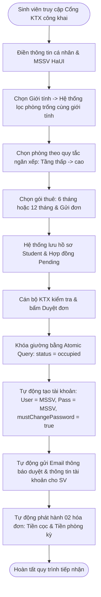
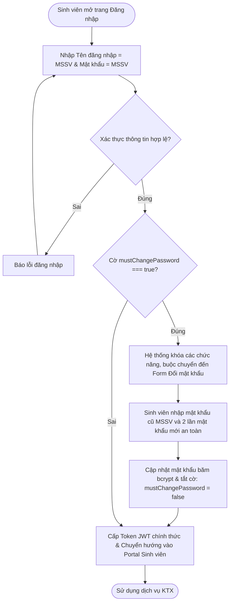
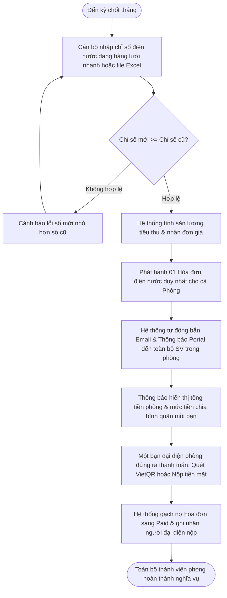
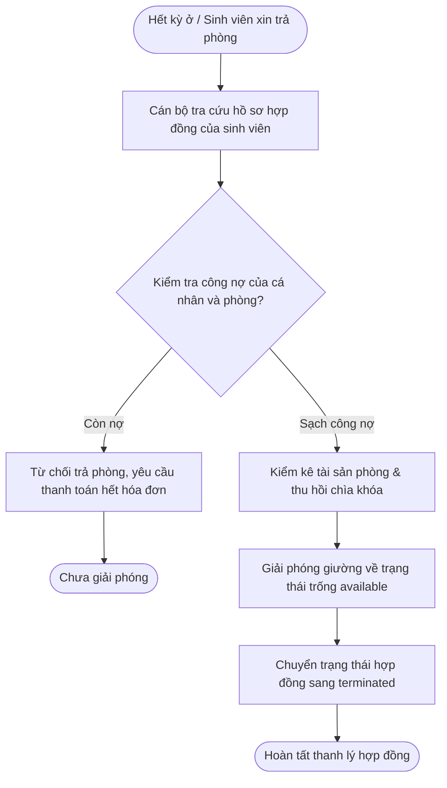
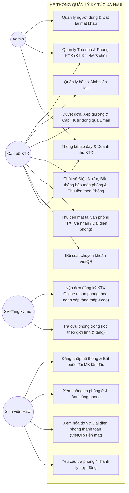
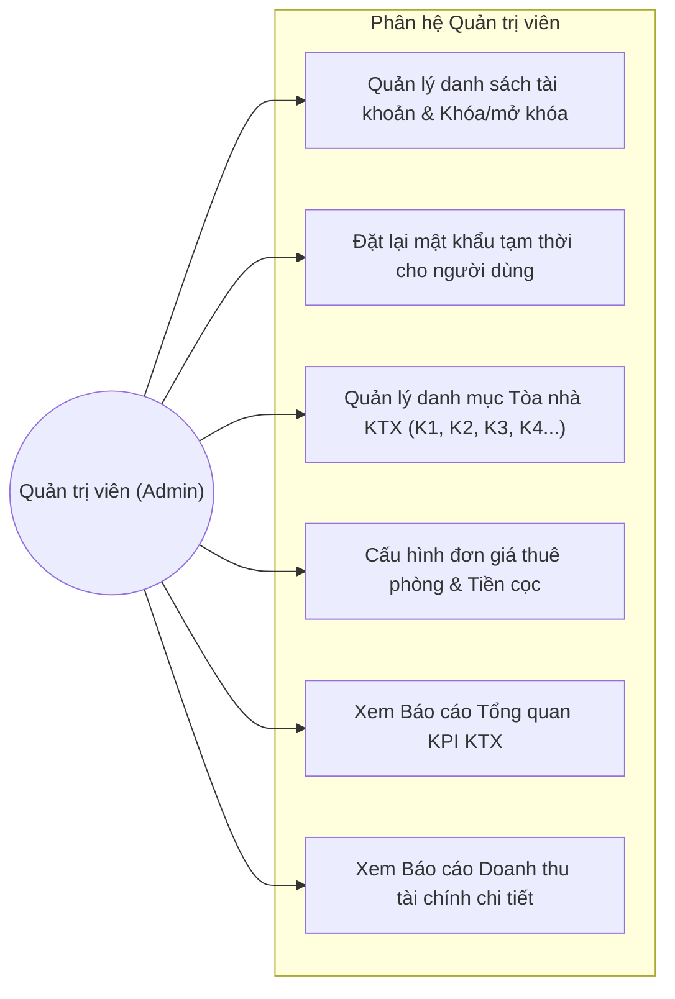
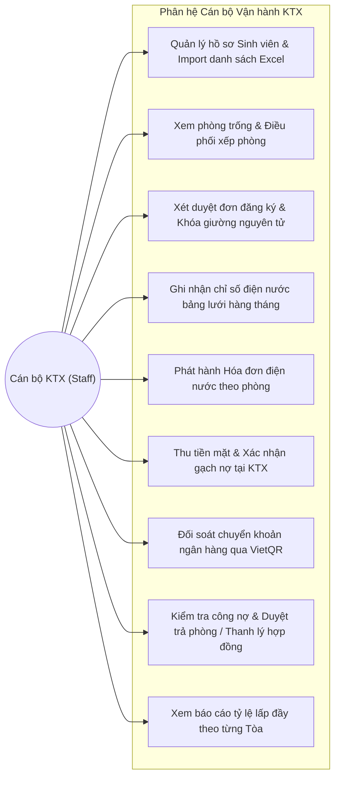
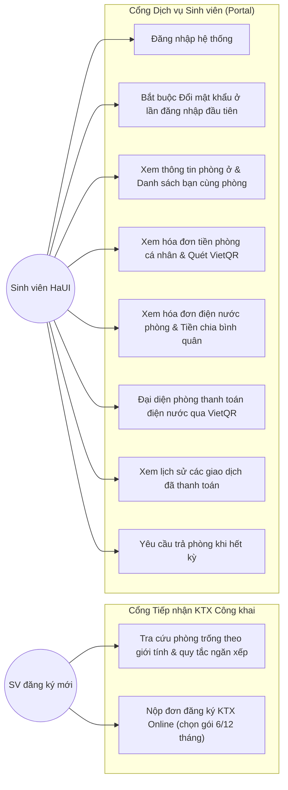

# CHƯƠNG 2: KHẢO SÁT HIỆN TRẠNG VÀ PHÂN TÍCH YÊU CẦU HỆ THỐNG (HaUI - DMS)

---

## 2.1. MÔ TẢ BÀI TOÁN

### 2.1.1. Hiện trạng quản lý tại Ký túc xá Đại học Công nghiệp Hà Nội (HaUI)
Trường Đại học Công nghiệp Hà Nội (HaUI) là cơ sở giáo dục đại học quy mô lớn với nhiều cơ sở đào tạo (Cơ sở 1 - Bắc Từ Liêm, Cơ sở 2 - Tây Tựu, Cơ sở 3 - Hà Nam). Hệ thống Ký túc xá của trường bao gồm các tòa nhà cao tầng hiện đại (như các tòa K1, K2, K3, K4...) đáp ứng nhu cầu nội trú cho hàng ngàn sinh viên mỗi năm học.

Tuy nhiên, trong quá trình vận hành thực tế, Ban Quản lý KTX đối mặt với nhiều bài toán nghiệp vụ phức tạp:
- **Áp lực đăng ký đầu năm học:** Vào đầu mỗi học kỳ, hàng ngàn sinh viên nộp đơn xin nội trú. Việc thu nhận hồ sơ qua giấy tờ hoặc các biểu mẫu trực tuyến tự do dễ gây rác dữ liệu, quá tải tiếp nhận và nguy cơ tài khoản ảo, mạo danh sinh viên.
- **Xung đột phân bổ phòng/giường:** Nếu xếp phòng thủ công hoặc kiểm tra rời rạc (đọc-rồi-ghi), nhiều cán bộ cùng thao tác sẽ dẫn đến tình trạng hai sinh viên cùng được xếp vào một chiếc giường (Overbooking) hoặc xếp nhầm giới tính nam/nữ giữa các phòng.
- **Chốt số điện nước và quản lý công nợ lắt nhắt:** Sinh viên ở ghép từ 4, 6 đến 8 bạn/phòng. Việc thu tiền điện nước chia nhỏ thành từng hóa đơn lẻ đến từng cá nhân dẫn đến tình trạng nợ đọng kéo dài, người nộp người không, cán bộ khó đối soát và dễ thất thoát tài chính.
- **Quy trình cấp tài khoản và bảo mật:** Việc cho phép sinh viên tự do tạo tài khoản trên web dễ dẫn đến mạo danh MSSV của người khác.

### 2.1.2. Mục tiêu xây dựng Hệ thống HaUI - DMS
Hệ thống **Web Quản lý Ký túc xá Đại học Công nghiệp Hà Nội (HaUI - DMS)** (Phiên bản tinh gọn v2.0-HaUI) được thiết kế và triển khai nhằm số hóa và giải quyết dứt điểm các bài toán trên:
1. **Nộp đơn KTX Online không cần tài khoản trước:** Sinh viên truy cập trực tiếp Cổng tiếp nhận công khai để nộp đơn, lọc phòng trống theo đúng giới tính và áp dụng quy tắc ngăn xếp (tầng thấp, số phòng nhỏ trước).
2. **Cấp tài khoản tự động & Bảo mật hai lớp:** Không cho phép tự do đăng ký tài khoản. Khi cán bộ duyệt đơn KTX thành công, hệ thống tự động sinh tài khoản User (Tên đăng nhập = MSSV, Mật khẩu khởi tạo = MSSV), kích hoạt cờ `mustChangePassword: true` và gửi thông tin về Email sinh viên, bắt buộc đổi mật khẩu ở lần đăng nhập đầu tiên.
3. **Chống tranh chấp giường bằng Atomic Query:** Sử dụng cơ chế khóa nguyên tử một bước (`findOneAndUpdate`) trực tiếp tại CSDL MongoDB, loại bỏ hoàn toàn nguy cơ trùng giường.
4. **Quản lý hóa đơn điện nước theo đơn vị Phòng:** Mỗi tháng chốt 01 hóa đơn điện nước duy nhất cho cả phòng, tự động bắn thông báo đồng loạt cho tất cả thành viên kèm gợi ý tiền chia bình quân. Một bạn bất kỳ trong phòng (trưởng phòng hoặc đại diện) đứng ra quét mã VietQR động thanh toán dứt điểm cho cả phòng.
5. **Điều kiện trả phòng nghiêm ngặt:** Chỉ duyệt trả phòng và giải phóng giường khi phòng sạch công nợ (không còn hóa đơn tiền phòng hay điện nước tồn đọng).

---

## 2.2. QUY TRÌNH NGHIỆP VỤ CỦA HỆ THỐNG

### 2.2.1. Quy trình 1: Nộp đơn KTX Online, Duyệt đơn & Cấp tài khoản qua Email


---

### 2.2.2. Quy trình 2: Đăng nhập & Bắt buộc Đổi mật khẩu lần đầu


---

### 2.2.3. Quy trình 3: Chốt số Điện Nước theo Phòng, Bắn thông báo & Thanh toán Đại diện


---

### 2.2.4. Quy trình 4: Trả phòng & Thanh lý Hợp đồng KTX


---

## 2.3. YÊU CẦU CHỨC NĂNG (FUNCTIONAL REQUIREMENTS — FR)

Hệ thống HaUI - DMS bao gồm 8 phân hệ chức năng (M1 - M8) bám sát tài liệu đặc tả:

| Mã FR | Tên chức năng | Mô tả chi tiết theo tài liệu đặc tả HaUI - DMS | Tác nhân |
|---|---|---|:---:|
| **M1: Xác thực & Quản lý Tài khoản** | | | |
| **FR-01** | Đăng nhập hệ thống | Đăng nhập bằng Email/MSSV và mật khẩu; cấp JWT (hạn 7 ngày). Nếu `mustChangePassword === true`, chặn các chức năng khác và điều hướng sang đổi mật khẩu. | All |
| **FR-02** | Cấp tài khoản tự động | Không mở đăng ký tự do. Tài khoản sinh viên được sinh tự động khi duyệt đơn KTX (User = MSSV, Pass = MSSV, cờ `mustChangePassword = true`). | System |
| **FR-03** | Đăng xuất | Hủy phiên làm việc người dùng trên hệ thống. | All |
| **FR-04** | Thông tin cá nhân | Lấy thông tin tài khoản hiện tại (`/auth/me`) kèm chi tiết hồ sơ sinh viên nếu là `student`. | All |
| **FR-05** | Đổi mật khẩu cá nhân | Bắt buộc thực hiện ở lần đăng nhập đầu tiên. Tự động tắt cờ `mustChangePassword` sau khi đổi thành công. | All |
| **FR-06** | Đặt lại mật khẩu tạm | Admin/Staff reset mật khẩu tạm cho người dùng, bật cờ `mustChangePassword`. Staff không được reset Admin. | Admin, Staff |
| **FR-07** | Quản lý danh sách tài khoản | Chỉ Admin: xem danh sách tài khoản, lọc theo vai trò, khóa/mở khóa tài khoản. | Admin |
| **M2: Quản lý Hồ sơ Sinh viên HaUI** | | | |
| **FR-10** | Danh sách sinh viên | Xem danh sách phân trang, tìm kiếm theo MSSV HaUI, họ tên, lọc theo khoa/viện (*CNTT, Cơ khí, Điện, Kinh tế...*), giới tính. | Admin, Staff |
| **FR-11** | Chi tiết sinh viên | Xem toàn bộ hồ sơ sinh viên, phòng ở hiện tại, lịch sử hợp đồng và công nợ hóa đơn. | Admin, Staff |
| **FR-12** | Thêm mới sinh viên | Thêm thủ công hồ sơ từng sinh viên, kiểm tra trùng lặp `studentCode` duy nhất. | Admin, Staff |
| **FR-12b**| Import Excel hàng loạt | Tải template Excel mẫu, upload danh sách hàng loạt sinh viên; hệ thống kiểm tra dữ liệu và lưu tự động. | Admin, Staff |
| **FR-13** | Cập nhật hồ sơ sinh viên | Chỉnh sửa thông tin nhân thân, số điện thoại, lớp học, khoa; chặn đổi sang MSSV đã có. | Admin, Staff |
| **FR-14** | Vô hiệu hóa sinh viên | Chặn xóa nếu sinh viên còn hợp đồng KTX đang hoạt động (`active`) hoặc còn nợ tiền. | Admin, Staff |
| **M3: Tòa nhà & Phòng KTX HaUI** | | | |
| **FR-20** | Danh sách Tòa KTX HaUI | Quản lý các tòa (K1, K2, K3, K4...); kèm thống kê số phòng, tổng chỗ, chỗ ở, chỗ trống. | Admin, Staff |
| **FR-21** | Thêm/Sửa Tòa nhà | Quản lý mã tòa, tên tòa, mô tả. Chặn tắt hoạt động tòa nếu còn sinh viên đang ở. | Admin, Staff |
| **FR-22** | Danh sách phòng KTX | Xem danh sách phòng theo tòa, tầng, giới tính (`male`/`female`), sức chứa (4/6/8 chỗ); hiển thị giường trống. | Admin, Staff |
| **FR-23** | Xem phòng trống & Quy tắc ngăn xếp | Lọc phòng theo giới tính. Sắp xếp ưu tiên theo ngăn xếp: **Tầng thấp nhất trước $\rightarrow$ Số phòng nhỏ nhất trước**. | All |
| **FR-24** | Tạo phòng mới | Chọn Tòa, Tầng, Số phòng, Giới tính, Sức chứa, Đơn giá/tháng, Tiền cọc; tự động sinh danh sách giường trống (`available`). | Admin, Staff |
| **FR-25** | Cập nhật phòng | Chỉnh sửa thông tin phòng. Chặn sửa giới tính/sức chứa nếu phòng đã có sinh viên đang ở. | Admin, Staff |
| **M4: Đăng ký & Hợp đồng KTX** | | | |
| **FR-30** | Đăng ký ở KTX Online công khai | Sinh viên chưa có tài khoản nộp đơn trực tiếp tại Portal công khai; chọn phòng theo ngăn xếp, chọn gói thuê (6 hoặc 12 tháng). | Guest |
| **FR-31** | Danh sách hợp đồng/đơn | Admin/Staff xem danh sách đơn, lọc theo trạng thái (`pending`, `active`, `expired`, `terminated`). | Admin, Staff |
| **FR-32** | Duyệt đơn & Khóa giường nguyên tử | Khóa giường bằng `findOneAndUpdate`, chuyển hợp đồng sang `active`, cấp tài khoản gửi qua email, sinh 02 hóa đơn (tiền cọc & tiền phòng kỳ). | Admin, Staff |
| **FR-33** | Từ chối / Hủy đơn đăng ký | Cán bộ từ chối đơn kèm lý do; gửi email thông báo từ chối cho sinh viên, không khóa giường. | Admin, Staff |
| **FR-34** | Trả phòng & Thanh lý hợp đồng | Kiểm tra sạch nợ hóa đơn; giải phóng giường về `available`; chuyển hợp đồng sang `terminated`. | Admin, Staff |
| **M5: Điện Nước & Hóa đơn theo Phòng** | | | |
| **FR-40** | Ghi chỉ số điện nước bảng lưới | Cán bộ nhập nhanh chỉ số trên lưới dòng (hoặc tải file Excel); tự động tính sản lượng và thành tiền. | Admin, Staff |
| **FR-41** | Chốt HĐ phòng & Bắn thông báo | Phát hành **01 hóa đơn điện nước duy nhất cho cả phòng**; bắn thông báo toàn phòng kèm mức chia bình quân; 1 bạn đại diện nộp tiền. | Admin, Staff |
| **FR-42** | Lịch sử điện nước phòng | Tra cứu lịch sử tiêu thụ điện nước theo từng tháng để phát hiện biến động bất thường. | Staff, Student |
| **M6: Hóa đơn & Thanh toán** | | | |
| **FR-50** | Quản lý danh sách hóa đơn | Quản lý phân tách: Hóa đơn cá nhân (tiền phòng kỳ, cọc) và Hóa đơn phòng (điện nước). | Admin, Staff |
| **FR-51** | Chi tiết hóa đơn | Xem chi tiết: sản lượng điện/nước, danh sách thành viên phòng, số tiền chia bình quân, người đã nộp. | All |
| **FR-52** | Thu tiền mặt tại KTX | Sinh viên cá nhân hoặc đại diện phòng nộp tiền mặt tại KTX; cán bộ xác nhận thu và gạch nợ `paid`. | Staff |
| **FR-53** | Thanh toán VietQR động | Sinh mã VietQR ngân hàng có sẵn số tiền và cú pháp chuẩn (`HAUI <Mã HĐ> <MSSV/Số phòng>`). | Student |
| **FR-54** | Xác nhận chuyển khoản | Cán bộ đối soát tài khoản ngân hàng và bấm xác nhận hoàn tất hóa đơn sang `paid`. | Staff |
| **M7: Cổng Dịch vụ Sinh viên (Portal)** | | | |
| **FR-60** | Hồ sơ & Phòng ở của tôi | Sinh viên xem tòa, số phòng, số giường, danh sách bạn cùng phòng (Họ tên, MSSV). | Student |
| **FR-61** | Hợp đồng của tôi | Xem hợp đồng đang hoạt động, gói thuê (6 hoặc 12 tháng), thời hạn bắt đầu/kết thúc. | Student |
| **FR-62** | Hóa đơn & Đại diện thanh toán | Xem hóa đơn tiền phòng cá nhân và hóa đơn điện nước phòng; quét mã VietQR đại diện nộp cho phòng. | Student |
| **FR-63** | Lịch sử thanh toán | Xem danh sách các biên lai/giao dịch đã thanh toán thành công. | Student |
| **M8: Dashboard & Báo cáo Thống kê** | | | |
| **FR-70** | Thống kê tổng quan KTX | Hiển thị KPI: Tổng số chỗ, số chỗ đang ở, số chỗ trống, tổng sinh viên nội trú, tổng nợ chưa thu. | Admin, Staff |
| **FR-71** | Báo cáo lấp đầy theo Tòa | Thống kê tỷ lệ phòng/giường trống chi tiết theo từng tòa K1, K2, K3, K4. | Admin, Staff |
| **FR-72** | Thống kê Doanh thu KTX | Thống kê số tiền thu theo tháng/kỳ, tách biệt Doanh thu tiền phòng trọn gói và Doanh thu điện nước. | Admin |

---

## 2.4. YÊU CẦU PHI CHỨC NĂNG (NON-FUNCTIONAL REQUIREMENTS — NFR)

### 2.4.1. Hiệu năng và Khả năng chịu tải (Performance)
- **NFR-PERF-01 (Thời gian phản hồi API):** 95% các yêu cầu tra cứu phòng trống và hóa đơn phản hồi trong thời gian dưới **1.0 giây**; các thao tác tổng hợp báo cáo dưới **3.0 giây**.
- **NFR-PERF-02 (Khả năng chịu tải cao điểm):** Hệ thống chịu tải tối thiểu **500 sinh viên nộp đơn đồng thời** trong ngày đầu mở cổng KTX mà không bị nghẽn giao dịch.
- **NFR-PERF-03 (Chống xung đột giường tuyệt đối):** Thực thi câu lệnh nguyên tử một bước (`findOneAndUpdate`) tại CSDL MongoDB, đảm bảo **Zero Overbooking** (tuyệt đối không bao giờ xếp 2 sinh viên vào cùng 1 giường).

### 2.4.2. An toàn và Bảo mật (Security)
- **NFR-SEC-01 (Kiểm soát cấp tài khoản):** Tuyệt đối không mở đăng ký tài khoản tự do trên web. Tài khoản chỉ được cấp tự động sau khi cán bộ duyệt đơn KTX.
- **NFR-SEC-02 (Chính sách mật khẩu):** Mật khẩu khởi tạo được mã hóa một chiều bằng `bcrypt` (salt rounds = 10). Bắt buộc đổi mật khẩu ở lần đăng nhập đầu tiên (`mustChangePassword: true`).
- **NFR-SEC-03 (Xác thực và Phân quyền):** Sử dụng JSON Web Token (JWT) có thời hạn 7 ngày, kiểm soát phân quyền chặt chẽ bằng Middleware RBAC 3 cấp (Admin, Staff, Student).
- **NFR-SEC-04 (Chống lỗ hổng IDOR):** Dữ liệu hóa đơn và phòng ở cá nhân luôn được ràng buộc trực tiếp theo `req.user.studentId` trích xuất từ chữ ký JWT, ngăn chặn sinh viên xem hoặc can thiệp dữ liệu của người khác.

### 2.4.3. Độ tin cậy và Tính toàn vẹn (Reliability)
- **NFR-REL-01 (Tính nhất quán dữ liệu):** Dữ liệu chỉ số điện nước mới phải luôn $\ge$ chỉ số cũ. Dữ liệu phòng ở tự động đồng bộ số giường trống thời gian thực.
- **NFR-REL-02 (Độ sẵn sàng):** Tỷ lệ hoạt động liên tục (Uptime) của hệ thống đạt tối thiểu **99.5%** trong suốt kỳ đăng ký và vận hành KTX.

### 2.4.4. Tính khả dụng và Trải nghiệm người dùng (Usability)
- **NFR-USE-01 (Giao diện thân thiện):** Giao diện phát triển bằng Ant Design, hiển thị tốt trên máy tính, máy tính bảng và điện thoại di động (Responsive Web).
- **NFR-USE-02 (Chuẩn hóa ngôn ngữ):** Toàn bộ giao diện, thông báo lỗi và email gửi sinh viên sử dụng tiếng Việt có dấu chuẩn mực, rõ ràng, dễ hiểu.

---

## 2.5. TÁC NHÂN HỆ THỐNG (ACTORS)

Hệ thống được thiết kế tinh gọn gồm **3 nhóm tác nhân người dùng chính và 1 nhóm người dùng vãng lai**:

| Mã tác nhân | Tên tác nhân | Quyền hạn và Trách nhiệm trong hệ thống | Phương thức cấp tài khoản |
|---|---|---|---|
| **AC-1** | **Admin (Quản trị viên)** | Toàn quyền cao nhất: quản lý tài khoản cán bộ và sinh viên, cấu hình danh mục tòa nhà (K1, K2...), giá phòng, xem toàn bộ báo cáo doanh thu tài chính. | Khởi tạo ban đầu qua script seed hệ thống. |
| **AC-2** | **Staff (Cán bộ KTX)** | Quản lý sinh viên, duyệt đơn đăng ký, xếp giường, chốt chỉ số điện nước hàng tháng, thu tiền mặt tại KTX, đối soát thanh toán chuyển khoản. | Do Quản trị viên (Admin) tạo tài khoản trực tiếp. |
| **AC-3** | **Student (Sinh viên HaUI)** | Xem thông tin phòng ở, danh sách bạn cùng phòng, nhận thông báo tiền điện nước, thanh toán hóa đơn cá nhân và đại diện thanh toán điện nước phòng qua mã VietQR hoặc nộp tiền mặt. | Hệ thống **tự động cấp tài khoản qua Email** (User = MSSV, Pass = MSSV) sau khi đơn đăng ký KTX (FR-30) được duyệt thành công (FR-32); bắt buộc đổi mật khẩu ở lần đăng nhập đầu tiên. |
| **Guest** | **Sinh viên đăng ký mới** | Sinh viên chưa có tài khoản KTX: truy cập Cổng tiếp nhận KTX công khai để tra cứu phòng trống và nộp đơn đăng ký trực tuyến. | Không cần tài khoản, nộp đơn trực tiếp bằng MSSV và thông tin cá nhân. |

---

## 2.6. BIỂU ĐỒ USE CASE (USE CASE DIAGRAMS)

### 2.6.1. Biểu đồ Use Case tổng quát (HaUI - DMS)
*(Biểu đồ chuẩn hóa theo tài liệu đặc tả HaUI DMS)*



---

### 2.6.2. Biểu đồ Use Case phân rã phía Quản trị viên (Admin)


---

### 2.6.3. Biểu đồ Use Case phân rã phía Cán bộ KTX (Staff)


---

### 2.6.4. Biểu đồ Use Case phân rã phía Sinh viên & Khách (Student & Guest)


---

## 2.7. MÔ TẢ CHI TIẾT 10 USE CASE CỐT LÕI

### 2.7.1. Use Case UC-01: Nộp đơn đăng ký KTX Online trực tiếp (FR-30)
- **Mã Use Case:** `UC-01`
- **Tên Use Case:** Nộp đơn đăng ký ở KTX Online công khai
- **Tác nhân chính:** Sinh viên đăng ký mới (Guest / Sinh viên HaUI)
- **Điều kiện tiên quyết:** Sinh viên truy cập vào Cổng thông tin KTX HaUI, chưa cần có tài khoản đăng nhập.
- **Điều kiện sau:** Hồ sơ sinh viên và đơn đăng ký được lưu tạm vào hệ thống ở trạng thái `pending`.

#### Luồng sự kiện chính (Main Flow):
1. Sinh viên nhấn vào nút **"Đăng ký ở KTX"** ngay tại màn hình đăng nhập công khai.
2. Hệ thống hiển thị Biểu mẫu đăng ký trực tuyến.
3. Sinh viên nhập thông tin cá nhân: Mã số sinh viên HaUI (MSSV), Họ và tên, Giới tính (`male`/`female`), Số điện thoại, Email cá nhân, Ngày sinh, Khoa/Viện, Lớp học, Thông tin liên hệ gia đình.
4. Sinh viên chọn Giới tính $\rightarrow$ Hệ thống tự động lọc danh sách phòng trống (`beds.status === 'available'`) theo đúng giới tính quy định của phòng (BR-01).
5. Hệ thống áp dụng **Quy tắc ngăn xếp (Stack Allocation - BR-07)**: hiển thị ưu tiên danh sách phòng từ tầng thấp nhất và số phòng nhỏ nhất trở lên (ví dụ: Tòa K1, Tầng 1: P101, P102...).
6. Sinh viên chọn phòng và vị trí giường mong muốn trong danh sách gợi ý.
7. Sinh viên chọn gói thời hạn thuê: **Gói 6 tháng** (1 học kỳ) hoặc **Gói 12 tháng** (cả năm học) (BR-02).
8. Sinh viên nhấn nút **"Gửi đơn đăng ký"** (`POST /contracts/register-online`).
9. Hệ thống kiểm tra tính hợp lệ dữ liệu, lưu hồ sơ sinh viên vào collection `students` và tạo hợp đồng ở trạng thái `pending`.
10. Hệ thống hiển thị thông báo gửi đơn thành công và hướng dẫn sinh viên kiểm tra email thường xuyên để nhận kết quả xét duyệt.

#### Luồng rẽ nhánh / Ngoại lệ:
- **3a. Trùng lặp MSSV:** Nếu sinh viên đã có đơn đang chờ duyệt hoặc đang có hợp đồng KTX còn hiệu lực, hệ thống báo lỗi: *"MSSV này đã có đơn đăng ký hoặc đang lưu trú tại KTX"*.
- **6a. Giường đã bị người khác chọn trước:** Nếu vị trí giường đã bị người khác đăng ký giữ chỗ trước, hệ thống cảnh báo và yêu cầu sinh viên chọn vị trí giường khác trong danh sách ngăn xếp.

---

### 2.7.2. Use Case UC-02: Duyệt đơn đăng ký, Khóa giường, Cấp tài khoản qua Email & Sinh hóa đơn (FR-32)
- **Mã Use Case:** `UC-02`
- **Tên Use Case:** Xét duyệt đơn KTX & Cấp tài khoản tự động
- **Tác nhân chính:** Cán bộ KTX (Staff)
- **Điều kiện tiên quyết:** Có đơn đăng ký của sinh viên ở trạng thái `pending`.
- **Điều kiện sau:** Giường được khóa sang `occupied`, hợp đồng chuyển sang `active`, tài khoản người dùng được sinh và gửi qua email cho sinh viên, 02 hóa đơn (tiền cọc và tiền phòng) được phát hành.

#### Luồng sự kiện chính (Main Flow):
1. Cán bộ KTX mở danh sách **"Đơn đăng ký chờ duyệt"** (`FR-31`).
2. Cán bộ xem xét chi tiết thông tin sinh viên, khoa/viện và vị trí phòng/giường đăng ký.
3. Cán bộ nhấn nút **"Phê duyệt"**.
4. Hệ thống thực thi chuỗi giao dịch nguyên tử:
   - **Khóa giường bằng Atomic Query (BR-05):**
     ```javascript
     const updatedRoom = await Room.findOneAndUpdate(
       { _id: roomId, "beds.bedNumber": bedNumber, "beds.status": "available" },
       { $set: { "beds.$.status": "occupied", "beds.$.studentId": studentId } },
       { new: true }
     );
     ```
   - Chuyển trạng thái hợp đồng KTX sang `active`.
   - **Tự động cấp tài khoản người dùng (BR-06):**
     - Tạo bản ghi trong `users` với: `username = studentCode`, `password = bcrypt(studentCode)`, `role = 'student'`, `mustChangePassword = true`.
     - Gắn liên kết `userId` vào hồ sơ `Student`.
   - **Tự động gửi Email thông báo trúng tuyển:** Gửi thư đến email cá nhân của sinh viên với nội dung chúc mừng, cung cấp Tên đăng nhập (= Mã SV), Mật khẩu khởi tạo (= Mã SV), thông tin phòng ở, và nhắc nhở bắt buộc đổi mật khẩu ở lần đăng nhập đầu tiên.
   - **Tự động phát hành 02 hóa đơn:**
     1. Hóa đơn tiền cọc phòng (`type: 'deposit'`).
     2. Hóa đơn tiền phòng trọn gói (`type: 'room_semester'`) tính theo gói 6 hoặc 12 tháng.
5. Hệ thống hiển thị thông báo duyệt đơn thành công.

#### Luồng rẽ nhánh:
- **4a. Giường vừa bị chiếm cùng lúc (Race Condition):** Nếu hàm `findOneAndUpdate` trả về `null` do người khác vừa duyệt vào giường đó trước một mili-giây, hệ thống rollback, báo lỗi `409 BED_ALREADY_OCCUPIED` và yêu cầu cán bộ chọn vị trí giường khác cho sinh viên.
- **3a. Từ chối đơn đăng ký (FR-33):** Cán bộ nhấn **"Từ chối"**, nhập lý do; hệ thống gửi email thông báo từ chối cho sinh viên, không khóa giường.

---

### 2.7.3. Use Case UC-03: Chốt số Điện Nước, Bắn thông báo toàn phòng & Thu tiền theo Phòng (FR-40, FR-41)
- **Mã Use Case:** `UC-03`
- **Tên Use Case:** Chốt chỉ số điện nước & Phát hành hóa đơn theo phòng
- **Tác nhân chính:** Cán bộ KTX (Staff)
- **Điều kiện tiên quyết:** Đến kỳ chốt điện nước định kỳ hàng tháng.
- **Điều kiện sau:** 01 hóa đơn điện nước duy nhất của phòng được tạo lập, toàn bộ thành viên trong phòng nhận được thông báo kèm mức tiền chia bình quân.

#### Luồng sự kiện chính (Main Flow):
1. Cán bộ chọn Tòa nhà (K1, K2...) và Tháng cần ghi chỉ số (ví dụ: `10/2026`).
2. Hệ thống hiển thị danh sách toàn bộ các phòng kèm chỉ số điện/nước cũ tháng trước đã điền sẵn dạng **Bảng lưới (Matrix Grid)**.
3. Cán bộ nhập các chỉ số điện mới và nước mới cho từng phòng (hỗ trợ phím Tab/Enter nhảy ô liên tục trên máy tính hoặc tablet).
4. Hệ thống kiểm tra: $\text{Chỉ số mới} \ge \text{Chỉ số cũ}$.
5. Cán bộ bấm **"Chốt & Phát hành hóa đơn Điện Nước"**.
6. Hệ thống thực hiện:
   - Tính sản lượng tiêu thụ: $\Delta E = E_{\text{mới}} - E_{\text{cũ}}$, $\Delta W = W_{\text{mới}} - W_{\text{cũ}}$.
   - Tính tổng tiền = $(\Delta E \times \text{Đơn giá điện}) + (\Delta W \times \text{Đơn giá nước})$.
   - **Phát hành 01 hóa đơn điện nước duy nhất cho cả phòng** (mã `INV-UTIL-...`, `type: 'utility'`, `status: 'unpaid'`).
   - **Bắn thông báo tức thời đến TẤT CẢ thành viên trong phòng (BR-03):** Gửi email và thông báo Portal đến toàn bộ sinh viên trong phòng, nêu rõ chỉ số, tổng tiền phòng và số tiền gợi ý chia bình quân:
     $$\text{Mỗi bạn} = \frac{\text{Tổng tiền điện nước phòng}}{\text{Số lượng SV đang cư trú thực tế}}$$
7. Hệ thống thông báo hoàn tất phát hành hóa đơn cả tòa.

#### Luồng rẽ nhánh:
- **4a. Chỉ số mới nhỏ hơn chỉ số cũ:** Hệ thống tô đỏ cảnh báo tại dòng nhập liệu: *"Chỉ số mới không được nhỏ hơn chỉ số cũ"*, khóa nút phát hành đối với phòng có số liệu sai.

---

### 2.7.4. Use Case UC-04: Đăng nhập & Bắt buộc Đổi mật khẩu lần đầu (FR-01, FR-05)
- **Mã Use Case:** `UC-04`
- **Tên Use Case:** Đăng nhập & Bắt buộc đổi mật khẩu khởi tạo
- **Tác nhân chính:** Sinh viên HaUI (Student)
- **Điều kiện tiên quyết:** Sinh viên đã nhận được email cấp tài khoản sau khi đơn KTX được duyệt.
- **Điều kiện sau:** Mật khẩu mới được cập nhật băm `bcrypt`, cờ `mustChangePassword` chuyển sang `false`, sinh viên truy cập đầy đủ các chức năng Portal.

#### Luồng sự kiện chính (Main Flow):
1. Sinh viên truy cập trang đăng nhập, điền `username` = Mã SV và `password` = Mã SV (thông tin nhận qua email).
2. Hệ thống xác thực danh tính, kiểm tra cờ `mustChangePassword === true`.
3. Hệ thống chặn quyền truy cập vào các menu khác và tự động điều hướng sinh viên sang màn hình **"Đổi mật khẩu lần đầu bắt buộc"**.
4. Sinh viên nhập mật khẩu hiện tại (Mã SV), nhập mật khẩu mới và xác nhận lại mật khẩu mới.
5. Sinh viên nhấn nút **"Xác nhận đổi mật khẩu"**.
6. Hệ thống kiểm tra: mật khẩu mới đáp ứng độ dài tối thiểu, hai lần nhập khớp nhau và khác mật khẩu mặc định.
7. Hệ thống băm mật khẩu mới bằng `bcrypt`, lưu vào CSDL và cập nhật `mustChangePassword: false`.
8. Hệ thống cấp Token JWT chính thức và chuyển hướng sinh viên vào trang chủ Portal.

---

### 2.7.5. Use Case UC-05: Thanh toán Hóa đơn qua Mã VietQR động (FR-53, FR-62)
- **Mã Use Case:** `UC-05`
- **Tên Use Case:** Thanh toán hóa đơn bằng VietQR
- **Tác nhân:** Sinh viên HaUI (Cá nhân đóng tiền phòng hoặc Đại diện phòng đóng tiền điện nước)
- **Điều kiện tiên quyết:** Có hóa đơn ở trạng thái `unpaid`.
- **Điều kiện sau:** Hóa đơn chuyển trạng thái sang `paid`, công nợ được gạch dứt điểm.

#### Luồng sự kiện chính (Main Flow):
1. Sinh viên vào mục **"Hóa đơn của tôi"** trên Portal.
2. Sinh viên chọn hóa đơn cần đóng (Hóa đơn tiền phòng cá nhân hoặc Hóa đơn điện nước chung của phòng).
3. Sinh viên bấm nút **"Thanh toán qua VietQR"**.
4. Hệ thống sinh mã VietQR chuẩn ngân hàng hiển thị ngay trên màn hình:
   - Số tiền: Khóa cứng đúng bằng số tiền hóa đơn (`amount`).
   - Cú pháp chuyển khoản chuẩn:
     - Hóa đơn cá nhân: `HAUI <Mã hóa đơn> <MSSV>`.
     - Hóa đơn điện nước phòng: `HAUI <Mã hóa đơn phòng> <Số phòng>`.
5. Sinh viên mở ứng dụng Mobile Banking của bất kỳ ngân hàng nào, thực hiện quét mã QR (toàn bộ số tiền, tài khoản thụ hưởng của KTX và cú pháp được điền tự động chính xác 100%).
6. Sinh viên xác nhận chuyển tiền trên App ngân hàng.
7. Cán bộ KTX đối soát tài khoản và bấm **"Xác nhận thanh toán"** (hoặc Webhook tự động gạch nợ - FR-54b).
8. Hệ thống chuyển trạng thái hóa đơn sang `paid`, ghi nhận người đại diện nộp tiền, toàn bộ sinh viên trong phòng đều được ghi nhận hoàn thành nghĩa vụ.

---

### 2.7.6. Use Case UC-06: Thu tiền mặt tại văn phòng KTX & Xác nhận gạch nợ (FR-52)
- **Mã Use Case:** `UC-06`
- **Tên Use Case:** Thu tiền mặt tại KTX & Xác nhận thanh toán
- **Tác nhân chính:** Cán bộ KTX (Staff), Sinh viên HaUI (Student)
- **Điều kiện tiên quyết:** Sinh viên trực tiếp đến văn phòng KTX nộp tiền cho hóa đơn cá nhân hoặc đại diện phòng nộp tiền điện nước.
- **Điều kiện sau:** Hóa đơn chuyển sang trạng thái `paid`, biên lai thu tiền mặt được lưu lại.

#### Luồng sự kiện chính (Main Flow):
1. Sinh viên cung cấp Mã sinh viên hoặc Số phòng cho cán bộ KTX tại văn phòng.
2. Cán bộ KTX tra cứu danh sách hóa đơn chưa thanh toán (`GET /invoices?status=unpaid`).
3. Cán bộ chọn đúng hóa đơn sinh viên yêu cầu nộp (tiền phòng kỳ, tiền cọc hoặc tiền điện nước tháng của phòng).
4. Cán bộ nhận đủ số tiền mặt tương ứng từ sinh viên và nhấn nút **"Xác nhận thu tiền mặt"** (`POST /payments/cash`).
5. Hệ thống cập nhật:
   - Tạo bản ghi trong collection `payments`: `method = 'cash'`, `amount = invoice.amount`, `cashCollectedBy = staffId`, `paidAt = now()`.
   - Cập nhật trạng thái hóa đơn trong `invoices` sang `paid`.
   - Nếu là hóa đơn điện nước phòng: ghi nhận MSSV của bạn đại diện nộp tiền (`payerStudentId`), gạch nợ cho toàn bộ thành viên trong phòng.
6. Hệ thống in/xuất biên lai thu tiền điện tử và thông báo giao dịch thành công.

---

### 2.7.7. Use Case UC-07: Trả phòng & Thanh lý Hợp đồng KTX (FR-34)
- **Mã Use Case:** `UC-07`
- **Tên Use Case:** Thanh lý hợp đồng KTX & Trả phòng
- **Tác nhân:** Cán bộ KTX (Staff), Sinh viên HaUI (Student)
- **Điều kiện tiên quyết:** Sinh viên hết hạn thời gian thuê (6 hoặc 12 tháng) hoặc có nguyện vọng chấm dứt hợp đồng sớm.
- **Điều kiện sau:** Giường chuyển về `available`, hợp đồng chuyển sang `terminated`.

#### Luồng sự kiện chính (Main Flow):
1. Sinh viên đến văn phòng KTX xin làm thủ tục trả phòng.
2. Cán bộ KTX mở hồ sơ hợp đồng của sinh viên trên hệ thống.
3. Hệ thống kiểm tra điều kiện ràng buộc công nợ (**BR-04**):
   - Sinh viên không còn bất kỳ hóa đơn tiền phòng cá nhân nào chưa thanh toán.
   - Phòng của sinh viên không còn nợ hóa đơn điện nước tồn đọng.
4. Cán bộ cùng sinh viên kiểm kê hiện trạng tài sản phòng, thu hồi chìa khóa.
5. Cán bộ bấm nút **"Xác nhận Trả phòng & Thanh lý hợp đồng"**.
6. Hệ thống thực hiện:
   - Giải phóng vị trí giường của sinh viên về trạng thái trống (`beds.status = 'available'`, xóa `studentId`).
   - Chuyển trạng thái hợp đồng sang `terminated`.
7. Hệ thống hiển thị thông báo hoàn tất thủ tục trả phòng.

#### Luồng rẽ nhánh:
- **3a. Còn nợ hóa đơn:** Nếu phát hiện sinh viên hoặc phòng còn hóa đơn ở trạng thái `unpaid`, hệ thống chặn thao tác và cảnh báo: *"Sinh viên hoặc phòng còn hóa đơn chưa thanh toán, không thể thanh lý hợp đồng"*. Cán bộ yêu cầu sinh viên hoàn tất nghĩa vụ tài chính trước khi tiếp tục.

---

### 2.7.8. Use Case UC-08: Quản lý Tòa nhà & Khởi tạo phòng tự động sinh giường (FR-20, FR-21, FR-24)
- **Mã Use Case:** `UC-08`
- **Tên Use Case:** Quản lý Tòa nhà & Tạo phòng KTX
- **Tác nhân chính:** Quản trị viên (Admin), Cán bộ KTX (Staff)
- **Điều kiện tiên quyết:** Cán bộ/Admin đã đăng nhập tài khoản có thẩm quyền quản lý cơ sở vật chất.
- **Điều kiện sau:** Phòng KTX mới được tạo lập trong CSDL, mảng giường (`beds`) được khởi tạo tự động ở trạng thái `available`.

#### Luồng sự kiện chính (Main Flow):
1. Người dùng truy cập phân hệ **"Quản lý Phòng KTX"** (`FR-22`), chọn Tòa nhà (ví dụ: Tòa K1, K2...).
2. Người dùng nhấn nút **"Thêm phòng mới"** (`FR-24`).
3. Hệ thống hiển thị Form tạo phòng với các trường thông tin:
   - Tòa nhà (`buildingId`).
   - Số phòng (ví dụ: `P101`, `P202`).
   - Giới tính phòng (`gender`: `male` hoặc `female`) (BR-01).
   - Sức chứa phòng (`capacity`: chọn 4, 6 hoặc 8 người).
   - Đơn giá thuê tháng (`pricePerMonth`) và Tiền cọc (`depositAmount`).
4. Người dùng nhấn **"Lưu thông tin"** (`POST /rooms`).
5. Hệ thống kiểm tra tính duy nhất của số phòng trong tòa (`buildingId + roomNumber`).
6. Hệ thống **tự động sinh danh sách giường nhúng** tương ứng với sức chứa:
   - Nếu `capacity = 4`: Sinh mảng 4 giường: `[{ bedNumber: 1, status: 'available' }, ..., { bedNumber: 4, status: 'available' }]`.
   - Lưu phòng mới vào collection `rooms` với trạng thái `active`.
7. Hệ thống thông báo tạo phòng thành công và hiển thị phòng mới trên sơ đồ trực quan.

#### Luồng rẽ nhánh:
- **5a. Trùng số phòng:** Nếu số phòng đã tồn tại trong tòa, hệ thống báo lỗi: *"Số phòng này đã tồn tại trong tòa nhà đã chọn"*.

---

### 2.7.9. Use Case UC-09: Quản lý hồ sơ Sinh viên & Import danh sách từ file Excel (FR-10, FR-12b)
- **Mã Use Case:** `UC-09`
- **Tên Use Case:** Quản lý hồ sơ Sinh viên & Nhập liệu Excel hàng loạt
- **Tác nhân chính:** Cán bộ KTX (Staff), Quản trị viên (Admin)
- **Điều kiện tiên quyết:** Người dùng có quyền quản trị hồ sơ sinh viên.
- **Điều kiện sau:** Danh sách hàng trăm sinh viên mới được lưu vào hệ thống nhanh chóng và chính xác.

#### Luồng sự kiện chính (Main Flow):
1. Cán bộ KTX vào mục **"Quản lý Sinh viên"** (`FR-10`).
2. Cán bộ nhấn nút **"Tải file mẫu Excel"** (`.xlsx`) được thiết kế chuẩn cấu trúc: MSSV, Họ và tên, Giới tính, Ngày sinh, Số điện thoại, Email, Khoa/Viện, Lớp học.
3. Cán bộ điền danh sách sinh viên vào file Excel và nhấn nút **"Import Excel"** (`FR-12b`).
4. Cán bộ chọn file từ máy tính và tải lên hệ thống (`POST /students/import-excel`).
5. Hệ thống tự động phân tích file Excel (Parse Data) và thực thi kiểm tra tính hợp lệ:
   - Kiểm tra định dạng số điện thoại, email.
   - Kiểm tra trùng lặp MSSV nội bộ trong file Excel và trùng với MSSV đã có trong CSDL MongoDB.
6. Hệ thống thực hiện lưu hàng loạt vào collection `students` bằng lệnh `bulkWrite` hoặc `insertMany`.
7. Hệ thống trả về báo cáo kết quả chi tiết:
   - Tổng số bản ghi xử lý.
   - Số sinh viên thêm mới thành công.
   - Danh sách các dòng bị lỗi (nếu có) kèm nguyên nhân cụ thể để cán bộ chỉnh sửa.

---

### 2.7.10. Use Case UC-10: Thống kê KPI, Tỷ lệ lấp đầy & Báo cáo doanh thu KTX (FR-70, FR-71, FR-72)
- **Mã Use Case:** `UC-10`
- **Tên Use Case:** Thống kê Quản trị & Báo cáo Tài chính KTX
- **Tác nhân chính:** Quản trị viên (Admin), Cán bộ KTX (Staff - xem lấp đầy)
- **Điều kiện tiên quyết:** Đăng nhập tài khoản Admin hoặc Staff.
- **Điều kiện sau:** Dashboard số liệu và biểu đồ trực quan thời gian thực được hiển thị, hỗ trợ xuất file báo cáo.

#### Luồng sự kiện chính (Main Flow):
1. Người dùng truy cập phân hệ **"Dashboard & Báo cáo Thống kê"** (`/dashboard`).
2. Hệ thống tải dữ liệu tổng hợp thời gian thực và hiển thị các thẻ KPI tổng quan (`FR-70`):
   - Tổng số chỗ trong KTX, số chỗ đang ở (`occupied`), số chỗ còn trống (`available`), tỷ lệ lấp đầy toàn trường (%).
   - Tổng số sinh viên HaUI đang cư trú thực tế.
   - Số đơn đăng ký mới đang chờ duyệt (`pending`).
   - Tổng số tiền công nợ chưa thu (gồm tiền phòng kỳ và tiền điện nước các phòng chưa đóng).
3. Người dùng chọn xem **Báo cáo lấp đầy theo Tòa nhà** (`FR-71`): Biểu đồ cột hiển thị tỷ lệ lấp đầy chi tiết của từng tòa K1, K2, K3, K4 giúp cán bộ điều phối phòng ở.
4. Người dùng (Admin) chọn xem **Báo cáo Doanh thu KTX** (`FR-72`):
   - Biểu đồ doanh thu theo từng tháng/kỳ.
   - Bảng phân tách chi tiết: *Doanh thu tiền phòng trọn gói* và *Doanh thu tiền điện nước*.
5. Người dùng nhấn nút **"Xuất báo cáo Excel"** để lưu trữ hoặc trình Ban Giám hiệu nhà trường.

---

## 2.8. MA TRẬN PHÂN QUYỀN VAI TRÒ (RBAC MATRIX)

Ma trận phân quyền tinh gọn theo đúng tài liệu đặc tả HaUI DMS:

| Nhóm chức năng nghiệp vụ | Admin (Quản trị viên) | Staff (Cán bộ KTX) | Student (Sinh viên HaUI) | Guest (SV đăng ký mới) |
|---|:---:|:---:|:---:|:---:|
| **Quản lý tài khoản cán bộ** | Toàn quyền (✅) | Không có quyền (❌) | Không có quyền (❌) | Không có quyền (❌) |
| **Đặt lại mật khẩu tạm thời** | Toàn quyền (cho mọi người) | Có quyền (cho SV, không reset Admin) | Không có quyền (❌) | Không có quyền (❌) |
| **Quản lý Tòa nhà & Phòng KTX** | Toàn quyền (✅) | Toàn quyền (✅) | Chỉ xem phòng trống (👁️) | Chỉ xem phòng trống (👁️) |
| **Nộp đơn đăng ký KTX Online** | Không có quyền (❌) | Không có quyền (❌) | Không có quyền (❌) | Toàn quyền (✅) |
| **Duyệt đơn KTX & Cấp TK qua Email** | Toàn quyền (✅) | Toàn quyền (✅) | Không có quyền (❌) | Không có quyền (❌) |
| **Thêm / Sửa hồ sơ Sinh viên HaUI** | Toàn quyền (✅) | Toàn quyền (✅) | Không có quyền (❌) | Không có quyền (❌) |
| **Ghi chỉ số Điện Nước & Chốt HĐ phòng**| Toàn quyền (✅) | Toàn quyền (✅) | Nhận thông báo & Xem HĐ phòng (👁️)| Không có quyền (❌) |
| **Thu tiền mặt tại văn phòng KTX** | Toàn quyền (✅) | Toàn quyền (✅) | Không có quyền (❌) | Không có quyền (❌) |
| **Quét mã VietQR thanh toán (Phòng/Điện nước)**| Không có quyền (❌) | Không có quyền (❌) | Toàn quyền (Cá nhân / Đại diện phòng) (✅)| Không có quyền (❌) |
| **Xem Dashboard Doanh thu & Lấp đầy**| Toàn quyền (✅) | Xem tỷ lệ lấp đầy (✅) | Không có quyền (❌) | Không có quyền (❌) |

---

## 2.9. CÁC QUY TẮC NGHIỆP VỤ CỐT LÕI (BUSINESS RULES — BR)

Tài liệu đặc tả HaUI DMS thiết lập **7 quy tắc nghiệp vụ bất biến**:

1. **BR-01 (Phòng chia theo giới tính tuyệt đối):** Phòng KTX gắn cờ `male` chỉ nhận sinh viên nam, phòng `female` chỉ nhận sinh viên nữ. Hệ thống tự động lọc và chặn khi sinh viên đăng ký online hoặc cán bộ xếp phòng nếu lệch giới tính.
2. **BR-02 (Chu kỳ thu tiền phòng trọn gói):** Tiền phòng thu trọn gói 1 lần khi duyệt hợp đồng:
   - Thuê 6 tháng: Đóng cả 6 tháng.
   - Thuê 12 tháng: Đóng cả 12 tháng.
3. **BR-03 (Thu tiền điện nước theo Đơn vị Phòng & Bắn thông báo toàn phòng):**
   - Hóa đơn tiền điện nước phát hành theo đơn vị Phòng (01 hóa đơn duy nhất/phòng/tháng), không chia nhỏ hóa đơn lẻ cho từng cá nhân để tránh nợ đọng lắt nhắt và khó quản lý.
   - Khi chốt chỉ số, hệ thống tự động bắn thông báo đồng loạt cho toàn bộ thành viên trong phòng biết tổng tiền và số tiền chia bình quân:
     $$\text{Tiền bình quân mỗi SV} = \frac{(\text{Số điện tiêu thụ} \times \text{Đơn giá điện}) + (\text{Số nước tiêu thụ} \times \text{Đơn giá nước})}{\text{Số lượng SV đang cư trú thực tế trong phòng}}$$
   - Một người trong phòng (trưởng phòng hoặc đại diện) đứng ra thanh toán toàn bộ hóa đơn cho phòng (Online qua VietQR hoặc Offline tiền mặt tại KTX).
4. **BR-04 (Điều kiện trả phòng / thanh lý hợp đồng):** Sinh viên chỉ được duyệt trả phòng và giải phóng giường khi không còn bất kỳ hóa đơn nào ở trạng thái `unpaid` (bao gồm hóa đơn cá nhân và hóa đơn điện nước của phòng).
5. **BR-05 (Chống tranh chấp giường bằng Atomic Query — Race Condition Prevention):**
   - Tuyệt đối không sử dụng luồng "Đọc kiểm tra (`find`) $\rightarrow$ Sửa (`save`)".
   - Bắt buộc dùng câu lệnh nguyên tử một bước (`findOneAndUpdate`) với điều kiện tiên quyết là giường phải đang ở trạng thái `available`:
     ```javascript
     const updatedRoom = await Room.findOneAndUpdate(
       { _id: roomId, "beds.bedNumber": bedNumber, "beds.status": "available" },
       { $set: { "beds.$.status": "occupied", "beds.$.studentId": studentId } },
       { new: true }
     );
     if (!updatedRoom) {
       throw new ApiError(409, 'BED_ALREADY_OCCUPIED', 'Giường này vừa được người khác đăng ký hoặc không còn trống!');
     }
     ```
   - Đảm bảo tính nhất quán dữ liệu ở cấp CSDL, loại bỏ hoàn toàn khả năng 2 sinh viên được xếp vào cùng một chiếc giường.
6. **BR-06 (Cấp tài khoản tự động & Bắt buộc đổi mật khẩu lần đầu):**
   - Không cho phép sinh viên tự do tạo tài khoản trên hệ thống để tránh tài khoản rác và mạo danh.
   - Tài khoản sinh viên được tạo tự động khi đơn đăng ký KTX online được duyệt: Tên đăng nhập = MSSV, Mật khẩu khởi tạo = MSSV (băm `bcrypt`), kích hoạt cờ `mustChangePassword: true`.
   - Hệ thống tự động gửi thông tin tài khoản qua email sinh viên.
   - Sinh viên bắt buộc phải đổi mật khẩu mới trong lần đầu tiên đăng nhập trước khi sử dụng các chức năng Portal.
7. **BR-07 (Quy tắc xếp phòng ngăn xếp — Stack Allocation Rule):**
   - Danh sách phòng KTX trống được quản lý và sắp xếp theo ngăn xếp ưu tiên tăng dần: **Tầng thấp nhất trước $\rightarrow$ Số phòng nhỏ nhất trước**.
   - Sinh viên nộp đơn đăng ký trước sẽ được hệ thống gợi ý và xếp vào các phòng tầng thấp và số phòng nhỏ trước (ví dụ: Tầng 1: P101 -> P102... rồi mới đến Tầng 2: P201 -> P202...).

---

## 2.10. KẾT LUẬN CHƯƠNG 2

Chương 2 đã khảo sát và phân tích toàn diện **Hệ thống Quản lý Ký túc xá Đại học Công nghiệp Hà Nội (HaUI - DMS)** dựa trên tài liệu đặc tả chuẩn xác:
- Mô tả chi tiết bài toán quản lý thực tế tại các tòa ký túc xá HaUI (K1 - K4) và các mục tiêu tin học hóa cụ thể.
- Xây dựng 4 quy trình nghiệp vụ then chốt với lưu đồ trực quan (Nộp đơn online & cấp tài khoản qua email, Đổi mật khẩu lần đầu, Chốt điện nước theo phòng, Trả phòng).
- Đặc tả chi tiết 30 yêu cầu chức năng (thuộc 8 phân hệ M1 - M8) và 10 yêu cầu phi chức năng chuẩn mực.
- Thiết lập hệ thống biểu đồ Use Case tổng quát và biểu đồ phân rã chi tiết cho từng tác nhân (Admin, Staff, Student, Guest).
- Đặc tả chi tiết 10 ca sử dụng trọng tâm và cốt lõi, đi kèm Ma trận phân quyền RBAC và 7 quy tắc nghiệp vụ bất biến (BR-01 đến BR-07).

Nội dung khảo sát và phân tích yêu cầu này là căn cứ vững chắc để bước sang **Chương 3: THIẾT KẾ HỆ THỐNG VÀ CƠ SỞ DỮ LIỆU**.
