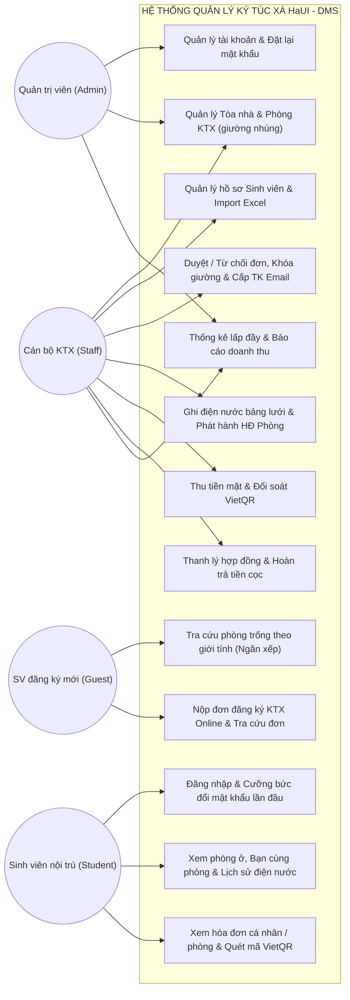

# Đặc Tả Yêu Cầu Phần Mềm (SRS) — HaUI - DMS

- **Tên đề tài:** Xây dựng hệ thống web Quản lý Ký túc xá Đại học Công nghiệp Hà Nội (`HaUI - DMS`)
- **Phiên bản:** v2.7 (Đồng bộ 100% giữa Codebase Backend, Hợp đồng API v2.7 và Báo cáo Đồ án)

---

## 1. Sơ Đồ Use Case Tổng Quát

---

## 2. Danh Mục Yêu Cầu Chức Năng (Functional Requirements)

### 2.1. Phân hệ Xác thực & Quản lý Tài khoản (`M1`)
- **FR-01 (Đăng nhập):** Xác thực bằng `Email` hoặc `MSSV` kèm mật khẩu; cấp JWT hạn 7 ngày; kiểm tra khóa tài khoản (`403 ACCOUNT_LOCKED`) sau khi đối chiếu mật khẩu để không lộ sự tồn tại của tài khoản.
- **FR-02 (Cấp tài khoản tự động qua duyệt đơn):** Không mở đăng ký tài khoản tự do. Khi duyệt đơn KTX của sinh viên chưa có tài khoản, hệ thống tự khởi tạo `User` (`role = 'student'`, tên đăng nhập = mật khẩu khởi tạo = `MSSV`, `mustChangePassword = true`) và gửi thông báo qua email.
- **FR-03 (Đăng xuất & Thông tin phiên):** Hỗ trợ hủy phiên (`POST /api/auth/logout`) và lấy thông tin người dùng hiện tại kèm hồ sơ sinh viên (`GET /api/auth/me`).
- **FR-04 (Cưỡng bức đổi mật khẩu lần đầu):** Chặn mọi thao tác khác khi `mustChangePassword === true`. Mật khẩu mới phải `>= 8` ký tự, bao gồm cả chữ và số, và không được trùng lại `MSSV`.
- **FR-05 (Quản lý tài khoản & Đặt lại mật khẩu tạm):** `admin` xem/lọc danh sách, tạo tài khoản `admin`/`staff`, sửa thông tin, khóa/mở khóa (chặn tự khóa chính mình hoặc khóa `admin` hoạt động cuối cùng). `admin` và `staff` đặt lại mật khẩu tạm 10 ký tự (`staff` chỉ được phép thao tác trên tài khoản `student`).

### 2.2. Phân hệ Quản lý Hồ sơ Sinh viên (`M2`)
- **FR-10 (Tra cứu & Chi tiết sinh viên):** Phân trang, tìm kiếm theo MSSV/họ tên/SĐT, lọc theo giới tính, khoa/viện, trạng thái tài khoản; xem chỗ ở hiện tại, lịch sử hợp đồng và hóa đơn nợ cá nhân.
- **FR-11 (Thêm, Sửa & Kiểm tra chuẩn dữ liệu):** Áp dụng bộ quy tắc thống nhất (`student.rules.js`): MSSV 10 chữ số duy nhất, CCCD 12 chữ số, SĐT 10 số bắt đầu bằng `0`, ngày sinh hợp lệ, địa chỉ thường trú, khoa/viện, lớp và liên hệ người thân khẩn cấp. Khi đổi MSSV/họ tên, tự động đồng bộ sang tài khoản `User`; chặn đổi giới tính khi đang có đơn chờ hoặc hợp đồng hiệu lực.
- **FR-12 (Nhập hàng loạt từ Excel):** Nhận danh sách tối đa 1.000 dòng/lần, lưu các dòng hợp lệ và trả báo cáo lỗi chi tiết theo đúng số thứ tự dòng Excel.
- **FR-13 (Vô hiệu hóa sinh viên):** Chỉ cho phép chuyển `inactive` khi sinh viên không còn đơn chờ, không còn hợp đồng đang giữ giường và sạch công nợ cá nhân.

### 2.3. Phân hệ Quản lý Tòa nhà & Phòng KTX (`M3`)
- **FR-20 (Quản lý Tòa nhà):** Xem danh sách tòa nhà kèm thống kê tổng phòng, tổng giường, giường đang ở, giường trống, giường bảo trì; thêm/cập nhật tòa; chặn ngừng hoạt động tòa nhà khi còn sinh viên đang lưu trú.
- **FR-21 (Quản lý Phòng & Giường nhúng):** Thiết lập phòng với sức chứa cố định `4 | 6 | 8` chỗ, giới tính `male | female`, đơn giá thuê/tháng và tiền đặt cọc; tự động sinh mảng giường nhúng `1..capacity`. Chặn đổi giới tính hoặc sức chứa khi phòng đang có người ở hoặc vướng đơn chờ duyệt.

### 2.4. Phân hệ Tiếp nhận Đăng ký & Hợp đồng (`M4`)
- **FR-30 (Tra cứu phòng trống & Nộp đơn công khai):** Sinh viên mới lọc phòng còn chỗ theo giới tính, hiển thị theo **quy tắc ngăn xếp** (ưu tiên tầng thấp nhất → số phòng nhỏ nhất trước), chọn phòng/giường và kỳ hạn (`6_months` hoặc `12_months`). Chặn nộp trùng nếu MSSV đang có đơn `pending` hoặc hợp đồng `active`, hoặc vị trí giường vừa có đơn khác giữ chỗ (`BED_ALREADY_REQUESTED`).
- **FR-31 (Tra cứu tiến độ đơn công khai):** Kiểm tra trạng thái đơn bằng cặp `studentCode + email`.
- **FR-32 (Phê duyệt đơn nguyên tử):** Cho phép giữ nguyên giường sinh viên chọn hoặc điều phối sang phòng/giường trống khác cùng giới tính; khóa giường nguyên tử một bước bằng `$elemMatch`; kích hoạt hợp đồng (`active`), cấp/tái sử dụng tài khoản `User`, phát hành 02 hóa đơn cá nhân (`deposit`, `room_semester`) hạn 7 ngày và gửi email thông báo.
- **FR-33 (Từ chối đơn):** Bắt buộc nhập lý do từ chối, chuyển trạng thái sang `rejected` (không khóa giường) và gửi email thông báo cho sinh viên.
- **FR-34 (Thanh lý hợp đồng & Trả phòng):** Kiểm tra điều kiện sạch nợ 100% (cả hóa đơn cá nhân lẫn hóa đơn điện nước của phòng đang ở); chuyển hợp đồng sang `terminated` và giải phóng đúng vị trí giường về `available`.
- **FR-35 (Hoàn trả tiền cọc):** Sau khi thanh lý hợp đồng, cán bộ xác nhận hoàn trả đủ tiền cọc tại văn phòng một lần duy nhất (`isDepositRefunded = true`).

### 2.5. Phân hệ Điện nước, Hóa đơn & Thanh toán (`M5`, `M6`)
- **FR-40 (Bảng lưới chỉ số điện nước):** Hiển thị toàn bộ phòng đang hoạt động (hoặc bảo trì nhưng còn người ở) của một tòa trong tháng kèm chỉ số cuối kỳ trước; lưu nháp hàng loạt, kiểm tra `newIndex >= oldIndex`, chặn sửa các phòng đã chốt.
- **FR-41 (Chốt & Phát hành hóa đơn điện nước theo Phòng):** Mỗi phòng có người ở sinh đúng **01 hóa đơn `scope: 'room'`** hạn 7 ngày, ghi nhận số người cư trú và mức tiền bình quân tham khảo, khóa bản ghi `isBilled = true`.
- **FR-50 (Thu tiền mặt & Đối soát VietQR):** Thu đủ 1 lần cho mỗi hóa đơn (`unpaid` → `paid`) bằng câu lệnh có điều kiện chống thu đúp; với hóa đơn phòng bắt buộc chọn người nộp là sinh viên đang ở phòng đó; với VietQR chặn trùng mã giao dịch ngân hàng (`transactionCode`).

### 2.6. Phân hệ Cổng Sinh viên & Báo cáo Thống kê (`M7`, `M8`)
- **FR-60 (Student Portal):** Xem hồ sơ cá nhân, thông tin phòng ở & bạn cùng phòng (chỉ hiển thị họ tên và MSSV để bảo vệ quyền riêng tư), danh sách hóa đơn cá nhân/phòng, tạo thông tin quét mã VietQR động chuẩn NAPAS, xem lịch sử phiếu thu và lịch sử điện nước đã chốt của phòng.
- **FR-70 (Dashboard & Báo cáo):** `admin` và `staff` xem KPI tổng quan và tỷ lệ lấp đầy theo tòa nhà; riêng `admin` xem báo cáo doanh thu thực thu theo tháng/năm (tách tiền phòng và tiền điện nước, không cộng tiền đặt cọc vào doanh thu).

---

## 3. Tám Quy Tắc Nghiệp Vụ Cốt Lõi (Business Rules)

| Mã | Tên quy tắc | Nội dung ràng buộc trong hệ thống |
|---|---|---|
| **BR-01** | Phân tách giới tính tuyệt đối | Sinh viên chỉ được đăng ký và xếp vào phòng có `room.gender === student.gender`. Không cho đổi giới tính phòng/sinh viên khi đang có đơn chờ hoặc hợp đồng hiệu lực. |
| **BR-02** | Thu tiền phòng trọn gói theo kỳ | Tiền phòng thu 1 lần cho trọn kỳ hợp đồng (`6_months` hoặc `12_months`) kèm 01 hóa đơn tiền cọc riêng biệt khi duyệt đơn. |
| **BR-03** | Hóa đơn điện nước gộp theo Phòng | Mỗi phòng có sinh viên ở chỉ phát hành **01 hóa đơn điện nước/tháng** (`scope: 'room'`). Hệ thống tính sẵn mức chia bình quân tham khảo; 01 sinh viên đại diện phòng đứng ra thanh toán dứt điểm cho cả phòng. |
| **BR-04** | Điều kiện sạch nợ khi trả phòng | Hợp đồng quá hạn (`expired`) vẫn giữ khóa giường. Chỉ được thanh lý trả phòng (`terminate`) khi sinh viên không còn hóa đơn cá nhân `unpaid` và phòng không còn hóa đơn điện nước `unpaid`. |
| **BR-05** | Khóa giường nguyên tử chống trùng | Giường chỉ khóa lúc cán bộ phê duyệt bằng `Room.findOneAndUpdate` với `$elemMatch: { bedNumber, status: 'available' }`, triệt tiêu 100% lỗi xếp trùng giường (*Zero Overbooking*). |
| **BR-06** | Cấp tài khoản tự động & Đổi MK lần đầu | Tài khoản sinh viên chỉ sinh khi duyệt đơn (`TK = MK = MSSV`, `mustChangePassword = true`). Chưa đổi mật khẩu thì bị chặn toàn bộ API nghiệp vụ. |
| **BR-07** | Quy tắc xếp phòng ngăn xếp (*Stack Rule*) | Danh sách phòng trống luôn sắp xếp tăng dần theo **Tầng thấp trước → Số phòng nhỏ trước** (`floor ASC, roomNumber numeric ASC`). |
| **BR-08** | Hoàn cọc tách biệt khỏi doanh thu | Tiền đặt cọc là khoản thu giữ hộ bảo đảm tài sản: không tính vào công nợ doanh thu hay biểu đồ doanh thu Dashboard; khi hoàn cọc chỉ đánh dấu trên `Contract` (`isDepositRefunded`), không sinh bản ghi âm trong `payments`. |

---

## 4. Ma Trận Phân Quyền RBAC

| Nhóm chức năng | Guest | `student` | `staff` | `admin` |
|---|:---:|:---:|:---:|:---:|
| Tra cứu phòng trống công khai, Nộp đơn & Tra cứu trạng thái đơn | ✅ | ✅ | ✅ | ✅ |
| Đăng nhập, Đăng xuất, Đổi mật khẩu cá nhân | — | ✅ | ✅ | ✅ |
| Xem Portal cá nhân (Phòng ở, Bạn cùng phòng, Hóa đơn, Sinh mã VietQR) | — | ✅ | ❌ | ❌ |
| Quản lý Hồ sơ Sinh viên & Import danh sách Excel | ❌ | ❌ | ✅ | ✅ |
| Quản lý Tòa nhà & Phòng KTX | ❌ | ❌ | ✅ | ✅ |
| Xét duyệt / Từ chối đơn, Thanh lý hợp đồng & Xác nhận hoàn cọc | ❌ | ❌ | ✅ | ✅ |
| Nhập chỉ số Điện Nước bảng lưới & Phát hành hóa đơn Phòng | ❌ | ❌ | ✅ | ✅ |
| Thu tiền mặt tại quầy & Đối soát chuyển khoản VietQR | ❌ | ❌ | ✅ | ✅ |
| Đặt lại mật khẩu tạm cho tài khoản Sinh viên | ❌ | ❌ | ✅ | ✅ |
| Quản lý tài khoản Cán bộ / Quản trị viên (`CRUD`, Khóa/Mở khóa) | ❌ | ❌ | ❌ | ✅ |
| Xem Dashboard KPI & Tỷ lệ lấp đầy theo tòa nhà | ❌ | ❌ | ✅ | ✅ |
| Xem Báo cáo Doanh thu tài chính theo tháng/năm (`/dashboard/revenue`) | ❌ | ❌ | ❌ | ✅ |

---

## 5. Yêu Cầu Phi Chức Năng (Non-Functional Requirements)

1. **Hiệu năng (Performance):** Phản hồi tra cứu thông thường `< 1.0s`, tổng hợp thống kê `< 3.0s`; truy vấn danh sách dùng `.lean()` kết hợp gom bảng tham chiếu `loadCtx()` không gây nghẽn *N+1 queries*.
2. **Bảo mật (Security):** Mật khẩu băm `bcrypt` (10 rounds), ẩn trường `passwordHash` ở cấp Schema (`select: false` + `toJSON`); xác thực JWT 7 ngày; chống truy cập chéo hồ sơ/hóa đơn sinh viên khác (Anti-IDOR); tự động ẩn dữ liệu nhạy cảm trong log hệ thống.
3. **Toàn vẹn dữ liệu (Data Integrity):** Khóa nguyên tử chống Race Condition trên cả 3 thao tác nhạy cảm: duyệt khóa giường (`Room`), phát hành hóa đơn điện nước (`UtilityReading`), và gạch nợ thu tiền (`Invoice`).
4. **Độ tin cậy (Reliability):** Bắt lỗi tập trung toàn cục (`error-handler.js`), chuẩn hóa mọi ngoại lệ Mongoose/JWT/JSON về đúng một định dạng envelope duy nhất; hoàn tác bù trừ tự động nếu phát sinh lỗi giữa chừng.
