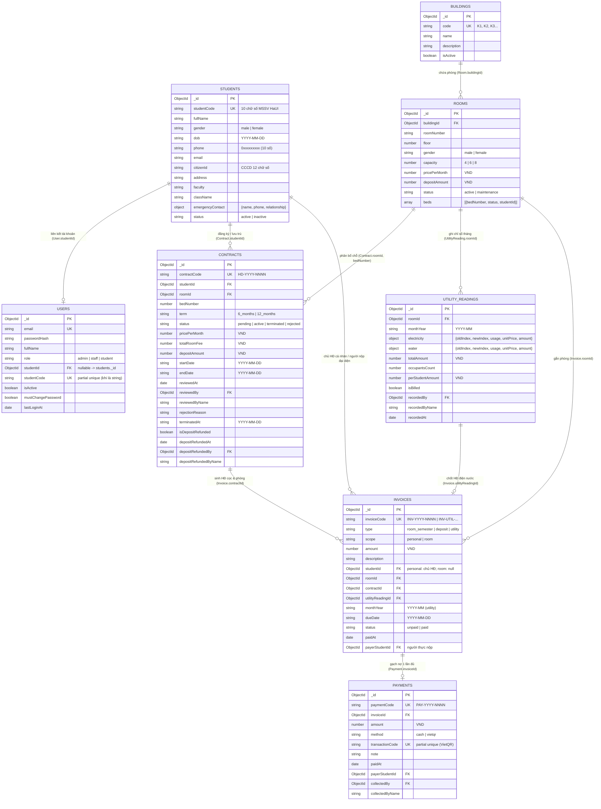

# Data Schema — HaUI - DMS (8 Core Collections)

- **Hệ quản trị CSDL:** MongoDB + Mongoose ODM
- **Số lượng Collection:** **8 Collections cốt lõi** (`users`, `students`, `buildings`, `rooms`, `contracts`, `utility_readings`, `invoices`, `payments`)
- **Quy ước chung:**
  - Khóa chính `_id` (`ObjectId`) được chuyển thành `id` (`String`) khi trả JSON qua `src/shared/to-json.js` và `src/shared/views.js`.
  - Mọi collection đều bật `{ timestamps: true }` tự động quản lý `createdAt` (`Date`) và `updatedAt` (`Date`).
  - Toàn bộ giá trị `enum` viết **chữ thường** (`src/shared/constants/enums.js`).
  - Tiền tệ lưu **số nguyên VND** (`Number`, `min: 0`). Ngày nghiệp vụ lưu chuỗi `'YYYY-MM-DD'`, tháng lưu `'YYYY-MM'` theo múi giờ Việt Nam (`UTC+7`).

---

## 1. Sơ Đồ Thực Thể – Mối Quan Hệ (ERD)

---

## 2. Đặc Tả Chi Tiết 8 Bảng Dữ Liệu (Collections)

### 2.1. Collection `users` — Tài khoản Đăng nhập & Phân quyền
- **Model file:** [user.model.js](file:///d:/CodeNhonLam/clone/BE_QLKTX/src/modules/auth/user.model.js)
- **Mục đích:** Quản lý thông tin xác thực của Quản trị viên, Cán bộ KTX và Sinh viên nội trú.

| Tên trường | Kiểu dữ liệu | Bắt buộc | Mặc định | Ràng buộc & Diễn giải |
|---|---|:---:|---|---|
| `_id` | `ObjectId` | Tự động | Tự sinh | Khóa chính |
| `email` | `String` | Có | — | `unique`, `lowercase`, `trim` — Email đăng nhập |
| `passwordHash` | `String` | Có | — | `select: false` — Mật khẩu băm `bcrypt` (10 salt rounds) |
| `fullName` | `String` | Có | — | `trim`, tối đa 150 ký tự |
| `role` | `String` | Có | — | Enum: `'admin' \| 'staff' \| 'student'` |
| `studentId` | `ObjectId` | Không | `null` | `ref: 'Student'` — Liên kết hồ sơ sinh viên (khi `role = 'student'`) |
| `studentCode` | `String` | Không | `null` | MSSV dùng để đăng nhập trực tiếp (đồng bộ khi cập nhật hồ sơ SV) |
| `isActive` | `Boolean` | Không | `true` | `false` khi tài khoản bị vô hiệu hóa |
| `mustChangePassword` | `Boolean` | Không | `false` | `true` khi mới cấp tự động hoặc vừa đặt lại mật khẩu tạm |
| `lastLoginAt` | `Date` | Không | `null` | Thời điểm đăng nhập thành công gần nhất |
| `createdAt`, `updatedAt` | `Date` | Tự động | Tự sinh | Dấu thời gian tạo & cập nhật |

- **Indexes:**
  - `{ email: 1 }` (`unique: true`)
  - `{ studentCode: 1 }` (`unique: true`, `partialFilterExpression: { studentCode: { $type: 'string' } }` — cho phép nhiều tài khoản cán bộ cùng để `studentCode: null`).

---

### 2.2. Collection `students` — Hồ sơ Sinh viên HaUI
- **Model file:** [student.model.js](file:///d:/CodeNhonLam/clone/BE_QLKTX/src/modules/students/student.model.js) · **Luật kiểm tra:** [student.rules.js](file:///d:/CodeNhonLam/clone/BE_QLKTX/src/modules/students/student.rules.js)
- **Mục đích:** Lưu trữ lý lịch sinh viên (có thể tạo từ Cổng đăng ký online, thêm thủ công hoặc import Excel trước khi có tài khoản `User`).

| Tên trường | Kiểu dữ liệu | Bắt buộc | Mặc định | Ràng buộc & Diễn giải |
|---|---|:---:|---|---|
| `_id` | `ObjectId` | Tự động | Tự sinh | Khóa chính |
| `studentCode` | `String` | Có | — | `unique`, khớp `/^\d{10}$/` — Mã sinh viên HaUI 10 chữ số |
| `fullName` | `String` | Có | — | `trim`, tối đa 150 ký tự |
| `gender` | `String` | Có | — | Enum: `'male' \| 'female'` (quyết định phân phòng theo `BR-01`) |
| `dob` | `String` | Có (luật) | `null` | Định dạng `'YYYY-MM-DD'`, nhỏ hơn ngày hiện tại |
| `phone` | `String` | Có | — | Khớp `/^0\d{9}$/` (10 chữ số, bắt đầu bằng `0`) |
| `email` | `String` | Có (luật) | `null` | `lowercase`, `trim` — Nhận thông báo duyệt đơn & cấp tài khoản |
| `citizenId` | `String` | Có (luật) | `null` | Khớp `/^\d{12}$/` — Số CCCD gắn chip 12 chữ số |
| `address` | `String` | Có (luật) | `null` | Địa chỉ thường trú |
| `faculty` | `String` | Có (luật) | `''` | Khoa / Viện đào tạo |
| `className` | `String` | Có (luật) | `''` | Lớp sinh hoạt (VD: `KTPM01-K18`) |
| `emergencyContact` | `Subdocument` | Có (luật) | `null` | `{ name: String, phone: String, relationship: String }` (`_id: false`) |
| `status` | `String` | Không | `'active'` | Enum: `'active' \| 'inactive'` |
| `createdAt`, `updatedAt` | `Date` | Tự động | Tự sinh | Dấu thời gian |

- **Indexes:** `{ studentCode: 1 }` (`unique: true`).

---

### 2.3. Collection `buildings` — Danh mục Tòa nhà KTX
- **Model file:** [building.model.js](file:///d:/CodeNhonLam/clone/BE_QLKTX/src/modules/rooms/building.model.js)

| Tên trường | Kiểu dữ liệu | Bắt buộc | Mặc định | Ràng buộc & Diễn giải |
|---|---|:---:|---|---|
| `_id` | `ObjectId` | Tự động | Tự sinh | Khóa chính |
| `code` | `String` | Có | — | `unique`, `uppercase`, khớp `/^[A-Z0-9-]{1,10}$/` (VD: `K1`, `K2`, `K3`) |
| `name` | `String` | Có | — | `trim`, tối đa 100 ký tự (VD: `Tòa K1`) |
| `description` | `String` | Không | `''` | Mô tả vị trí, đặc điểm tòa nhà |
| `isActive` | `Boolean` | Không | `true` | Chặn chuyển `false` nếu còn giường `occupied` trong tòa |
| `createdAt`, `updatedAt` | `Date` | Tự động | Tự sinh | Dấu thời gian |

- **Indexes:** `{ code: 1 }` (`unique: true`).

---

### 2.4. Collection `rooms` — Phòng KTX & Mảng Giường Nhúng
- **Model file:** [room.model.js](file:///d:/CodeNhonLam/clone/BE_QLKTX/src/modules/rooms/room.model.js)
- **Đặc điểm thiết kế:** Nhúng trực tiếp danh sách giường `beds[]` vào từng phòng (loại bỏ 2 bảng rời `RoomType` và `Bed`), giúp tra cứu nhanh và khóa giường nguyên tử trong 1 câu lệnh duy nhất.

| Tên trường | Kiểu dữ liệu | Bắt buộc | Mặc định | Ràng buộc & Diễn giải |
|---|---|:---:|---|---|
| `_id` | `ObjectId` | Tự động | Tự sinh | Khóa chính |
| `buildingId` | `ObjectId` | Có | — | `ref: 'Building'` — Tòa nhà trực thuộc |
| `roomNumber` | `String` | Có | — | Số phòng (VD: `'101'`, `'205'`), tối đa 20 ký tự |
| `floor` | `Number` | Có | `1` | Tầng (`>= 1`) — phục vụ sắp xếp ngăn xếp `BR-07` |
| `gender` | `String` | Có | — | Enum: `'male' \| 'female'` (chặn đổi khi đang có người ở hoặc đơn chờ) |
| `capacity` | `Number` | Có | — | Enum: `4 \| 6 \| 8` chỗ |
| `pricePerMonth` | `Number` | Có | `500000` | Đơn giá thuê 1 tháng / 1 sinh viên (VND, số nguyên `>= 0`) |
| `depositAmount` | `Number` | Có | `500000` | Mức tiền đặt cọc tài sản của 1 sinh viên (VND, số nguyên `>= 0`) |
| `status` | `String` | Không | `'active'` | Enum: `'active' \| 'maintenance'` |
| `beds` | `Subdocument[]` | Không | `[]` | Mảng giường nhúng từ `1..capacity` (`_id: false`): `{ bedNumber: Number, status: 'available' \| 'occupied' \| 'maintenance', studentId: ObjectId \| null }` |
| `createdAt`, `updatedAt` | `Date` | Tự động | Tự sinh | Dấu thời gian |

- **Indexes:**
  - `{ buildingId: 1, roomNumber: 1 }` (`unique: true`)
  - `{ gender: 1, 'beds.status': 1 }` (lọc phòng còn chỗ theo giới tính)
  - `{ floor: 1, roomNumber: 1 }` (sắp xếp ngăn xếp tầng thấp → phòng nhỏ)

---

### 2.5. Collection `contracts` — Đơn Đăng Ký & Hợp Đồng Lưu Trú
- **Model file:** [contract.model.js](file:///d:/CodeNhonLam/clone/BE_QLKTX/src/modules/contracts/contract.model.js)
- **Đặc điểm thiết kế:** Hợp nhất cả Đơn đăng ký (`pending` / `rejected`) và Hợp đồng chính thức (`active` / `terminated`) vào cùng một vòng đời. Trạng thái `expired` được tính tự động lúc đọc (`active` và `endDate < today()`).

| Tên trường | Kiểu dữ liệu | Bắt buộc | Mặc định | Ràng buộc & Diễn giải |
|---|---|:---:|---|---|
| `_id` | `ObjectId` | Tự động | Tự sinh | Khóa chính |
| `contractCode` | `String` | Có | — | `unique` — Mã đơn / hợp đồng `HD-YYYY-NNNN` |
| `studentId` | `ObjectId` | Có | — | `ref: 'Student'` |
| `roomId` | `ObjectId` | Có | — | `ref: 'Room'` |
| `bedNumber` | `Number` | Có | — | Số thứ tự giường trong phòng (`>= 1`) |
| `term` | `String` | Có | — | Enum: `'6_months' \| '12_months'` |
| `status` | `String` | Không | `'pending'` | Enum lưu DB: `'pending' \| 'active' \| 'terminated' \| 'rejected'` (khi trả API có thêm `'expired'`) |
| `pricePerMonth` | `Number` | Có | — | Đơn giá tháng chốt theo phòng (VND) |
| `totalRoomFee` | `Number` | Có | — | Tổng tiền phòng cả kỳ: `pricePerMonth * (6 hoặc 12)` (VND) |
| `depositAmount` | `Number` | Có | — | Tiền cọc chốt theo phòng (VND) |
| `startDate` | `String` | Không | `null` | `'YYYY-MM-DD'` — Gán ngày duyệt đơn |
| `endDate` | `String` | Không | `null` | `'YYYY-MM-DD'` — `startDate + 6/12 tháng` |
| `reviewedAt` | `Date` | Không | `null` | Thời điểm cán bộ duyệt hoặc từ chối |
| `reviewedBy` | `ObjectId` | Không | `null` | `ref: 'User'` — Cán bộ xử lý đơn |
| `reviewedByName` | `String` | Không | `null` | Họ tên cán bộ xử lý (đóng băng hiển thị lịch sử) |
| `rejectionReason` | `String` | Không | `null` | Lý do từ chối đơn (khi `status = 'rejected'`) |
| `terminatedAt` | `String` | Không | `null` | `'YYYY-MM-DD'` — Ngày thanh lý trả phòng |
| `isDepositRefunded` | `Boolean` | Không | `false` | Đã hoàn trả đủ tiền cọc tại văn phòng sau thanh lý (`BR-08`) |
| `depositRefundedAt` | `Date` | Không | `null` | Thời điểm xác nhận hoàn cọc |
| `depositRefundedBy` | `ObjectId` | Không | `null` | `ref: 'User'` — Cán bộ hoàn cọc |
| `depositRefundedByName` | `String` | Không | `null` | Họ tên cán bộ hoàn cọc |
| `createdAt`, `updatedAt` | `Date` | Tự động | Tự sinh | Dấu thời gian |

- **Indexes:**
  - `{ contractCode: 1 }` (`unique: true`)
  - `{ studentId: 1, status: 1 }`
  - `{ roomId: 1, bedNumber: 1, status: 1 }`

---

### 2.6. Collection `utility_readings` — Chỉ Số Điện Nước Hàng Tháng
- **Model file:** [utility-reading.model.js](file:///d:/CodeNhonLam/clone/BE_QLKTX/src/modules/fees/utility-reading.model.js)

| Tên trường | Kiểu dữ liệu | Bắt buộc | Mặc định | Ràng buộc & Diễn giải |
|---|---|:---:|---|---|
| `_id` | `ObjectId` | Tự động | Tự sinh | Khóa chính |
| `roomId` | `ObjectId` | Có | — | `ref: 'Room'` |
| `monthYear` | `String` | Có | — | Định dạng `'YYYY-MM'` (không vượt quá tháng hiện tại) |
| `electricity` | `Subdocument` | Có | — | `{ oldIndex, newIndex, usage, unitPrice, amount }` (`_id: false`, `newIndex >= oldIndex`) |
| `water` | `Subdocument` | Có | — | `{ oldIndex, newIndex, usage, unitPrice, amount }` (`_id: false`, `newIndex >= oldIndex`) |
| `totalAmount` | `Number` | Có | — | `electricity.amount + water.amount` (VND) |
| `occupantsCount` | `Number` | Không | `null` | Số SV đang ở phòng tại thời điểm bấm chốt (`publish`) |
| `perStudentAmount` | `Number` | Không | `null` | Mức chia bình quân tham khảo: `Math.round(totalAmount / occupantsCount)` |
| `isBilled` | `Boolean` | Không | `false` | `true` sau khi phát hành hóa đơn phòng (khóa không cho sửa chỉ số) |
| `recordedBy` | `ObjectId` | Không | `null` | `ref: 'User'` — Cán bộ lưu chỉ số |
| `recordedByName` | `String` | Không | `null` | Họ tên cán bộ lưu chỉ số |
| `recordedAt` | `Date` | Không | `null` | Thời điểm lưu chỉ số |
| `createdAt`, `updatedAt` | `Date` | Tự động | Tự sinh | Dấu thời gian |

- **Indexes:** `{ roomId: 1, monthYear: 1 }` (`unique: true`).

---

### 2.7. Collection `invoices` — Hóa Đơn Thu Phí
- **Model file:** [invoice.model.js](file:///d:/CodeNhonLam/clone/BE_QLKTX/src/modules/fees/invoice.model.js)
- **Đặc điểm thiết kế:** Phân định rõ 2 phạm vi (`scope`): `'personal'` (tiền cọc & tiền phòng cả kỳ của 1 SV) và `'room'` (01 hóa đơn điện nước duy nhất cho cả phòng mỗi tháng — `BR-03`). Thu đủ 1 lần duy nhất (`unpaid` → `paid`).

| Tên trường | Kiểu dữ liệu | Bắt buộc | Mặc định | Ràng buộc & Diễn giải |
|---|---|:---:|---|---|
| `_id` | `ObjectId` | Tự động | Tự sinh | Khóa chính |
| `invoiceCode` | `String` | Có | — | `unique` — `INV-YYYY-NNNN` (cá nhân) hoặc `INV-UTIL-<TÒA>-<PHÒNG>-<YYYYMM>` (điện nước) |
| `type` | `String` | Có | — | Enum: `'room_semester' \| 'deposit' \| 'utility'` |
| `scope` | `String` | Có | — | Enum: `'personal' \| 'room'` |
| `amount` | `Number` | Có | — | Số tiền thanh toán (VND, `>= 0`) |
| `description` | `String` | Không | `''` | Diễn giải chi tiết khoản thu |
| `studentId` | `ObjectId` | Không | `null` | `ref: 'Student'` — Chủ hóa đơn (`personal`); để `null` với hóa đơn `room` |
| `roomId` | `ObjectId` | Có | — | `ref: 'Room'` — Luôn gắn với phòng của hợp đồng hoặc phòng chốt điện nước |
| `contractId` | `ObjectId` | Không | `null` | `ref: 'Contract'` (với `deposit` và `room_semester`) |
| `utilityReadingId` | `ObjectId` | Không | `null` | `ref: 'UtilityReading'` (với `utility`) |
| `monthYear` | `String` | Không | `null` | `'YYYY-MM'` (với `utility`) |
| `dueDate` | `String` | Có | — | `'YYYY-MM-DD'` — Hạn thanh toán (mặc định +7 ngày từ lúc phát hành) |
| `status` | `String` | Không | `'unpaid'` | Enum: `'unpaid' \| 'paid'` |
| `paidAt` | `Date` | Không | `null` | Thời điểm xác nhận thanh toán |
| `payerStudentId` | `ObjectId` | Không | `null` | `ref: 'Student'` — Người nộp (chủ HĐ cá nhân hoặc SV đại diện phòng) |
| `createdAt`, `updatedAt` | `Date` | Tự động | Tự sinh | Dấu thời gian |

- **Indexes:**
  - `{ invoiceCode: 1 }` (`unique: true`)
  - `{ studentId: 1, status: 1 }`
  - `{ roomId: 1, type: 1, status: 1 }`
  - `{ contractId: 1 }`

---

### 2.8. Collection `payments` — Biên Lai Phiếu Thu
- **Model file:** [payment.model.js](file:///d:/CodeNhonLam/clone/BE_QLKTX/src/modules/payments/payment.model.js)
- **Đặc điểm thiết kế:** Bất biến (không sửa, không xóa). Chỉ ghi nhận giao dịch **thu tiền hóa đơn**; nghiệp vụ hoàn cọc không tạo phiếu thu để không làm sai lệch báo cáo doanh thu (`BR-08`).

| Tên trường | Kiểu dữ liệu | Bắt buộc | Mặc định | Ràng buộc & Diễn giải |
|---|---|:---:|---|---|
| `_id` | `ObjectId` | Tự động | Tự sinh | Khóa chính |
| `paymentCode` | `String` | Có | — | `unique` — Mã phiếu thu `PAY-YYYY-NNNN` |
| `invoiceId` | `ObjectId` | Có | — | `ref: 'Invoice'` |
| `amount` | `Number` | Có | — | Số tiền thu bằng đúng `Invoice.amount` (VND) |
| `method` | `String` | Có | — | Enum: `'cash' \| 'vietqr'` |
| `transactionCode` | `String` | Không | `null` | Mã giao dịch ngân hàng đối soát VietQR (`uppercase`, không trùng lặp) |
| `note` | `String` | Không | `''` | Ghi chú thu tiền |
| `paidAt` | `Date` | Không | `Date.now` | Thời điểm thu tiền |
| `payerStudentId` | `ObjectId` | Không | `null` | `ref: 'Student'` — Sinh viên nộp tiền |
| `collectedBy` | `ObjectId` | Không | `null` | `ref: 'User'` — Cán bộ xác nhận thu tiền |
| `collectedByName` | `String` | Không | `null` | Họ tên cán bộ xác nhận |
| `createdAt`, `updatedAt` | `Date` | Tự động | Tự sinh | Dấu thời gian |

- **Indexes:**
  - `{ paymentCode: 1 }` (`unique: true`)
  - `{ invoiceId: 1 }`
  - `{ paidAt: -1 }`
  - `{ transactionCode: 1 }` (`unique: true`, `partialFilterExpression: { transactionCode: { $type: 'string' } }` — chặn gạch nợ trùng 1 mã giao dịch ngân hàng nhưng cho phép nhiều phiếu tiền mặt có `transactionCode: null`).
