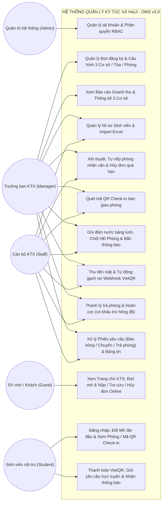

# ĐẶC TẢ YÊU CẦU PHẦN MỀM (SRS) — CHUẨN NGHIỆP VỤ HaUI 2026 (v3.0)
### HỆ THỐNG QUẢN LÝ KÝ TÚC XÁ ĐẠI HỌC CÔNG NGHIỆP HÀ NỘI (HaUI - DMS)

- **Đơn vị áp dụng:** Trung tâm Hỗ trợ sinh viên / Trung tâm Ký túc xá Trường Đại học Công nghiệp Hà Nội (`ssc.haui.edu.vn`)
- **Địa giới 3 Cơ sở (Cập nhật hành chính 2026):**
  - **Cơ sở 1 (`cs1`):** Ngõ 296 / Số 298 Đường Cầu Diễn, Phường Tây Tựu, TP. Hà Nội (Tòa **A14, A15**).
  - **Cơ sở 2 (`cs2`):** Tổ dân phố Thượng 2, Phường Tây Tựu, TP. Hà Nội (Tòa **B12, B14**).
  - **Cơ sở 3 (`cs3`):** Phường Phù Vân, Tỉnh Ninh Bình (Tòa **C15, C16, C17**).
- **Kiến trúc:** Modular Monolith (Node.js + Express 5 + MongoDB/Mongoose 9 · React + Vite + Ant Design) — **10 Modules · 11 Collections · 4 Vai trò RBAC**.

---

## 1. Tác nhân Hệ thống (4 Vai trò RBAC + Khách công khai)

| Mã | Tác nhân | Mã Role | Quyền hạn & Trách nhiệm cốt lõi | Phương thức cấp tài khoản |
|---|---|---|---|---|
| **AC-1** | **Quản trị Hệ thống** | `admin` | Quản trị kỹ thuật hệ thống: quản lý danh sách tài khoản người dùng, phân quyền, khóa/mở tài khoản, đặt lại mật khẩu. **Tách biệt khỏi duyệt đơn và doanh thu KTX.** | Khởi tạo qua `seed.js` |
| **AC-2** | **Trưởng ban QLKTX** | `manager` | Lãnh đạo Trung tâm Hỗ trợ SV: mở/đóng **Đợt đăng ký**, quản lý cấu hình Tòa nhà & Phòng 3 cơ sở, chạy xếp phòng tự động, duyệt chuyển phòng/trả phòng, **xem Báo cáo Doanh thu toàn trường**. | Do `admin` tạo |
| **AC-3** | **Cán bộ Quản sinh** | `staff` | Vận hành hằng ngày tại các cơ sở: quản lý hồ sơ SV & Import Excel, duyệt/từ chối đơn, hủy đơn quá hạn đóng phí, **quét QR Check-in**, chốt công tơ điện nước bảng lưới, thu tiền mặt, xử lý báo hỏng thiết bị, nghiệm thu trả phòng & khấu trừ cọc. | Do `admin` tạo |
| **AC-4** | **Sinh viên nội trú** | `student` | Đổi mật khẩu lần đầu, xem phòng ở & bạn cùng phòng, lấy **Mã QR Check-in**, xem hóa đơn cá nhân/phòng & quét **VietQR tự động gạch nợ**, gửi **Phiếu yêu cầu (báo hỏng / chuyển phòng / trả phòng)**, nhận **Chuông thông báo**, đăng ký/gia hạn đợt mới ngay trên Portal. | Tự động tạo & gửi Email khi đơn KTX được duyệt (`TK = MK = MSSV`, `mustChangePassword = true`) |
| **AC-5** | **Khách / SV chưa có TK** | *(Guest)* | Xem Trang chủ KTX công khai (Tin tức, Thông báo mở đợt, Bảng giá 2026–2027), tra cứu phòng trống trong Đợt đang mở, nộp đơn online (hệ thống tự phân luồng Tân SV vs Năm 2+ theo 4 số đầu MSSV), tra cứu hoặc tự hủy đơn `pending`. | Không yêu cầu đăng nhập |

---

## 2. Sơ đồ Use Case Tổng quát (HaUI - DMS v3.0)

---

## 3. Yêu cầu Chức năng Chi tiết (10 Phân hệ Nghiệp vụ)

### M1 – Xác thực & Quản lý Tài khoản (`/api/auth`, `/api/users`)
- **FR-01 (Đăng nhập):** Đăng nhập bằng Email hoặc MSSV + mật khẩu; cấp JWT hạn 7 ngày. Kiểm tra mật khẩu trước khi báo khóa tài khoản (`403 ACCOUNT_LOCKED`).
- **FR-02 (Cưỡng bức đổi mật khẩu lần đầu):** Khi `mustChangePassword === true`, chặn toàn bộ API nghiệp vụ (`403 MUST_CHANGE_PASSWORD`) trừ `/auth/me`, `/auth/logout`, `/auth/change-password`. Mật khẩu mới phải `>= 8` ký tự, có chữ & số, không trùng MSSV.
- **FR-03 (Quản trị tài khoản — Chỉ `admin`):** Xem/lọc danh sách, tạo tài khoản `admin`/`manager`/`staff` (trả mật khẩu tạm 10 ký tự), sửa, khóa/mở khóa (chặn tự khóa mình và chặn khóa `admin` hoạt động cuối cùng). `manager` và `staff` chỉ được reset mật khẩu tạm cho tài khoản `student`.

### M2 – Hồ sơ Sinh viên HaUI (`/api/students`)
- **FR-10 (Quản lý & Import Excel):** Phân trang, tìm kiếm, xem chi tiết hồ sơ kèm hợp đồng và công nợ; thêm/sửa hồ sơ với đủ trường bắt buộc (`studentCode` 10 số, `citizenId` 12 số, `address`, `phone`, `email`, `faculty`, `className`, `priorityType`, `hasHealthCondition`, `emergencyContact`); tự trích xuất `enrollmentYear` từ 4 chữ số đầu MSSV; hỗ trợ Import Excel tối đa 1.000 dòng/lần; chặn vô hiệu hóa khi còn đơn/hợp đồng hoặc nợ.

### M3 – Cơ sở Vật chất 3 Cơ sở & Bảng giá 2026–2027 (`/api/buildings`, `/api/rooms`)
- **FR-20 (Quản lý Tòa nhà gắn 3 Cơ sở):** Tạo/sửa tòa nhà gắn `campus` (`cs1`, `cs2`, `cs3`) theo đúng danh mục `A14-A15`, `B12-B14`, `C15-C17` (chỉ `manager`); chặn tắt tòa nhà khi còn người ở hoặc đơn `pending`/`pending_payment`.
- **FR-21 (Quản lý Phòng tinh gọn đến cấp Phòng):** Cấu hình `roomTier` (`high_quality | standard | basic`), sức chứa (`2 | 3 | 4 | 6` người), điều hòa/nóng lạnh, đơn giá đúng bảng giá HaUI 2026–2027, và số người đang giữ chỗ `occupiedCount` (quản lý gọn đến cấp Phòng — bỏ theo dõi số/vị trí từng giường lẻ để giảm độ phức tạp, sinh viên vào phòng tự chia giường với nhau). Chặn hạ `capacity` xuống thấp hơn `occupiedCount`, chặn đổi giới tính khi còn người ở/đơn chờ.

### M4 – Đợt Đăng Ký KTX & Phân Luồng Tự Động (`/api/periods`, `/api/public`)
- **FR-25 (Quản lý Đợt đăng ký — `manager`):** Mở, chỉnh sửa, đóng đợt đăng ký gắn `academicYearStart` (VD `2026`), `campus`, `targetCohort` (`freshman | returning | all`), `allowedFaculties` / `excludedFaculties`, `allowedTerms` (`5_months`, `6_months`, `8.5_months`, `10_months`, `12_months`), `startDate..endDate`, `paymentDeadlineDays` (mặc định 7 ngày).
- **FR-26 (Trang chủ Công khai chuẩn `ssc.haui.edu.vn`):** Cung cấp công khai: Thông tin 3 cơ sở & Bảng giá phòng 2026–2027 (`GET /api/public/campuses`), Tin tức & Thông báo chung (`GET /api/public/announcements`), Danh sách Đợt đang mở (`GET /api/public/periods/open`) và phòng trống lọc theo Đợt/Cơ sở/Giới tính/Hạng phòng (`GET /api/public/rooms/available`).
- **FR-27 (Phân luồng tự động Tân SV vs Năm 2+ theo MSSV):** Khi nộp đơn công khai (`POST /api/contracts/register-online`) hoặc đăng ký lại từ Portal nội bộ (`POST /api/portal/applications`), hệ thống đọc 4 chữ số đầu MSSV (`YYYY60xxxx`) so với `period.academicYearStart`:
  - `studyYear === 1` → `freshman`: Ngành Ngôn ngữ / Dệt may & Thiết kế / Hóa–Môi trường–Thực phẩm / CLC vào đợt CS1–CS2; các ngành còn lại vào đợt CS3 (Phường Phù Vân, Ninh Bình).
  - `studyYear >= 2` → `returning`: Chỉ mở đợt tại CS1–CS2.
  - Nếu MSSV đã có hồ sơ trước đó, cổng công khai **bắt buộc khớp `citizenId` (CCCD)** mới cho dùng lại hồ sơ (chống mạo danh ghi đè email).

### M5 – Xét duyệt Nhân văn, Chờ Đóng Phí, Hủy Quá Hạn & QR Check-in (`/api/contracts`)
- **FR-30 (SV tự hủy đơn `pending`):** Sinh viên được tự rút đơn đang chờ duyệt qua `POST /api/public/applications/cancel` (xác thực `studentCode + email + citizenId`) để nộp lại nếu chọn nhầm.
- **FR-31 (Duyệt đơn & Tự động xếp phòng nhân văn):**
  - Hỗ trợ duyệt từng đơn (`PATCH /api/contracts/:id/approve`) và **Tự động duyệt theo lô ưu tiên** (`POST /api/contracts/auto-approve`): ưu tiên diện `policy_family > poor_household > remote_area > normal`; **ưu tiên xếp phòng tầng thấp (`floor <= 2`)** cho sinh viên có `hasHealthCondition === true`.
  - Khóa 1 chỗ nguyên tử trong phòng (`occupiedCount < capacity` + `$inc: { occupiedCount: 1 }`) → chuyển hợp đồng sang **`pending_payment`** (chưa lên `active` ngay!), gán `paymentDeadline = today + paymentDeadlineDays`, cấp tài khoản `User` + gửi Email + bắn Thông báo + sinh hóa đơn `deposit` (bỏ qua nếu `depositAmount = 0`) và `room_semester`.
- **FR-32 (Hủy đơn quá hạn đóng phí — Chống bỏ cọc):** `manager`/`staff` hủy 1 hợp đồng `pending_payment` (`PATCH /api/contracts/:id/cancel`) hoặc hủy hàng loạt các hợp đồng quá `paymentDeadline` (`POST /api/contracts/cancel-overdue`) → chuyển các hóa đơn `unpaid` liên quan sang `cancelled`, hợp đồng sang `cancelled` và **giải phóng 1 chỗ trong phòng ngay lập tức**.
- **FR-33 (Quét Mã QR Check-in nhận phòng):** Khi hợp đồng tự động chuyển sang `active` sau khi đóng đủ phí đầu kỳ, hệ thống sinh mã `checkinCode` duy nhất. SV mở mã QR trên Portal; cán bộ tại văn phòng tầng 1 quét mã (`POST /api/contracts/checkin-qr`) để xác nhận bàn giao phòng (`checkedInAt`) trong vài giây.
- **FR-34 (Thanh lý & Hoàn cọc có khấu trừ hỏng đồ):** Kiểm tra sạch 100% công nợ (cá nhân + điện nước phòng) → `terminate` giải phóng 1 chỗ phòng. Bước `PATCH /api/contracts/:id/deposit-refund` nhận `{ deductionAmount, reason }`, tính `depositRefundAmount = depositAmount - deductionAmount`, ghi nhận phiếu chi hoàn cọc (`Payment` loại `refund` — tách khỏi doanh thu!).

### M6 & M7 – Điện Nước Bảng Lưới, Hóa Đơn & Webhook VietQR Tự Động (`/api/utility-readings`, `/api/invoices`, `/api/payments`)
- **FR-40 (Bảng lưới Điện Nước & Nối tiếp chỉ số):** Nhập hàng loạt chỉ số điện/nước cho từng tòa/tháng; kiểm tra `newIndex >= oldIndex` và kiểm tra khớp `oldIndex === previous.newIndex` (trừ trường hợp ghi nhận thay công tơ `allowMeterReset: true`).
- **FR-41 (Chốt 01 Hóa đơn Phòng & Bắn Thông báo + Email đồng loạt):** Phát hành 01 hóa đơn `scope: 'room'`/phòng/tháng kèm tiền chia bình quân, tự động tạo **Chuông thông báo In-app (`Notification`)** và gửi Email tới toàn bộ thành viên trong phòng.
- **FR-50 (Tự động gạch nợ qua Webhook VietQR + Simulator):**
  - Endpoint `POST /api/payments/webhook/vietqr` nhận payload chuẩn SePay/Casso (xác thực `x-webhook-secret`), bóc mã hóa đơn từ nội dung CK, kiểm tra số tiền và chống trùng `transactionCode`, tự động gạch nợ sang `paid` và tạo `Payment`.
  - **Tự động kích hoạt hợp đồng:** Ngay khi hóa đơn đầu kỳ cuối cùng (`deposit` + `room_semester`) của một hợp đồng `pending_payment` chuyển sang `paid` (dù qua Webhook VietQR hay thu tiền mặt), hệ thống **tự nâng hợp đồng lên `active`**, sinh `checkinCode` QR và bắn Thông báo + Email mời nhận phòng!
  - Kèm `POST /api/payments/webhook/simulate` cho `manager`/`staff` giả lập ngân hàng báo có phục vụ kiểm thử và bảo vệ Đồ án.

### M8 – Phiếu Yêu Cầu Trực Tuyến của Sinh Viên (`/api/requests`, `/api/portal/requests`)
- **FR-55 (Báo hỏng sửa chữa `repair`):** SV gửi phiếu báo hỏng điện/nước/điều hòa/nội thất kèm mô tả/ảnh; `staff`/`manager` cập nhật tiến độ `pending -> in_progress -> completed | rejected` và hệ thống tự báo vào chuông thông báo của SV.
- **FR-56 (Xin chuyển phòng `transfer`):** SV chọn phòng còn chỗ trống cùng giới tính trong cùng cơ sở để xin chuyển; `manager` bấm duyệt → hệ thống tự động khóa 1 chỗ ở phòng mới nguyên tử (`occupiedCount < capacity`), cập nhật `Contract.roomId` và nhả 1 chỗ ở phòng cũ!
- **FR-57 (Đăng ký trả phòng `checkout` — Khớp UC14):** SV gửi yêu cầu xin trả phòng trực tuyến trên Portal; `staff`/`manager` tiếp nhận nghiệm thu, kiểm tra sạch nợ và thực hiện thanh lý.

### M9 – Chuông Thông Báo & Bảng Tin KTX (`/api/notifications`, `/api/portal/notifications`)
- **FR-60:** Sinh viên xem danh sách thông báo cá nhân + bảng tin KTX, đếm số chưa đọc (`unreadCount`), đánh dấu đã đọc từng mục hoặc toàn bộ. `manager`/`staff` đăng Bảng tin mới (`POST /api/notifications/announcements`) hiển thị ra cả Trang chủ công khai lẫn Portal SV.

### M10 – Dashboard & Báo Cáo 3 Cơ Sở (`/api/dashboard`)
- **FR-70:** `manager` và `staff` xem KPI tổng quan và tỷ lệ lấp đầy lọc theo **3 Cơ sở (`cs1 | cs2 | cs3`)** và từng Tòa nhà (`A14-A15`, `B12-B14`, `C15-C17`).
- **FR-71 (Báo cáo Doanh thu — Chỉ `manager`):** Doanh thu thực thu theo tháng/năm (tách tiền phòng vs điện nước, loại trừ `deposit` và `paymentType: 'refund'`), hỗ trợ lọc theo `campus`!

---

## 4. Quy tắc Nghiệp vụ Cốt lõi (Business Rules — BR-01 đến BR-10)

1. **BR-01 (Phân tách giới tính tuyệt đối):** Phòng `male` chỉ xếp SV nam, `female` chỉ xếp SV nữ.
2. **BR-02 (Đăng ký theo Đợt & Phân luồng MSSV):** Chỉ nhận đơn trong Đợt đang `open` (`startDate <= hôm nay <= endDate`); tự xác định `freshman` vs `returning` từ 4 chữ số đầu MSSV HaUI so với `academicYearStart` của đợt.
3. **BR-03 (Hóa đơn điện nước 01 bản/Phòng & Thông báo đồng loạt):** Chốt 01 hóa đơn `scope: 'room'`/phòng/tháng, bắn Chuông thông báo + Email tới toàn bộ thành viên; 01 đại diện thanh toán cho cả phòng.
4. **BR-04 (Sạch nợ 100% mới thanh lý & Hoàn cọc khấu trừ):** Hợp đồng `active`/`expired` chỉ được `terminate` khi sạch cả hóa đơn cá nhân lẫn điện nước phòng; hoàn cọc hỗ trợ trừ khấu hao hư hại tài sản (`depositRefundAmount = depositAmount - depositDeductionAmount`).
5. **BR-05 (Khóa chỗ nguyên tử cấp Phòng):** Bắt buộc dùng `{ _id, status: 'active', $expr: { $lt: ['$occupiedCount', '$capacity'] } }` + `{ $inc: { occupiedCount: 1 } }` trong `Room.findOneAndUpdate` — loại bỏ 100% lỗi vượt sức chứa phòng.
6. **BR-06 (Cấp tài khoản tự động & Bắt buộc đổi mật khẩu lần đầu):** Không cho đăng ký tài khoản tự do; tài khoản SV sinh khi duyệt đơn (`TK = MK = MSSV`, `mustChangePassword = true`).
7. **BR-07 (Đóng phí giữ chỗ mới kích hoạt `active` & Chống bỏ cọc):** Duyệt đơn chuyển sang `pending_payment` (hạn 7 ngày); đóng đủ tiền phòng + cọc tự lên `active` + cấp mã QR Check-in; quá hạn cho hủy đơn (`cancelled`) nhả chỗ ngay.
8. **BR-08 (Tách tiền cọc & phiếu chi hoàn cọc khỏi Doanh thu):** Chỉ `paymentType === 'payment'` của hóa đơn `room_semester` và `utility` được tính vào doanh thu Dashboard.
9. **BR-09 (Ưu tiên nhân văn phòng tầng thấp):** Sinh viên có `hasHealthCondition === true` được tự động ưu tiên xếp vào các phòng tầng thấp (`floor <= 2`) khi duyệt tự động.
10. **BR-10 (Idempotency Webhook VietQR):** Mỗi `transactionCode` ngân hàng chỉ được ghi nhận đúng 1 lần (unique partial index) kết hợp cập nhật hóa đơn có điều kiện `status: 'unpaid'`.

---

## 5. Ma trận Phân quyền RBAC (4 Vai trò chuẩn HaUI)

| Chức năng | Guest | `student` | `staff` | `manager` | `admin` |
|---|:---:|:---:|:---:|:---:|:---:|
| Xem Trang chủ công khai, Đợt mở, Nộp / Tra cứu / Tự hủy đơn `pending` | ✅ | ✅ | ✅ | ✅ | — |
| Quản lý tài khoản User, Phân quyền, Khóa/Mở TK, Reset MK cán bộ | ❌ | ❌ | ❌ | ❌ | ✅ |
| Reset mật khẩu tạm cho tài khoản Sinh viên | ❌ | ❌ | ✅ | ✅ | ✅ |
| Quản lý Đợt đăng ký, Tòa nhà 3 Cơ sở & Cấu hình Phòng | ❌ | ❌ | 👁️ | ✅ | ❌ |
| Quản lý Hồ sơ Sinh viên & Import Excel | ❌ | ❌ | ✅ | ✅ | ❌ |
| Duyệt / Từ chối / Tự động xếp phòng / Hủy đơn quá hạn đóng phí | ❌ | ❌ | ✅ | ✅ | ❌ |
| Quét mã QR Check-in bàn giao phòng | ❌ | ❌ | ✅ | ✅ | ❌ |
| Ghi chỉ số Điện Nước bảng lưới & Chốt hóa đơn Phòng | ❌ | ❌ | ✅ | ✅ | ❌ |
| Thu tiền mặt & Giả lập / Đối soát VietQR | ❌ | ❌ | ✅ | ✅ | ❌ |
| Thanh lý hợp đồng & Quyết toán hoàn cọc (có khấu trừ) | ❌ | ❌ | ✅ | ✅ | ❌ |
| Xử lý Phiếu Báo hỏng (`repair`) / Duyệt Chuyển phòng (`transfer`) | ❌ | ❌ | ✅ *(Báo hỏng)* | ✅ *(Toàn bộ)* | ❌ |
| Đăng Bảng tin KTX (`announcement`) | ❌ | ❌ | ✅ | ✅ | ❌ |
| Xem Dashboard KPI & Tỷ lệ lấp đầy 3 Cơ sở | ❌ | ❌ | ✅ | ✅ | ❌ |
| Xem **Báo cáo Doanh thu tài chính** (`/dashboard/revenue`) | ❌ | ❌ | ❌ | ✅ | ❌ |
| Portal SV (Phòng ở, QR Check-in, VietQR, Yêu cầu, Chuông TB, Gia hạn) | ❌ | ✅ | ❌ | ❌ | ❌ |
