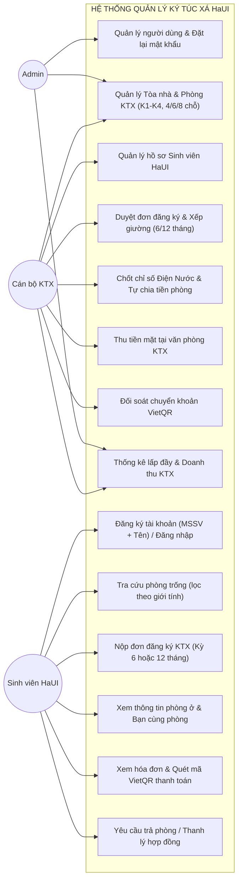

# ĐẶC TẢ YÊU CẦU PHẦN MỀM (SRS) — PHIÊN BẢN TINH GỌN HaUI
### HỆ THỐNG QUẢN LÝ KÝ TÚC XÁ ĐẠI HỌC CÔNG NGHIỆP HÀ NỘI (HaUI - DMS)

- **Đơn vị áp dụng:** Ký túc xá Đại học Công nghiệp Hà Nội (Cơ sở 1, 2, 3 - Các tòa K1, K2, K3, K4...)
- **Kiến trúc:** Modular Monolith (Node.js + Express + MongoDB + Mongoose)
- **Frontend:** React + Vite + Ant Design
- **Quy mô đội dự án:** 5 thành viên
- **Phiên bản:** v2.0-HaUI (Streamlined Edition)

---

## 1. Tác nhân Hệ thống (Actors)

Hệ thống được tinh gọn còn **3 nhóm tác nhân người dùng chính**, loại bỏ tác nhân Cron Job và Gateway phức tạp:

| Mã | Tác nhân | Quyền hạn & Trách nhiệm | Phương thức cấp tài khoản |
|---|---|---|---|
| **AC-1** | **Admin (Quản trị viên)** | Toàn quyền hệ thống: quản lý tài khoản cán bộ/sinh viên, cấu hình tòa nhà, giá phòng, xem toàn bộ báo cáo doanh thu. | Khởi tạo qua script seed ban đầu |
| **AC-2** | **Staff (Cán bộ KTX)** | Quản lý sinh viên, duyệt đơn xếp phòng, chốt chỉ số điện nước hàng tháng, thu tiền mặt, đối soát thanh toán. | Do Admin tạo tài khoản |
| **AC-3** | **Student (Sinh viên HaUI)** | Tra cứu phòng trống, nộp đơn thuê 6/12 tháng, xem thông tin phòng ở, xem hóa đơn và quét mã VietQR thanh toán. | Tự đăng ký bằng MSSV HaUI + Họ tên |

---

## 2. Sơ đồ Use Case Tổng quát (HaUI DMS)



---

## 3. Bảng Yêu cầu Chức năng (Functional Requirements — FR)

### M1 – Xác thực & Quản lý Tài khoản (`/auth`, `/users`)

- **FR-01 (Đăng nhập hệ thống):** Đăng nhập bằng Email/MSSV và mật khẩu; trả về JWT (hạn 7 ngày) chứa `id`, `role` (`admin`, `staff`, `student`), `studentCode`, và cờ `mustChangePassword`.
- **FR-02 (Tự đăng ký tài khoản cho sinh viên HaUI):** Sinh viên tự đăng ký qua `POST /auth/register` bằng `studentCode` (MSSV HaUI) và `fullName`. Hệ thống kiểm tra đối soát với hồ sơ sinh viên đã nhập sẵn (bỏ qua dấu/hoa thường). Hợp lệ sẽ tạo User vai trò `student`, liên kết hai chiều với `Student` và cấp token đăng nhập ngay.
- **FR-03 (Đăng xuất):** Hủy phiên làm việc (`POST /auth/logout`).
- **FR-04 (Thông tin cá nhân đang đăng nhập):** Lấy thông tin tài khoản hiện tại (`GET /auth/me`), kèm thông tin hồ sơ sinh viên nếu là `student`.
- **FR-05 (Đổi mật khẩu cá nhân):** Người dùng tự đổi mật khẩu (`PATCH /auth/change-password`); yêu cầu xác thực mật khẩu cũ; tự động tắt cờ `mustChangePassword`.
- **FR-06 (Đặt lại mật khẩu tạm thời):** Admin hoặc Staff cấp lại mật khẩu tạm 10 ký tự ngẫu nhiên cho người dùng (`POST /users/:id/reset-password`); bật cờ `mustChangePassword`; Staff không được reset Admin; không thể tự reset chính mình.
- **FR-07 (Quản lý danh sách tài khoản — Chỉ Admin):** Xem danh sách tài khoản (`GET /users`), lọc theo `role`, `isActive`, tìm kiếm theo email/tên/MSSV. Khóa/mở khóa tài khoản (`PATCH /users/:id/status`).

---

### M2 – Quản lý Hồ sơ Sinh viên HaUI (`/students`)

- **FR-10 (Danh sách sinh viên):** Xem danh sách sinh viên phân trang, tìm kiếm theo MSSV HaUI, họ tên, số điện thoại, lọc theo giới tính (`male`/`female`), khoa/viện (*CNTT, Cơ khí, Điện, Điện tử, Du lịch, Ngoại ngữ, Kinh tế...*); hiển thị trạng thái đang ở KTX (tòa, phòng, số giường) và cờ đã có tài khoản.
- **FR-11 (Chi tiết sinh viên):** Xem toàn bộ hồ sơ sinh viên, thông tin phòng ở hiện tại, lịch sử hợp đồng và công nợ hóa đơn chưa trả.
- **FR-12 (Thêm mới sinh viên):** Admin/Staff thêm thủ công hồ sơ từng sinh viên; kiểm tra trùng lặp `studentCode` (MSSV HaUI là duy nhất).
- **FR-12b (Import danh sách sinh viên hàng loạt qua Excel):** Hỗ trợ Admin/Staff tải file template mẫu Excel (`.xlsx`); tải lên danh sách hàng loạt sinh viên cùng lúc; hệ thống tự động xác thực dữ liệu, kiểm tra trùng lặp MSSV, lưu hàng loạt vào CSDL chỉ trong vài giây và trả về báo cáo kết quả chi tiết (số bản ghi thành công, danh sách dòng bị lỗi).
- **FR-13 (Cập nhật hồ sơ sinh viên):** Admin/Staff chỉnh sửa thông tin nhân thân, số điện thoại, lớp học, khoa; chặn đổi `studentCode` sang mã đã tồn tại.
- **FR-14 (Xóa/Vô hiệu hóa hồ sơ sinh viên):** Chặn xóa/vô hiệu hóa nếu sinh viên vẫn còn hợp đồng KTX đang hoạt động (`active`) hoặc còn nợ hóa đơn chưa thanh toán.

---

### M3 – Cơ sở Vật chất: Tòa nhà & Phòng KTX HaUI (`/buildings`, `/rooms`)
*(Đã loại bỏ bảng RoomType riêng biệt; nhúng trực tiếp sức chứa, giá tiền và giường vào Room)*

- **FR-20 (Danh sách Tòa KTX HaUI):** Xem danh sách các tòa (K1, K2, K3, K4...); kèm thống kê nhanh tổng số phòng, tổng số chỗ, số chỗ đang ở, số chỗ còn trống theo từng tòa.
- **FR-21 (Thêm/Sửa Tòa nhà):** Admin/Staff quản lý thông tin tòa nhà (mã tòa, tên, mô tả). Chặn tắt hoạt động tòa nhà nếu còn phòng đang có sinh viên ở.
- **FR-22 (Danh sách phòng KTX):** Xem danh sách phòng theo tòa, tầng, giới tính (`male`/`female`), sức chứa (`4`, `6`, `8` chỗ); hiển thị số giường trống thực tế trên từng phòng.
- **FR-23 (Xem phòng còn chỗ trống):** Hỗ trợ sinh viên và cán bộ tìm kiếm phòng còn chỗ trống; **tự động lọc theo đúng giới tính** của sinh viên để tránh xếp nhầm nam/nữ.
- **FR-24 (Tạo phòng mới):** Admin/Staff tạo phòng KTX:
  - Chọn Tòa, Tầng, Số phòng.
  - Chọn Giới tính phòng (`male`/`female`).
  - Chọn Sức chứa (`capacity`: 4, 6 hoặc 8 người).
  - Nhập Đơn giá thuê tháng (`pricePerMonth`) và Tiền cọc (`depositAmount`).
  - **Hệ thống tự động sinh danh sách giường tương ứng** (Giường 1, Giường 2, ... Giường N) ở trạng thái `available`.
- **FR-25 (Cập nhật phòng):** Admin/Staff sửa thông tin phòng. Chặn sửa đổi giới tính phòng hoặc sức chứa nếu phòng đã có sinh viên đang cư trú (`ROOM_HAS_OCCUPANTS`).
<!-- - **FR-26 (Bảo trì giường):** Cán bộ chuyển trạng thái giường sang bảo trì (`maintenance`) hoặc mở lại (`available`); chặn chuyển bảo trì giường đang có người ở. -->

---

### M4 – Đăng ký & Hợp đồng KTX (`/contracts`)
*(Hợp đồng thuê trọn gói theo Kỳ: 6 tháng hoặc 12 tháng; hợp nhất quản lý lưu trú & hợp đồng)*

- **FR-30 (Sinh viên nộp đơn đăng ký ở KTX):** Sinh viên chọn tòa nhà, chọn phòng còn chỗ (đúng giới tính), chọn số giường và chọn gói thời hạn:
  - Gói **6 tháng** (1 học kỳ).
  - Gói **12 tháng** (Cả năm học).
  - Đơn được tạo ở trạng thái `pending`.
- **FR-31 (Danh sách đơn đăng ký & hợp đồng):** Admin/Staff xem danh sách hợp đồng/đơn đăng ký, lọc theo trạng thái (`pending`, `active`, `expired`, `terminated`), lọc theo tòa/phòng/kỳ thuê.
- **FR-32 (Duyệt đơn đăng ký — Kích hoạt hợp đồng):** Admin/Staff bấm Duyệt đơn:
  - **Khóa giường bằng Atomic Query:** Sử dụng câu lệnh cập nhật nguyên tử có điều kiện (`findOneAndUpdate` kiểm tra `beds.status === 'available'`) để khóa giường sang `occupied` và gắn `studentId`. Nếu phát hiện giường vừa bị người khác chiếm cùng lúc, hệ thống lập tức hủy thao tác và báo lỗi `409 BED_ALREADY_OCCUPIED` (chống Race Condition).
  - Hợp đồng chuyển sang `active` với ngày bắt đầu và kết thúc chuẩn theo 6 tháng hoặc 12 tháng.
  - **Tự động sinh ngay 02 hóa đơn:**
    1. **Hóa đơn tiền cọc (`deposit`):** Bằng số tiền cọc quy định của phòng.
    2. **Hóa đơn tiền phòng trọn gói (`room_semester`):** Tính bằng $\text{pricePerMonth} \times (6 \text{ hoặc } 12 \text{ tháng})$.
- **FR-33 (Từ chối / Hủy đơn đăng ký):** Admin/Staff từ chối đơn kèm lý do; sinh viên có thể tự hủy đơn khi đơn còn ở trạng thái `pending`.
- **FR-34 (Trả phòng & Thanh lý hợp đồng):** Admin/Staff duyệt trả phòng:
  - Kiểm tra điều kiện: Sinh viên phải thanh toán hết toàn bộ hóa đơn tiền phòng và tiền điện nước tồn đọng.
  - Giải phóng giường về trạng thái trống (`available`).
  - Hợp đồng chuyển sang trạng thái `terminated` (chấm dứt).

---

### M5 – Chỉ số Điện Nước & Chia tiền theo phòng (`/utility-readings`)
*(Chốt số và thu theo tháng; loại bỏ cấu hình FeeType phức tạp)*

- **FR-40 (Ghi chỉ số điện nước nhanh dạng Bảng lưới theo Tòa / Excel):** Hàng tháng, cán bộ chọn Tòa nhà (K1, K2...) và Tháng ghi (vd: `10/2026`):
  - **Nhập bảng lưới nhanh (Matrix Grid):** Màn hình hiển thị danh sách toàn bộ phòng trong tòa; số cũ đã tự động điền sẵn; cán bộ chỉ việc nhập liên tục các ô số mới (hỗ trợ phím Tab/Enter nhảy ô tiện lợi trên mobile/tablet) và bấm "Lưu toàn bộ" 1 lần duy nhất.
  - **Nhập qua Excel:** Cho phép xuất danh sách phòng kèm số cũ ra file Excel, cán bộ nhập số mới vào Excel và Upload ngược lên hệ thống.
  - Hệ thống tự động tính số tiêu thụ: $\text{Tiêu thụ} = \text{Chỉ số mới} - \text{Chỉ số cũ}$.
  - Tính tổng tiền điện = $\text{Số điện} \times \text{Đơn giá điện}$; Tổng tiền nước = $\text{Số khối nước} \times \text{Đơn giá nước}$.
- **FR-41 (Tự động chia tiền theo đầu người & Sinh hóa đơn):** Khi cán bộ bấm "Chốt & Phát hành hóa đơn":
  - Hệ thống đếm chính xác số sinh viên đang ở (`occupied`) trong phòng tại tháng đó.
  - Tự động chia đều: $\text{Tiền mỗi bạn} = \frac{\text{Tổng tiền điện + Tổng tiền nước}}{\text{Số người trong phòng}}$.
  - Tự động sinh hóa đơn loại `utility` cho từng sinh viên trong phòng với hạn thanh toán quy định (vd: 7 ngày).
- **FR-42 (Xem lịch sử điện nước của phòng):** Tra cứu lịch sử tiêu thụ điện nước theo từng tháng của từng phòng để theo dõi biến động bất thường.

---

### M6 – Hóa đơn & Thanh toán (`/invoices`, `/payments`)
*(Hỗ trợ 2 hình thức: Tiền mặt tại KTX + Quét mã VietQR động có sẵn số tiền & nội dung)*

- **FR-50 (Quản lý danh sách hóa đơn):** Cán bộ xem toàn bộ hóa đơn toàn KTX, lọc theo trạng thái (`unpaid`, `paid`), lọc theo loại (`room_semester`, `deposit`, `utility`), tìm kiếm theo MSSV HaUI, mã hóa đơn, số phòng.
- **FR-51 (Chi tiết hóa đơn):** Xem chi tiết cấu thành tiền (tiền phòng kỳ mấy, hoặc tiền điện nước tháng nào kèm chi tiết số ký điện/khối nước đã chia).
- **FR-52 (Thanh toán Tiền mặt tại phòng KTX):** 
  - Sinh viên đóng tiền mặt trực tiếp cho cán bộ/thủ quỹ KTX HaUI.
  - Cán bộ tra cứu hóa đơn -> Bấm **"Xác nhận thu tiền mặt"**.
  - Hệ thống lưu lại lịch sử thanh toán (`method: 'cash'`, `cashCollectedBy: staffId`), chuyển hóa đơn sang `paid`.
- **FR-53 (Thanh toán Online qua Mã VietQR động):**
  - Hệ thống sinh mã VietQR chuẩn ngân hàng hiển thị trực tiếp trên giao diện:
    - **Số tiền:** Khóa cứng đúng bằng số tiền hóa đơn (`amount`).
    - **Nội dung chuyển khoản (Syntax chuẩn):** Mã hóa đơn + MSSV (Ví dụ: `HAUI INV0123 2021601234`).
  - Sinh viên dùng bất kỳ App Ngân hàng nào quét mã là toàn bộ thông tin được điền tự động chính xác.
- **FR-54 (Xác nhận chuyển khoản ngân hàng):** Cán bộ đối soát tài khoản ngân hàng KTX và bấm xác nhận hoàn tất hóa đơn (`method: 'vietqr'`, nhập mã giao dịch tham chiếu nếu cần).
- **FR-54b (Mở rộng nâng cao — Tự động hóa gạch nợ qua Webhook SePay / Casso):** *(Tùy chọn triển khai)*
  - Tích hợp cổng Webhook Open API (SePay / Casso) lắng nghe biến động số dư tài khoản ngân hàng KTX.
  - Khi sinh viên quét mã VietQR và thanh toán thành công, ngân hàng đẩy Webhook về backend.
  - Hệ thống tự động bóc tách mã hóa đơn từ nội dung chuyển khoản (`HAUI INV0123...`), đối soát số tiền và tự động gạch nợ sang trạng thái `paid` ngay lập tức mà không cần cán bộ bấm xác nhận thủ công.

---

### M7 – Cổng Dịch vụ Sinh viên KTX HaUI (`/portal/*`)

- **FR-60 (Hồ sơ & Phòng ở của tôi):** Sinh viên xem thông tin cá nhân, tòa nhà, số phòng, số giường đang ở; xem danh sách bạn cùng phòng (chỉ gồm Họ tên và MSSV để đảm bảo riêng tư).
- **FR-61 (Hợp đồng của tôi):** Xem chi tiết hợp đồng KTX hiện tại (kỳ thuê 6 hay 12 tháng, ngày bắt đầu, ngày hết hạn).
- **FR-62 (Hóa đơn cá nhân & Quét mã QR trả tiền):**
  - Xem danh sách các hóa đơn của mình: Hóa đơn tiền phòng cả kỳ, hóa đơn cọc, và các hóa đơn điện nước từng tháng.
  - Xem chi tiết từng hóa đơn và mở trực tiếp **Mã VietQR thanh toán** để quét mã trả tiền ngay trên điện thoại.
- **FR-63 (Lịch sử thanh toán):** Xem danh sách các phiếu thu / giao dịch đã thanh toán thành công kèm thời gian và hình thức (tiền mặt / chuyển khoản).

---

### M8 – Dashboard & Báo cáo Thống kê KTX HaUI (`/dashboard`)

- **FR-70 (Thống kê tổng quan KTX):** Hiển thị các thẻ KPI thời gian thực:
  - Tổng số giường, số giường đang ở, số giường còn trống (tỷ lệ lấp đầy KTX).
  - Tổng số sinh viên HaUI đang nội trú.
  - Số đơn đăng ký mới đang chờ duyệt.
  - Tổng công nợ chưa thu (tiền phòng kỳ này + tiền điện nước các phòng chưa nộp).
- **FR-71 (Báo cáo lấp đầy theo Tòa nhà):** Thống kê chi tiết tỷ lệ phòng/giường trống theo từng tòa (K1, K2, K3, K4) để cán bộ điều phối xếp phòng.
- **FR-72 (Thống kê Doanh thu KTX):** Thống kê tổng số tiền đã thu theo tháng/kỳ, phân tách rõ: Doanh thu tiền phòng trọn gói và Doanh thu tiền điện nước.

---

## 4. Các Quy tắc Nghiệp vụ Cốt lõi (Business Rules — BR)

1. **BR-01 (Phòng chia theo giới tính tuyệt đối):** Phòng KTX gắn cờ `male` chỉ nhận sinh viên nam, phòng `female` chỉ nhận sinh viên nữ. Hệ thống tự chặn khi sinh viên đăng ký hoặc cán bộ xếp phòng nếu lệch giới tính.
2. **BR-02 (Chu kỳ thu tiền phòng):** Tiền phòng thu trọn gói 1 lần khi duyệt hợp đồng:
   - Thuê 6 tháng: Đóng cả 6 tháng.
   - Thuê 12 tháng: Đóng cả 12 tháng.
3. **BR-03 (Công thức chia tiền điện nước):**
   $$\text{Tiền điện nước SV} = \frac{(\text{Chỉ số điện mới} - \text{Chỉ số điện cũ}) \times \text{Đơn giá điện} + (\text{Chỉ số nước mới} - \text{Chỉ số nước cũ}) \times \text{Đơn giá nước}}{\text{Số lượng SV đang cư trú thực tế trong phòng}}$$
4. **BR-04 (Điều kiện trả phòng / thanh lý hợp đồng):** Sinh viên chỉ được duyệt trả phòng và giải phóng giường khi không còn bất kỳ hóa đơn nào ở trạng thái `unpaid`.
5. **BR-05 (Chống tranh chấp giường bằng Atomic Query — Race Condition Prevention):**
   - Tuyệt đối không sử dụng luồng "Đọc kiểm tra (`find`) $\rightarrow$ Sửa (`save`)" vì khi nhiều người cùng thao tác trong 1 giây sẽ gây trùng giường.
   - Bắt buộc dùng câu lệnh nguyên tử một bước (`findOneAndUpdate`) với điều kiện tiên quyết là giường phải đang ở trạng thái `available`:
     ```javascript
     const updatedRoom = await Room.findOneAndUpdate(
       { _id: roomId, "beds.bedNumber": bedNumber, "beds.status": "available" },
       { $set: { "beds.$.status": "occupied", "beds.$.studentId": studentId } },
       { new: true }
     );
     if (!updatedRoom) {
       throw new ApiError(409, 'BED_ALREADY_OCCUPIED', 'Giường này vừa được người khác đăng ký hoặc không còn trống!');
     }
     ```
   - Đảm bảo tính nhất quán dữ liệu ở cấp CSDL, loại bỏ hoàn toàn khả năng 2 sinh viên được xếp vào cùng một chiếc giường.

---

## 5. Ma trận Phân quyền Tinh gọn (RBAC Matrix)

| Chức năng | Admin | Staff (Cán bộ) | Student (Sinh viên) |
|---|:---:|:---:|:---:|
| Quản lý tài khoản cán bộ | ✅ | ❌ | ❌ |
| Đặt lại mật khẩu tạm thời | ✅ (cho mọi người) | ✅ (cho SV, không reset Admin) | ❌ |
| Quản lý Tòa nhà & Phòng KTX | ✅ | ✅ | 👁️ Chỉ xem phòng trống |
| Thêm/Sửa hồ sơ Sinh viên | ✅ | ✅ | ❌ |
| Duyệt đơn đăng ký KTX | ✅ | ✅ | ❌ (Chỉ gửi đơn) |
| Ghi chỉ số Điện Nước & Chốt hóa đơn | ✅ | ✅ | 👁️ Chỉ xem tiền phòng mình |
| Thu tiền mặt tại KTX | ✅ | ✅ | ❌ |
| Quét mã VietQR thanh toán | ❌ | ❌ | ✅ |
| Xem Dashboard Doanh thu & Báo cáo | ✅ | ✅ (xem lấp đầy) | ❌ |
