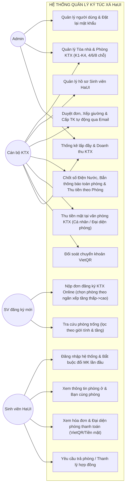

# ĐẶC TẢ YÊU CẦU PHẦN MỀM (SRS) — PHIÊN BẢN TINH GỌN HaUI
### HỆ THỐNG QUẢN LÝ KÝ TÚC XÁ ĐẠI HỌC CÔNG NGHIỆP HÀ NỘI (HaUI - DMS)

- **Đơn vị áp dụng:** Ký túc xá Đại học Công nghiệp Hà Nội (Cơ sở 1, 2, 3 - Các tòa K1, K2, K3, K4...)
- **Kiến trúc:** Modular Monolith (Node.js + Express + MongoDB + Mongoose)
- **Frontend:** React + Vite + Ant Design
- **Quy mô đội dự án:** 5 thành viên
- **Phiên bản:** v2.0-HaUI (Streamlined Edition)

---

## 1. Tác nhân Hệ thống (Actors)

Hệ thống được tinh gọn còn **3 nhóm tác nhân người dùng chính**, loại bỏ tác nhân Cron Job và Gateway phức tạp:

| Mã | Tác nhân | Quyền hạn & Trách nhiệm | Phương thức cấp tài khoản |
|---|---|---|---|
| **AC-1** | **Admin (Quản trị viên)** | Toàn quyền hệ thống: quản lý tài khoản cán bộ/sinh viên, cấu hình tòa nhà, giá phòng, xem toàn bộ báo cáo doanh thu. | Khởi tạo qua script seed ban đầu |
| **AC-2** | **Staff (Cán bộ KTX)** | Quản lý sinh viên, duyệt đơn xếp phòng, chốt chỉ số điện nước hàng tháng, thu tiền mặt, đối soát thanh toán. | Do Admin tạo tài khoản |
| **AC-3** | **Student (Sinh viên HaUI)** | Nộp đơn KTX online không cần tài khoản, xem phòng ở & bạn cùng phòng, nhận thông báo điện nước, thanh toán hóa đơn phòng cá nhân & đại diện đóng tiền điện nước phòng (VietQR / Tiền mặt). | Hệ thống tự động cấp tài khoản qua Email (TK & MK khởi tạo là Mã sinh viên) sau khi đơn đăng ký KTX (FR-30) được duyệt thành công (FR-32); bắt buộc đổi mật khẩu ở lần đăng nhập đầu tiên. |

---

## 2. Sơ đồ Use Case Tổng quát (HaUI DMS)



---

## 3. Bảng Yêu cầu Chức năng (Functional Requirements — FR)

### M1 – Xác thực & Quản lý Tài khoản (`/auth`, `/users`)

- **FR-01 (Đăng nhập hệ thống):** Đăng nhập bằng Email/MSSV và mật khẩu; trả về JWT (hạn 7 ngày) chứa `id`, `role` (`admin`, `staff`, `student`), `studentCode`, và cờ `mustChangePassword`. Nếu `mustChangePassword === true` (tài khoản mới cấp qua duyệt KTX hoặc vừa được reset), hệ thống chặn truy cập các chức năng khác và buộc chuyển hướng đến giao diện đổi mật khẩu (FR-05).
- **FR-02 (Cấp tài khoản sinh viên tự động qua xét duyệt KTX — Không cho phép tự đăng ký tài khoản tự do):**
  - Hệ thống **không mở tính năng cho sinh viên tự do đăng ký tài khoản** trên giao diện đăng nhập nhằm tránh rác dữ liệu, tài khoản ảo và mạo danh sinh viên.
  - Tài khoản sinh viên được hệ thống tự động khởi tạo và kích hoạt khi Cán bộ/Admin duyệt thành công đơn đăng ký KTX trực tuyến (xem chi tiết tại FR-30, FR-32).
  - Quy ước thông tin tài khoản ban đầu:
    - **Tên đăng nhập (Username):** Mã sinh viên HaUI (`studentCode`).
    - **Mật khẩu khởi tạo (Password):** Mặc định là chính Mã sinh viên HaUI (`studentCode`) (được băm an toàn bằng `bcrypt`).
    - **Cờ bảo mật (`mustChangePassword`):** Luôn được đặt là `true`.
  - Thông tin tài khoản được gửi tự động qua email của sinh viên đã kê khai trong đơn đăng ký.
  - Khi đăng nhập lần đầu tiên thành công, hệ thống bắt buộc sinh viên phải đổi mật khẩu mới (FR-05) mới được tiếp tục sử dụng các chức năng Portal.
- **FR-03 (Đăng xuất):** Hủy phiên làm việc (`POST /auth/logout`).
- **FR-04 (Thông tin cá nhân đang đăng nhập):** Lấy thông tin tài khoản hiện tại (`GET /auth/me`), kèm thông tin hồ sơ sinh viên nếu là `student`.
- **FR-05 (Đổi mật khẩu cá nhân — Bắt buộc thực hiện ở lần đăng nhập đầu tiên):** Người dùng tự đổi mật khẩu (`PATCH /auth/change-password`); yêu cầu xác thực mật khẩu cũ (với sinh viên mới đăng nhập lần đầu là chính MSSV); nhập mật khẩu mới và xác nhận lại; tự động tắt cờ `mustChangePassword: false` sau khi cập nhật thành công.
- **FR-06 (Đặt lại mật khẩu tạm thời):** Admin hoặc Staff cấp lại mật khẩu tạm cho người dùng (`POST /users/:id/reset-password`); bật cờ `mustChangePassword`; Staff không được reset Admin; không thể tự reset chính mình.
- **FR-07 (Quản lý danh sách tài khoản — Chỉ Admin):** Xem danh sách tài khoản (`GET /users`), lọc theo `role`, `isActive`, tìm kiếm theo email/tên/MSSV. Khóa/mở khóa tài khoản (`PATCH /users/:id/status`).

---

### M2 – Quản lý Hồ sơ Sinh viên HaUI (`/students`)

- **FR-10 (Danh sách sinh viên):** Xem danh sách sinh viên phân trang, tìm kiếm theo MSSV HaUI, họ tên, số điện thoại, lọc theo giới tính (`male`/`female`), khoa/viện (*CNTT, Cơ khí, Điện, Điện tử, Du lịch, Ngoại ngữ, Kinh tế...*); hiển thị trạng thái đang ở KTX (tòa, phòng, số giường) và cờ đã có tài khoản.
- **FR-11 (Chi tiết sinh viên):** Xem toàn bộ hồ sơ sinh viên, thông tin phòng ở hiện tại, lịch sử hợp đồng và công nợ hóa đơn chưa trả.
- **FR-12 (Thêm mới sinh viên):** Admin/Staff thêm thủ công hồ sơ từng sinh viên; kiểm tra trùng lặp `studentCode` (MSSV HaUI là duy nhất).
- **FR-12b (Import danh sách sinh viên hàng loạt qua Excel):** Hỗ trợ Admin/Staff tải file template mẫu Excel (`.xlsx`); tải lên danh sách hàng loạt sinh viên cùng lúc; hệ thống tự động xác thực dữ liệu, kiểm tra trùng lặp MSSV, lưu hàng loạt vào CSDL chỉ trong vài giây và trả về báo cáo kết quả chi tiết (số bản ghi thành công, danh sách dòng bị lỗi).
- **FR-13 (Cập nhật hồ sơ sinh viên):** Admin/Staff chỉnh sửa thông tin nhân thân, số điện thoại, lớp học, khoa; chặn đổi `studentCode` sang mã đã tồn tại.
- **FR-14 (Xóa/Vô hiệu hóa hồ sơ sinh viên):** Chặn xóa/vô hiệu hóa nếu sinh viên vẫn còn hợp đồng KTX đang hoạt động (`active`) hoặc còn nợ hóa đơn chưa thanh toán.

---

### M3 – Cơ sở Vật chất: Tòa nhà & Phòng KTX HaUI (`/buildings`, `/rooms`)
*(Đã loại bỏ bảng RoomType riêng biệt; nhúng trực tiếp sức chứa, giá tiền và giường vào Room)*

- **FR-20 (Danh sách Tòa KTX HaUI):** Xem danh sách các tòa (K1, K2, K3, K4...); kèm thống kê nhanh tổng số phòng, tổng số chỗ, số chỗ đang ở, số chỗ còn trống theo từng tòa.
- **FR-21 (Thêm/Sửa Tòa nhà):** Admin/Staff quản lý thông tin tòa nhà (mã tòa, tên, mô tả). Chặn tắt hoạt động tòa nhà nếu còn phòng đang có sinh viên ở.
- **FR-22 (Danh sách phòng KTX):** Xem danh sách phòng theo tòa, tầng, giới tính (`male`/`female`), sức chứa (`4`, `6`, `8` chỗ); hiển thị số giường trống thực tế trên từng phòng.
- **FR-23 (Xem phòng còn chỗ trống & Xếp phòng theo quy tắc ngăn xếp):**
  - Hỗ trợ sinh viên và cán bộ tìm kiếm phòng còn chỗ trống; **tự động lọc theo đúng giới tính** của sinh viên (`male`/`female`) để tránh xếp nhầm nam/nữ.
  - **Áp dụng quy tắc ngăn xếp (Stack Rule - First-Come First-Served):** Danh sách phòng trống được sắp xếp và hiển thị ưu tiên theo thứ tự: **Tầng thấp nhất trước $\rightarrow$ Số phòng nhỏ nhất trước** rồi tăng dần lên (ví dụ: Tầng 1: P101 -> P102... khi đầy mới lên Tầng 2: P201 -> P202...). Phòng ở "đỉnh ngăn xếp" (tầng thấp nhất, số phòng nhỏ nhất còn chỗ) sẽ được ưu tiên hiển thị trước để sinh viên chọn hoặc hệ thống tự động gán.
- **FR-24 (Tạo phòng mới):** Admin/Staff tạo phòng KTX:
  - Chọn Tòa, Tầng, Số phòng.
  - Chọn Giới tính phòng (`male`/`female`).
  - Chọn Sức chứa (`capacity`: 4, 6 hoặc 8 người).
  - Nhập Đơn giá thuê tháng (`pricePerMonth`) và Tiền cọc (`depositAmount`).
  - **Hệ thống tự động sinh danh sách giường tương ứng** (Giường 1, Giường 2, ... Giường N) ở trạng thái `available`.
- **FR-25 (Cập nhật phòng):** Admin/Staff sửa thông tin phòng. Chặn sửa đổi giới tính phòng hoặc sức chứa nếu phòng đã có sinh viên đang cư trú (`ROOM_HAS_OCCUPANTS`).

---

### M4 – Đăng ký & Hợp đồng KTX (`/contracts`)
*(Hợp đồng thuê trọn gói theo Kỳ: 6 tháng hoặc 12 tháng; hợp nhất quản lý lưu trú & hợp đồng)*

- **FR-30 (Sinh viên nộp đơn đăng ký ở KTX Online trực tiếp tại Cổng Đăng nhập/Portal công khai):**
  - **Truy cập công khai không cần tài khoản:** Ngay trên màn hình Đăng nhập (hoặc Cổng tiếp nhận KTX công khai), có nút / liên kết **"Đăng ký ở KTX"**. Sinh viên chưa có tài khoản có thể nhấp vào để mở ngay biểu mẫu đăng ký trực tuyến mà không cần đăng nhập trước (thay thế hoàn toàn việc nộp hồ sơ giấy thủ công).
  - **Biểu mẫu đăng ký trực tuyến:** Sinh viên tự điền các trường thông tin cần thiết:
    - Mã sinh viên (MSSV HaUI - duy nhất)
    - Họ và tên
    - Giới tính (`male` / `female` - bắt buộc để lọc phòng)
    - Số điện thoại liên lạc
    - Email cá nhân (chính xác, dùng để nhận thông báo duyệt & tài khoản KTX)
    - Ngày sinh, Khoa/Viện (*CNTT, Cơ khí, Điện...*), Lớp học, Thông tin liên hệ gia đình / khẩn cấp.
  - **Chọn phòng trực tuyến theo quy tắc ngăn xếp (Stack Allocation):**
    - Sinh viên chọn Giới tính $\rightarrow$ Hệ thống tự động lọc và hiển thị danh sách phòng/giường còn chỗ trống (`beds.status === 'available'`) theo đúng giới tính.
    - Danh sách phòng trống được sắp xếp theo quy tắc ngăn xếp: **Ưu tiên từ tầng thấp nhất và số phòng nhỏ nhất trở lên** (sinh viên nộp đơn sớm được xếp vào các phòng tầng thấp nhất, số phòng thấp nhất). Sinh viên chọn phòng và vị trí giường mong muốn trong danh sách này.
  - **Chọn gói thời hạn thuê:**
    - Gói **6 tháng** (1 học kỳ).
    - Gói **12 tháng** (Cả năm học).
  - **Nộp đơn:** Sinh viên nhấn "Gửi đơn đăng ký" (`POST /contracts/register-online`). Hệ thống tự động lưu tạm hồ sơ sinh viên vào `students` (chưa gán `userId`) và tạo hợp đồng ở trạng thái `pending`.
- **FR-31 (Danh sách đơn đăng ký & hợp đồng):** Admin/Staff xem danh sách hợp đồng/đơn đăng ký, lọc theo trạng thái (`pending`, `active`, `expired`, `terminated`), lọc theo tòa/phòng/kỳ thuê.
- **FR-32 (Duyệt đơn đăng ký — Khóa giường, Cấp tài khoản qua Email & Sinh hóa đơn):** Admin/Staff kiểm tra thông tin và bấm Duyệt đơn:
  - **Khóa giường bằng Atomic Query:** Sử dụng câu lệnh cập nhật nguyên tử có điều kiện (`findOneAndUpdate` kiểm tra `beds.status === 'available'`) để khóa giường sang `occupied` và gắn `studentId`. Nếu phát hiện giường vừa bị người khác chiếm cùng lúc, hệ thống lập tức hủy thao tác và báo lỗi `409 BED_ALREADY_OCCUPIED` (chống Race Condition).
  - Hợp đồng chuyển sang `active` với ngày bắt đầu và kết thúc chuẩn theo 6 tháng hoặc 12 tháng.
  - **Tự động cấp tài khoản người dùng (`User`):**
    - Tạo tài khoản User với: `email` (từ hồ sơ đăng ký), `role: 'student'`, `studentCode`.
    - **Tên đăng nhập (Username):** Mã sinh viên (`studentCode`).
    - **Mật khẩu khởi tạo (Password):** Mặc định là chính Mã sinh viên (`studentCode`) (mã hóa băm `bcrypt`).
    - Bật cờ `mustChangePassword: true`.
    - Liên kết hai chiều `userId` với hồ sơ `Student`.
  - **Gửi Email thông báo xét duyệt thành công:** Kích hoạt gửi email tự động tới hòm thư sinh viên đã đăng ký:
    - Tiêu đề: `[HaUI DMS] Thông báo xét duyệt đơn KTX thành công & Cấp tài khoản hệ thống`.
    - Nội dung: Chúc mừng sinh viên đã được tiếp nhận vào KTX (Tòa nhà, Phòng, Số giường, Thời hạn thuê);
    - Cung cấp thông tin tài khoản đăng nhập: **Tài khoản = Mã SV**, **Mật khẩu ban đầu = Mã SV**;
    - Hướng dẫn đăng nhập vào Cổng thông tin KTX và ghi chú bắt buộc: *Sinh viên phải đổi mật khẩu mới ngay trong lần đăng nhập đầu tiên để bảo vệ tài khoản*.
  - **Tự động sinh ngay 02 hóa đơn:**
    1. **Hóa đơn tiền cọc (`deposit`):** Bằng số tiền cọc quy định của phòng.
    2. **Hóa đơn tiền phòng trọn gói (`room_semester`):** Tính bằng $\text{pricePerMonth} \times (6 \text{ hoặc } 12 \text{ tháng})$.
- **FR-33 (Từ chối / Hủy đơn đăng ký):** Admin/Staff từ chối đơn kèm lý do (hệ thống gửi email thông báo từ chối cho sinh viên, không khóa giường); sinh viên có thể tự tra cứu tiến độ đơn bằng MSSV + Email.
- **FR-34 (Trả phòng & Thanh lý hợp đồng):** Admin/Staff duyệt trả phòng:
  - Kiểm tra điều kiện: Sinh viên phải thanh toán hết toàn bộ hóa đơn tiền phòng cá nhân và phòng không còn nợ hóa đơn điện nước tồn đọng.
  - Giải phóng giường về trạng thái trống (`available`).
  - Hợp đồng chuyển sang trạng thái `terminated` (chấm dứt).

---

### M5 – Chỉ số Điện Nước & Hóa đơn theo Phòng (`/utility-readings`, `/invoices`)
*(Chốt số và thu tiền theo đơn vị Phòng; loại bỏ cấu hình FeeType phức tạp)*

- **FR-40 (Ghi chỉ số điện nước nhanh dạng Bảng lưới theo Tòa / Excel):** Hàng tháng, cán bộ chọn Tòa nhà (K1, K2...) và Tháng ghi (vd: `10/2026`):
  - **Nhập bảng lưới nhanh (Matrix Grid):** Màn hình hiển thị danh sách toàn bộ phòng trong tòa; số cũ đã tự động điền sẵn; cán bộ chỉ việc nhập liên tục các ô số mới (hỗ trợ phím Tab/Enter nhảy ô tiện lợi trên mobile/tablet) và bấm "Lưu toàn bộ" 1 lần duy nhất.
  - **Nhập qua Excel:** Cho phép xuất danh sách phòng kèm số cũ ra file Excel, cán bộ nhập số mới vào Excel và Upload ngược lên hệ thống.
  - Hệ thống tự động tính số tiêu thụ: $\text{Tiêu thụ} = \text{Chỉ số mới} - \text{Chỉ số cũ}$.
  - Tính tổng tiền điện = $\text{Số điện} \times \text{Đơn giá điện}$; Tổng tiền nước = $\text{Số khối nước} \times \text{Đơn giá nước}$.
- **FR-41 (Chốt hóa đơn Điện Nước theo Phòng, Bắn thông báo toàn phòng & Đại diện thanh toán):**
  - Khi cán bộ bấm "Chốt & Phát hành hóa đơn Điện Nước":
    - **Phát hành 01 hóa đơn điện nước tổng duy nhất cho cả Phòng:** Không chia nhỏ ra từng hóa đơn lẻ cho từng cá nhân (để tinh gọn quản lý kế toán, tránh tình trạng nợ đọng lắt nhắt và khó đối soát). Hóa đơn mang mã định danh theo phòng và kỳ (ví dụ: `INV-UTIL-K1-302-202610`), loại `utility`, gắn với `roomId` và danh sách thành viên hiện tại của phòng.
    - **Bắn thông báo tức thời đến TẤT CẢ thành viên trong phòng:** Hệ thống tự động gửi thông báo đồng loạt (qua Email và chuông thông báo trên Portal) cho toàn bộ sinh viên đang ở trong phòng:
      - Chi tiết chỉ số điện cũ/mới, số khối nước cũ/mới và tổng tiền điện nước tháng này của cả phòng.
      - Thông tin gợi ý mức tiền bình quân mỗi người:
        $$\text{Mỗi bạn} = \frac{\text{Tổng tiền điện nước phòng}}{\text{Số lượng sinh viên đang ở thực tế}}$$
        để các bạn tự thu gom nội bộ với nhau trong phòng.
      - Hạn chót thanh toán của phòng (ví dụ: 7 ngày kể từ ngày chốt số).
    - **Thanh toán đại diện cả phòng:**
      - **Một người bất kỳ trong phòng (trưởng phòng hoặc bạn đại diện)** đứng ra thanh toán toàn bộ hóa đơn điện nước cho cả phòng.
      - **Phương thức linh hoạt (Online hoặc Offline):**
        - **Online:** Đại diện phòng mở hóa đơn điện nước phòng trên Portal để quét mã VietQR động (chuyển khoản ngân hàng chính xác số tiền và cú pháp).
        - **Offline:** Đại diện phòng mang tiền mặt lên văn phòng KTX nộp trực tiếp cho cán bộ/thủ quỹ.
      - Khi hóa đơn phòng được thanh toán thành công (`paid`), hệ thống cập nhật gạch nợ cho phòng, ghi nhận sinh viên đại diện đã thanh toán (`payerStudentId`), toàn bộ thành viên trong phòng đều được ghi nhận hoàn thành nghĩa vụ tiền điện nước tháng đó (phòng sạch công nợ).
- **FR-42 (Xem lịch sử điện nước của phòng):** Tra cứu lịch sử tiêu thụ điện nước theo từng tháng của từng phòng để theo dõi biến động bất thường.

---

### M6 – Hóa đơn & Thanh toán (`/invoices`, `/payments`)
*(Hỗ trợ 2 hình thức: Tiền mặt tại KTX + Quét mã VietQR động có sẵn số tiền & nội dung)*

- **FR-50 (Quản lý danh sách hóa đơn):** Cán bộ xem toàn bộ hóa đơn toàn KTX, lọc theo trạng thái (`unpaid`, `paid`), lọc theo loại (`room_semester`, `deposit`, `utility`), tìm kiếm theo MSSV HaUI, mã hóa đơn, số phòng. Quản lý phân tách 2 nhóm: Hóa đơn cá nhân (tiền phòng kỳ, cọc) và Hóa đơn theo phòng (tiền điện nước).
- **FR-51 (Chi tiết hóa đơn):** Xem chi tiết cấu thành tiền:
  - Hóa đơn tiền phòng / tiền cọc: Gắn với sinh viên, kỳ thuê, đơn giá.
  - Hóa đơn điện nước: Gắn với phòng, tháng chốt, chi tiết số ký điện / khối nước, danh sách các thành viên trong phòng, số tiền chia bình quân nội bộ mỗi người, và thông tin người đã đại diện nộp tiền (nếu đã thanh toán).
- **FR-52 (Thanh toán Tiền mặt tại văn phòng KTX):** 
  - Sinh viên đóng tiền phòng cá nhân hoặc đại diện phòng nộp tiền điện nước trực tiếp cho cán bộ/thủ quỹ KTX HaUI.
  - Cán bộ tra cứu hóa đơn -> Bấm **"Xác nhận thu tiền mặt"**.
  - Hệ thống lưu lại lịch sử thanh toán (`method: 'cash'`, `cashCollectedBy: staffId`, ghi nhận thông tin người nộp), chuyển hóa đơn sang `paid`.
- **FR-53 (Thanh toán Online qua Mã VietQR động):**
  - Hệ thống sinh mã VietQR chuẩn ngân hàng hiển thị trực tiếp trên giao diện:
    - **Số tiền:** Khóa cứng đúng bằng số tiền hóa đơn (`amount`).
    - **Nội dung chuyển khoản (Syntax chuẩn):**
      - Hóa đơn tiền phòng cá nhân: `HAUI <Mã hóa đơn> <MSSV>` (Ví dụ: `HAUI INV0123 2021601234`).
      - Hóa đơn điện nước phòng: `HAUI <Mã hóa đơn phòng> <Số phòng>` (Ví dụ: `HAUI INVUTIL302 P302`).
  - Sinh viên dùng bất kỳ App Ngân hàng nào quét mã là toàn bộ thông tin được điền tự động chính xác. Bất kỳ thành viên nào trong phòng cũng có thể quét mã đại diện thanh toán cho cả phòng.
- **FR-54 (Xác nhận chuyển khoản ngân hàng):** Cán bộ đối soát tài khoản ngân hàng KTX và bấm xác nhận hoàn tất hóa đơn (`method: 'vietqr'`, nhập mã giao dịch tham chiếu nếu cần).
- **FR-54b (Mở rộng nâng cao — Tự động hóa gạch nợ qua Webhook SePay / Casso):** *(Tùy chọn triển khai)*
  - Tích hợp cổng Webhook Open API (SePay / Casso) lắng nghe biến động số dư tài khoản ngân hàng KTX.
  - Khi sinh viên quét mã VietQR và thanh toán thành công, ngân hàng đẩy Webhook về backend.
  - Hệ thống tự động bóc tách mã hóa đơn từ nội dung chuyển khoản (`HAUI INV...`), đối soát số tiền và tự động gạch nợ sang trạng thái `paid` ngay lập tức mà không cần cán bộ bấm xác nhận thủ công.

---

### M7 – Cổng Dịch vụ Sinh viên KTX HaUI (`/portal/*`)

- **FR-60 (Hồ sơ & Phòng ở của tôi):** Sinh viên xem thông tin cá nhân, tòa nhà, số phòng, số giường đang ở; xem danh sách bạn cùng phòng (chỉ gồm Họ tên và MSSV để đảm bảo riêng tư).
- **FR-61 (Hợp đồng của tôi):** Xem chi tiết hợp đồng KTX hiện tại (kỳ thuê 6 hay 12 tháng, ngày bắt đầu, ngày hết hạn).
- **FR-62 (Hóa đơn cá nhân & Hóa đơn Điện nước phòng — Đại diện thanh toán):**
  - **Hóa đơn cá nhân:** Xem hóa đơn tiền phòng cả kỳ và tiền cọc; mở trực tiếp mã VietQR để thanh toán tiền phòng của mình.
  - **Hóa đơn Điện nước phòng:** Xem hóa đơn điện nước tháng này của phòng mình, số điện/nước tiêu thụ, tổng tiền cả phòng, mức tiền chia bình quân mỗi người.
  - **Đại diện thanh toán phòng:** Bất kỳ bạn nào trong phòng cũng có thể bấm "Thanh toán đại diện phòng qua VietQR" để quét mã trả tiền cho cả phòng. Nếu đã có người nộp (bằng tiền mặt hoặc VietQR), màn hình hiển thị trạng thái "Đã thanh toán bởi bạn [Họ tên - MSSV] vào ngày [...]".
- **FR-63 (Lịch sử thanh toán):** Xem danh sách các phiếu thu / giao dịch đã thanh toán thành công kèm thời gian và hình thức (tiền mặt / chuyển khoản).

---

### M8 – Dashboard & Báo cáo Thống kê KTX HaUI (`/dashboard`)

- **FR-70 (Thống kê tổng quan KTX):** Hiển thị các thẻ KPI thời gian thực:
  - Tổng số giường, số giường đang ở, số giường còn trống (tỷ lệ lấp đầy KTX).
  - Tổng số sinh viên HaUI đang nội trú.
  - Số đơn đăng ký mới đang chờ duyệt.
  - Tổng công nợ chưa thu (tiền phòng kỳ này + tiền điện nước các phòng chưa nộp).
- **FR-71 (Báo cáo lấp đầy theo Tòa nhà):** Thống kê chi tiết tỷ lệ phòng/giường trống theo từng tòa (K1, K2, K3, K4) để cán bộ điều phối xếp phòng.
- **FR-72 (Thống kê Doanh thu KTX):** Thống kê tổng số tiền đã thu theo tháng/kỳ, phân tách rõ: Doanh thu tiền phòng trọn gói và Doanh thu tiền điện nước.

---

## 4. Các Quy tắc Nghiệp vụ Cốt lõi (Business Rules — BR)

1. **BR-01 (Phòng chia theo giới tính tuyệt đối):** Phòng KTX gắn cờ `male` chỉ nhận sinh viên nam, phòng `female` chỉ nhận sinh viên nữ. Hệ thống tự động lọc và chặn khi sinh viên đăng ký online hoặc cán bộ xếp phòng nếu lệch giới tính.
2. **BR-02 (Chu kỳ thu tiền phòng):** Tiền phòng thu trọn gói 1 lần khi duyệt hợp đồng:
   - Thuê 6 tháng: Đóng cả 6 tháng.
   - Thuê 12 tháng: Đóng cả 12 tháng.
3. **BR-03 (Thu tiền điện nước theo Đơn vị Phòng & Bắn thông báo toàn phòng):**
   - Hóa đơn tiền điện nước phát hành theo đơn vị Phòng (1 hóa đơn duy nhất/phòng/tháng), không chia nhỏ hóa đơn lẻ cho từng cá nhân để tránh nợ đọng lắt nhắt và khó quản lý.
   - Khi chốt chỉ số, hệ thống tự động bắn thông báo đồng loạt cho toàn bộ thành viên trong phòng biết tổng tiền và số tiền chia bình quân:
     $$\text{Tiền bình quân mỗi SV} = \frac{(\text{Số điện tiêu thụ} \times \text{Đơn giá điện}) + (\text{Số nước tiêu thụ} \times \text{Đơn giá nước})}{\text{Số lượng SV đang cư trú thực tế trong phòng}}$$
   - Một người trong phòng (trưởng phòng hoặc đại diện) đứng ra thanh toán toàn bộ hóa đơn cho phòng (Online qua VietQR hoặc Offline tiền mặt tại KTX).
4. **BR-04 (Điều kiện trả phòng / thanh lý hợp đồng):** Sinh viên chỉ được duyệt trả phòng và giải phóng giường khi không còn bất kỳ hóa đơn nào ở trạng thái `unpaid` (bao gồm hóa đơn cá nhân và hóa đơn điện nước của phòng).
5. **BR-05 (Chống tranh chấp giường bằng Atomic Query — Race Condition Prevention):**
   - Tuyệt đối không sử dụng luồng "Đọc kiểm tra (`find`) $\rightarrow$ Sửa (`save`)" vì khi nhiều người cùng thao tác trong 1 giây sẽ gây trùng giường.
   - Bắt buộc dùng câu lệnh nguyên tử một bước (`findOneAndUpdate`) với điều kiện tiên quyết là giường phải đang ở trạng thái `available`:
     ```javascript
     const updatedRoom = await Room.findOneAndUpdate(
       { _id: roomId, "beds.bedNumber": bedNumber, "beds.status": "available" },
       { $set: { "beds.$.status": "occupied", "beds.$.studentId": studentId } },
       { new: true }
     );
     if (!updatedRoom) {
       throw new ApiError(409, 'BED_ALREADY_OCCUPIED', 'Giường này vừa được người khác đăng ký hoặc không còn trống!');
     }
     ```
   - Đảm bảo tính nhất quán dữ liệu ở cấp CSDL, loại bỏ hoàn toàn khả năng 2 sinh viên được xếp vào cùng một chiếc giường.
6. **BR-06 (Cấp tài khoản tự động & Bắt buộc đổi mật khẩu lần đầu):**
   - Không cho phép sinh viên tự do tạo tài khoản trên hệ thống.
   - Tài khoản sinh viên được tạo tự động khi đơn đăng ký KTX online được duyệt: Tên đăng nhập = MSSV, Mật khẩu khởi tạo = MSSV (băm bcrypt), kích hoạt cờ `mustChangePassword: true`.
   - Hệ thống tự động gửi thông tin tài khoản qua email sinh viên.
   - Sinh viên bắt buộc phải đổi mật khẩu mới trong lần đầu tiên đăng nhập trước khi sử dụng các chức năng Portal.
7. **BR-07 (Quy tắc xếp phòng ngăn xếp — Stack Allocation Rule):**
   - Danh sách phòng KTX trống được quản lý và sắp xếp theo ngăn xếp ưu tiên tăng dần: **Tầng thấp nhất trước $\rightarrow$ Số phòng nhỏ nhất trước**.
   - Sinh viên nộp đơn đăng ký trước sẽ được hệ thống gợi ý và xếp vào các phòng tầng thấp và số phòng nhỏ trước (ví dụ: Tầng 1: P101 -> P102... rồi mới đến Tầng 2: P201 -> P202...).

---

## 5. Ma trận Phân quyền Tinh gọn (RBAC Matrix)

| Chức năng | Admin | Staff (Cán bộ) | Student (Sinh viên) |
|---|:---:|:---:|:---:|
| Quản lý tài khoản cán bộ | ✅ | ❌ | ❌ |
| Đặt lại mật khẩu tạm thời | ✅ (cho mọi người) | ✅ (cho SV, không reset Admin) | ❌ |
| Quản lý Tòa nhà & Phòng KTX | ✅ | ✅ | 👁️ Chỉ xem phòng trống |
| Nộp đơn đăng ký KTX Online (chưa cần TK) | ❌ | ❌ | ✅ (Sinh viên / Khách) |
| Duyệt đơn đăng ký KTX & Cấp TK qua Email | ✅ | ✅ | ❌ |
| Thêm/Sửa hồ sơ Sinh viên | ✅ | ✅ | ❌ |
| Ghi chỉ số Điện Nước & Chốt hóa đơn Phòng | ✅ | ✅ | 👁️ Nhận thông báo & Xem hóa đơn phòng |
| Thu tiền mặt tại KTX | ✅ | ✅ | ❌ |
| Quét mã VietQR thanh toán (Phòng/Điện nước) | ❌ | ❌ | ✅ (Cá nhân hoặc đại diện phòng) |
| Xem Dashboard Doanh thu & Báo cáo | ✅ | ✅ (xem lấp đầy) | ❌ |
