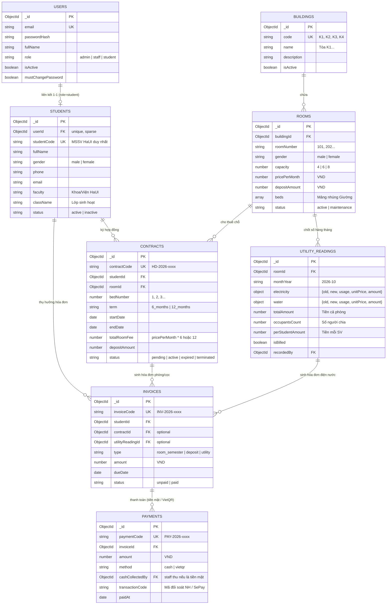

# THIẾT KẾ CƠ SỞ DỮ LIỆU (DATA SCHEMA) — PHIÊN BẢN TINH GỌN HaUI
### HỆ THỐNG QUẢN LÝ KÝ TÚC XÁ ĐẠI HỌC CÔNG NGHIỆP HÀ NỘI (HaUI - DMS)

- **Hệ quản trị CSDL:** MongoDB + Mongoose ODM (Node.js)
- **Tài liệu tham chiếu:** [EDIT_DOCS_DAC_TA_YEU_CAU.md](file:///d:/BE_QLKTX/docs/EDIT_DOCS_DAC_TA_YEU_CAU.md)
- **Đặc trưng tinh gọn:**
  - Giảm từ 12-14 collection xuống còn **7 collection cốt lõi**.
  - **Bỏ bảng RoomType & Bed riêng:** Nhúng trực tiếp sức chứa (4/6/8 chỗ), giá tiền, tiền cọc và danh sách giường vào từng phòng `Room`.
  - **Bỏ bảng FeeType động:** Cố định 3 loại khoản thu (`room_semester`, `deposit`, `utility`).
  - **Hợp nhất Residency vào Contract:** 1 hợp đồng quản lý trực tiếp giường, sinh viên và thời hạn lưu trú (6 tháng / 12 tháng).

---

## 1. Sơ đồ Quan hệ Thực thể (Entity Relationship Diagram — ERD)



---

## 2. Quy ước Kỹ thuật CSDL (Database Conventions)

1. **Khóa chính:** `_id` mặc định của MongoDB (`ObjectId`).
2. **Tiền tệ:** Toàn bộ trường tiền (`pricePerMonth`, `amount`, `depositAmount`, `totalRoomFee`...) lưu số nguyên **Integer (VNĐ)**, tuyệt đối không dùng số thực `Float`.
3. **Giá trị Enum:** Viết thường `lowercase` (ví dụ: `'male'`, `'female'`, `'admin'`, `'staff'`, `'student'`, `'active'`).
4. **Timestamps:** Mọi collection đều kích hoạt `{ timestamps: true }` để tự sinh `createdAt` và `updatedAt`.
5. **Giới tính (`gender`):** Bắt buộc chuẩn hóa thành 2 giá trị `'male'` hoặc `'female'`, dùng làm điều kiện cốt lõi để ngăn chặn xếp phòng nhầm giới tính.

---

## 3. Chi tiết 7 Collections Cốt lõi

### 3.1. Collection `users` (Tài khoản Đăng nhập & Xác thực)
*Mapping file:* `src/modules/auth/user.model.js`

| Tên trường | Kiểu dữ liệu | Ràng buộc | Diễn giải |
|---|---|---|---|
| `_id` | ObjectId | PK | Khóa chính tự sinh |
| `email` | String | required, unique, lowercase, trim | Email đăng nhập (hoặc email sinh viên HaUI) |
| `passwordHash`| String | required | Mật khẩu băm an toàn bằng `bcrypt` (10 rounds) |
| `fullName` | String | required, trim | Họ và tên hiển thị |
| `role` | String | required, enum: `['admin', 'staff', 'student']` | Vai trò người dùng (đã lược bỏ 'viewer') |
| `isActive` | Boolean | default: `true` | Cờ khóa / mở khóa tài khoản |
| `mustChangePassword` | Boolean | default: `false` | Bật `true` khi Admin/Staff reset mật khẩu tạm |

*Indexes:*
- `{ email: 1 }` (unique)

---

### 3.2. Collection `students` (Hồ sơ Sinh viên HaUI)
*Mapping file:* `src/modules/students/student.model.js`

| Tên trường | Kiểu dữ liệu | Ràng buộc | Diễn giải |
|---|---|---|---|
| `_id` | ObjectId | PK | Khóa chính tự sinh |
| `userId` | ObjectId | ref: `'User'`, unique, sparse: `true` | Liên kết tài khoản User (null khi chưa tự đăng ký) |
| `studentCode` | String | required, unique, uppercase, trim | **MSSV HaUI** (ví dụ: `2021601234`), duy nhất |
| `fullName` | String | required, trim | Họ và tên sinh viên |
| `gender` | String | required, enum: `['male', 'female']` | **Giới tính** (bắt buộc để xếp phòng nam/nữ) |
| `phone` | String | required, match: `/^0\d{9}$/` | Số điện thoại liên lạc (10 số) |
| `email` | String | lowercase, trim | Email cá nhân của sinh viên |
| `dob` | Date | optional | Ngày tháng năm sinh |
| `faculty` | String | trim | Khoa/Viện HaUI (*CNTT, Cơ khí, Điện, Ngoại ngữ...*) |
| `className` | String | trim | Lớp học (*ví dụ: KTPM01-K16*) |
| `emergencyContact` | Object | optional | `{ name: String, phone: String, relationship: String }` |
| `status` | String | enum: `['active', 'inactive']`, default: `'active'` | Trạng thái theo dõi hồ sơ |

*Indexes:*
- `{ studentCode: 1 }` (unique)
- `{ fullName: "text" }` (phục vụ tìm kiếm nhanh)

---

### 3.3. Collection `buildings` (Tòa nhà KTX HaUI)
*Mapping file:* `src/modules/rooms/building.model.js`

| Tên trường | Kiểu dữ liệu | Ràng buộc | Diễn giải |
|---|---|---|---|
| `_id` | ObjectId | PK | Khóa chính |
| `code` | String | required, unique, uppercase, trim | Mã tòa nhà (ví dụ: `K1`, `K2`, `K3`, `K4`) |
| `name` | String | required, trim | Tên tòa nhà (ví dụ: `Tòa K1 - KTX Cơ sở 1`) |
| `description` | String | optional, trim | Vị trí, mô tả khu vực |
| `isActive` | Boolean | default: `true` | Đang hoạt động hay tạm đóng |

---

### 3.4. Collection `rooms` (Phòng KTX & Giường nhúng trực tiếp)
*Mapping file:* `src/modules/rooms/room.model.js`
> **Đặc điểm kiến trúc:** Không dùng bảng `RoomType` và `Bed` riêng. Giường được nhúng trực tiếp dạng Subdocument Array bên trong `rooms`.

| Tên trường | Kiểu dữ liệu | Ràng buộc | Diễn giải |
|---|---|---|---|
| `_id` | ObjectId | PK | Khóa chính |
| `buildingId` | ObjectId | required, ref: `'Building'` | Thuộc tòa nhà nào |
| `roomNumber` | String | required, trim | Số phòng (ví dụ: `"302"`, `"405"`) |
| `floor` | Number | required, min: 1 | Tầng (ví dụ: tầng 3) |
| `gender` | String | required, enum: `['male', 'female']` | **Phòng Nam hay Nữ** |
| `capacity` | Number | required, enum: `[4, 6, 8]` | Sức chứa cố định (4, 6 hoặc 8 người) |
| `pricePerMonth`| Number | required, min: 0 | Đơn giá thuê 1 tháng / sinh viên (VND) |
| `depositAmount`| Number | required, min: 0 | Tiền đặt cọc phòng (VND, thường 500.000đ) |
| `status` | String | enum: `['active', 'maintenance']`, default: `'active'` | Trạng thái phòng |
| `beds` | Array | Subdocument Array | **Danh sách giường nhúng** (xem chi tiết bên dưới) |

**Cấu trúc Subdocument `beds`:**
```javascript
[
  {
    bedNumber: Number, // Số thứ tự giường: 1, 2, 3... đến capacity
    status: String,    // enum: ['available', 'occupied', 'maintenance'], default: 'available'
    studentId: ObjectId // ref: 'Student', null khi giường trống
  }
]
```

*Indexes:*
- `{ buildingId: 1, roomNumber: 1 }` (unique — không bao giờ trùng số phòng trong cùng 1 tòa)
- `{ gender: 1, "beds.status": 1 }` (tìm nhanh phòng còn giường trống theo giới tính)

---

### 3.5. Collection `contracts` (Hợp đồng Thuê KTX theo Kỳ)
*Mapping file:* `src/modules/contracts/contract.model.js`

| Tên trường | Kiểu dữ liệu | Ràng buộc | Diễn giải |
|---|---|---|---|
| `_id` | ObjectId | PK | Khóa chính |
| `contractCode`| String | required, unique, uppercase | Mã hợp đồng (vd: `HD-2026-0012`) |
| `studentId` | ObjectId | required, ref: `'Student'` | Sinh viên thuê |
| `roomId` | ObjectId | required, ref: `'Room'` | Phòng thuê |
| `bedNumber` | Number | required, min: 1 | Số giường thuê trong phòng |
| `term` | String | required, enum: `['6_months', '12_months']` | **Kỳ thuê: 6 tháng hoặc 12 tháng** |
| `startDate` | Date | required | Ngày bắt đầu ở |
| `endDate` | Date | required | Ngày kết thúc hợp đồng |
| `pricePerMonth`| Number | required | Đơn giá tháng tại thời điểm ký (VND) |
| `totalRoomFee` | Number | required | **Tiền phòng cả kỳ:** `pricePerMonth * (6 hoặc 12)` |
| `depositAmount`| Number | required | Tiền cọc phòng (VND) |
| `status` | String | required, enum: `['pending', 'active', 'expired', 'terminated']` | `pending` (chờ duyệt), `active` (đang ở), `terminated` (đã trả phòng) |
| `rejectionReason`| String | optional | Lý do từ chối nếu đơn bị hủy |
| `approvedBy` | ObjectId | ref: `'User'` | Cán bộ duyệt hợp đồng |

*Indexes:*
- `{ contractCode: 1 }` (unique)
- `{ studentId: 1, status: 1 }`
- `{ roomId: 1, bedNumber: 1, status: 1 }`

---

### 3.6. Collection `utility_readings` (Chỉ số Điện Nước Chốt Hàng Tháng)
*Mapping file:* `src/modules/fees/utility-reading.model.js`

| Tên trường | Kiểu dữ liệu | Ràng buộc | Diễn giải |
|---|---|---|---|
| `_id` | ObjectId | PK | Khóa chính |
| `roomId` | ObjectId | required, ref: `'Room'` | Phòng chốt số |
| `monthYear` | String | required, format: `YYYY-MM` | Tháng ghi (ví dụ: `"2026-10"`) |
| `electricity` | Object | required | Chi tiết số điện: `{ oldIndex, newIndex, usage, unitPrice, amount }` |
| `water` | Object | required | Chi tiết số nước: `{ oldIndex, newIndex, usage, unitPrice, amount }` |
| `totalAmount` | Number | required, min: 0 | Tổng tiền điện + tiền nước cả phòng (VND) |
| `occupantsCount`| Number | required, min: 1 | Số lượng sinh viên đang ở thực tế lúc chốt số |
| `perStudentAmount`| Number | required, min: 0 | $\text{Tiền mỗi sinh viên} = \text{totalAmount} \div \text{occupantsCount}$ |
| `isBilled` | Boolean | default: `false` | Đã chia tiền phát hành hóa đơn cá nhân chưa |
| `recordedBy` | ObjectId | ref: `'User'` | Cán bộ nhập chỉ số |

*Indexes:*
- `{ roomId: 1, monthYear: 1 }` (unique — 1 phòng chỉ ghi chỉ số 1 lần trong 1 tháng)

---

### 3.7. Collection `invoices` (Hóa đơn Thu tiền)
*Mapping file:* `src/modules/fees/invoice.model.js`

| Tên trường | Kiểu dữ liệu | Ràng buộc | Diễn giải |
|---|---|---|---|
| `_id` | ObjectId | PK | Khóa chính |
| `invoiceCode` | String | required, unique, uppercase | Mã hóa đơn chuẩn (ví dụ: `INV-2026-0089`) |
| `studentId` | ObjectId | required, ref: `'Student'` | Sinh viên chịu trách nhiệm thanh toán |
| `type` | String | required, enum: `['room_semester', 'deposit', 'utility']` | 3 loại phí: Tiền phòng cả kỳ, Tiền cọc, Tiền điện nước tháng |
| `contractId` | ObjectId | optional, ref: `'Contract'` | Liên kết nếu là tiền phòng hoặc tiền cọc |
| `utilityReadingId`| ObjectId | optional, ref: `'UtilityReading'` | Liên kết nếu là tiền điện nước tháng |
| `amount` | Number | required, min: 0 | Số tiền cần thanh toán (VNĐ) |
| `description` | String | trim | Diễn giải (vd: *"Tiền phòng KTX K1-302 Kỳ 1 (6 tháng)"*) |
| `dueDate` | Date | required | Hạn chót thanh toán (vd: 7 ngày sau khi phát hành) |
| `status` | String | required, enum: `['unpaid', 'paid']`, default: `'unpaid'` | Trạng thái hóa đơn |
| `paidAt` | Date | optional | Ngày thanh toán thành công |

*Indexes:*
- `{ invoiceCode: 1 }` (unique)
- `{ studentId: 1, status: 1 }`
- `{ type: 1, status: 1 }`

---

### 3.8. Collection `payments` (Lịch sử Giao dịch & Phiếu thu)
*Mapping file:* `src/modules/payments/payment.model.js`

| Tên trường | Kiểu dữ liệu | Ràng buộc | Diễn giải |
|---|---|---|---|
| `_id` | ObjectId | PK | Khóa chính |
| `paymentCode` | String | required, unique, uppercase | Mã phiếu thu (ví dụ: `PAY-2026-0045`) |
| `invoiceId` | ObjectId | required, ref: `'Invoice'` | Thu tiền cho hóa đơn nào |
| `amount` | Number | required, min: 0 | Số tiền đã thanh toán (VNĐ) |
| `method` | String | required, enum: `['cash', 'vietqr']` | Tiền mặt tại KTX hoặc Quét mã VietQR |
| `cashCollectedBy`| ObjectId | optional, ref: `'User'` | Cán bộ nhận tiền (nếu là tiền mặt) |
| `transactionCode`| String | optional, trim | Mã giao dịch ngân hàng / Mã SePay Webhook |
| `note` | String | optional, trim | Ghi chú thu tiền |
| `paidAt` | Date | default: `Date.now` | Thời điểm thanh toán |

*Indexes:*
- `{ paymentCode: 1 }` (unique)
- `{ invoiceId: 1 }`
- `{ transactionCode: 1 }` (chống xử lý trùng webhook SePay)

---

## 4. Các Truy vấn Nguyên tử Mẫu (Atomic Query Patterns)

### 4.1. Khóa giường nguyên tử (Chống Race Condition khi duyệt đơn)
```javascript
const room = await Room.findOneAndUpdate(
  {
    _id: roomId,
    "beds.bedNumber": bedNumber,
    "beds.status": "available"
  },
  {
    $set: {
      "beds.$.status": "occupied",
      "beds.$.studentId": studentId
    }
  },
  { new: true }
);

if (!room) {
  throw new ApiError(409, 'BED_ALREADY_OCCUPIED', 'Giường vừa có người khác đăng ký hoặc đang bảo trì!');
}
```

### 4.2. Giải phóng giường khi thanh lý hợp đồng (Trả phòng)
```javascript
await Room.findOneAndUpdate(
  {
    _id: roomId,
    "beds.bedNumber": bedNumber,
    "beds.studentId": studentId
  },
  {
    $set: {
      "beds.$.status": "available",
      "beds.$.studentId": null
    }
  }
);
```

### 4.3. Tự động chia tiền điện nước và phát hành hóa đơn hàng loạt
```javascript
// 1. Đếm số sinh viên đang ở trong phòng
const room = await Room.findById(roomId);
const occupants = room.beds.filter(b => b.status === 'occupied');
const count = occupants.length || 1; // chống chia cho 0

// 2. Tính số tiền mỗi người
const total = utilityReading.totalAmount;
const perStudentAmount = Math.round(total / count);

// 3. Tạo hóa đơn cho từng sinh viên
const invoices = occupants.map(b => ({
  invoiceCode: generateInvoiceCode(),
  studentId: b.studentId,
  utilityReadingId: utilityReading._id,
  type: 'utility',
  amount: perStudentAmount,
  dueDate: dayjs().add(7, 'day').toDate(),
  status: 'unpaid'
}));
await Invoice.insertMany(invoices);
```
