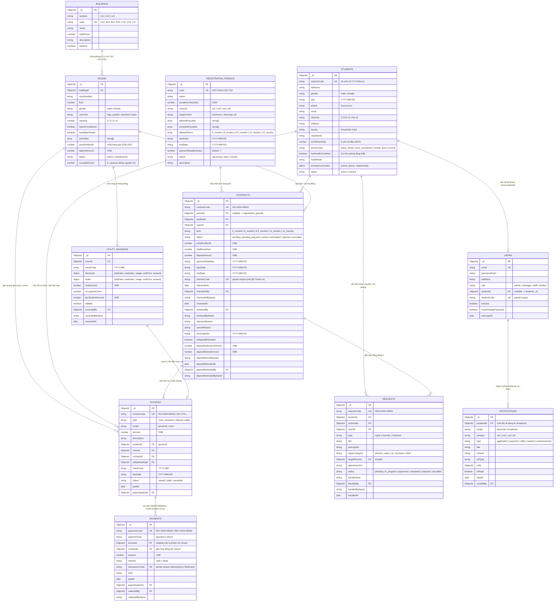

# THIẾT KẾ CƠ SỞ DỮ LIỆU (DATA SCHEMA) — CHUẨN NGHIỆP VỤ HaUI 2026 (v3.0)
### HỆ THỐNG QUẢN LÝ KÝ TÚC XÁ ĐẠI HỌC CÔNG NGHIỆP HÀ NỘI (HaUI - DMS)

- **Hệ quản trị CSDL:** MongoDB + Mongoose ODM (Node.js)
- **Tài liệu tham chiếu:** [EDIT_DOCS_DAC_TA_YEU_CAU.md](EDIT_DOCS_DAC_TA_YEU_CAU.md) · [API.md](API.md)
- **Đặc trưng kiến trúc v3.0 (11 Collections cốt lõi — Hạ tầng gọn sạch, Quản lý gọn đến cấp Phòng):**
  - Nhúng trực tiếp cấu hình hạng phòng (`high_quality | standard | basic`), sức chứa (`2 | 3 | 4 | 6`), trang thiết bị và bộ đếm `occupiedCount` vào từng phòng `Room` (bỏ theo dõi vị trí từng giường lẻ — sinh viên vào phòng tự sắp xếp giường với nhau).
  - Gắn trực tiếp **3 Cơ sở địa giới hành chính 2026** (`cs1`, `cs2`, `cs3`) lên `Building` (`A14-A15`, `B12-B14`, `C15-C17`).
  - Bổ sung **3 bảng nghiệp vụ cốt lõi** để số hóa trọn vẹn: `registration_periods` (Đợt mở cổng & phân luồng theo khóa/ngành), `requests` (Báo hỏng / Chuyển phòng / Trả phòng) và `notifications` (Chuông thông báo & Bảng tin KTX).
  - Hợp nhất Đơn đăng ký + Giữ chỗ chờ đóng phí (`pending_payment`) + Hợp đồng (`active`) + QR Check-in + Khấu trừ cọc trên cùng một bảng `contracts`.

---

## 1. Sơ đồ Quan hệ Thực thể (Entity Relationship Diagram — ERD)



---

## 2. Quy ước Kỹ thuật CSDL (Database Conventions)

1. **Khóa chính & JSON:** `_id` (`ObjectId`) chuyển thành `id` (`String`) khi trả JSON; ẩn `_id`, `__v`, `passwordHash`.
2. **Tiền tệ:** Toàn bộ trường tiền lưu **số nguyên Integer (VNĐ)** (`>= 0`).
3. **Ngày tháng (`UTC+7`):** Ngày nghiệp vụ không kèm giờ (`dob`, `startDate`, `endDate`, `paymentDeadline`, `dueDate`, `terminatedAt`) lưu chuỗi `'YYYY-MM-DD'`; tháng chốt điện nước lưu `'YYYY-MM'`.
4. **Giá trị Enum:** Viết thường `lowercase` tập trung tại `src/shared/constants/enums.js`.
5. **Timestamps:** Toàn bộ 11 collections bật `{ timestamps: true }` (`createdAt`, `updatedAt`).

---

## 3. Chi tiết 11 Collections Cốt lõi

### 3.1. Collection `users` — `src/modules/auth/user.model.js`
| Tên trường | Kiểu | Ràng buộc | Diễn giải |
|---|---|---|---|
| `email` | String | required, unique, lowercase, trim | Email đăng nhập |
| `passwordHash` | String | required, select: false | Băm `bcrypt` (10 rounds) |
| `fullName` | String | required, trim | Họ và tên hiển thị |
| `role` | String | required, enum: `['admin', 'manager', 'staff', 'student']` | 4 vai trò chuẩn HaUI |
| `studentId` | ObjectId | ref `'Student'`, default `null` | Liên kết 1-1 tới hồ sơ sinh viên |
| `studentCode` | String | partial unique (khi là chuỗi), default `null` | MSSV dùng đăng nhập trực tiếp |
| `isActive` | Boolean | default `true` | Cờ khóa / mở tài khoản |
| `mustChangePassword` | Boolean | default `false` | Bắt buộc đổi mật khẩu ở lần đầu |
| `lastLoginAt` | Date | default `null` | Lần đăng nhập cuối |

### 3.2. Collection `students` — `src/modules/students/student.model.js`
| Tên trường | Kiểu | Ràng buộc | Diễn giải |
|---|---|---|---|
| `studentCode` | String | required, unique, `/^\d{10}$/` | MSSV HaUI 10 chữ số (`YYYY60xxxx`) |
| `fullName` | String | required, trim | Họ và tên |
| `gender` | String | required, enum `['male', 'female']` | Giới tính |
| `dob` | String | `'YYYY-MM-DD'` | Ngày sinh |
| `phone` | String | required, `/^0\d{9}$/` | Số điện thoại 10 số |
| `email` | String | lowercase, trim | Email nhận thông báo & cấp tài khoản |
| `citizenId` | String | `/^\d{12}$/` | Số CCCD 12 chữ số (dùng xác thực chống ghi đè hồ sơ) |
| `address` | String | trim | Địa chỉ thường trú |
| `faculty` | String | trim | Khoa / Viện đào tạo |
| `className` | String | trim | Lớp sinh hoạt |
| `enrollmentYear` | Number | tự trích từ 4 số đầu `studentCode` | Năm nhập học (phân luồng Tân SV vs SV năm 2+) |
| `priorityType` | String | enum `['policy_family', 'poor_household', 'remote_area', 'normal']`, default `'normal'` | Diện ưu tiên xét duyệt KTX |
| `hasHealthCondition` | Boolean | default `false` | Có vấn đề sức khỏe/vận động cần ưu tiên phòng tầng thấp (`floor <= 2`) |
| `healthNote` | String | default `''` | Mô tả tình trạng sức khỏe / minh chứng |
| `emergencyContact` | Object | `{ name, phone, relationship }` | Liên hệ người thân |
| `status` | String | enum `['active', 'inactive']`, default `'active'` | Trạng thái hồ sơ |

### 3.3. Collection `buildings` — `src/modules/rooms/building.model.js`
| Tên trường | Kiểu | Ràng buộc | Diễn giải |
|---|---|---|---|
| `campus` | String | required, enum `['cs1', 'cs2', 'cs3']` | Cơ sở trực thuộc (`cs1`: 298 Cầu Diễn Tây Tựu HN, `cs2`: TDP Thượng 2 Tây Tựu HN, `cs3`: Phù Vân Ninh Bình) |
| `code` | String | required, unique, uppercase | Mã tòa thật HaUI: `A14`, `A15`, `B12`, `B14`, `C15`, `C16`, `C17` |
| `name` | String | required, trim | Tên tòa nhà |
| `totalFloors` | Number | default `5`, min `1` | Tổng số tầng |
| `description` | String | default `''` | Mô tả khu vực, văn phòng trực tầng 1 |
| `isActive` | Boolean | default `true` | Chặn tắt nếu còn người ở hoặc đơn chờ |

### 3.4. Collection `rooms` — `src/modules/rooms/room.model.js`
| Tên trường | Kiểu | Ràng buộc | Diễn giải |
|---|---|---|---|
| `buildingId` | ObjectId | required, ref `'Building'` | Tòa nhà trực thuộc |
| `roomNumber` | String | required, trim | Số phòng (`101`, `205`...) |
| `floor` | Number | required, min `1` | Tầng |
| `gender` | String | enum `['male', 'female', null]`, default `null` | Giới tính phòng động: `null` khi trống (`occupiedCount = 0`), tự gán khi người đầu tiên vào và tự mở lại `null` khi người cuối rời phòng |
| `roomTier` | String | required, enum `['high_quality', 'standard', 'basic']`, default `'standard'` | Hạng phòng theo bảng giá HaUI 2026–2027 |
| `capacity` | Number | required, enum `[2, 3, 4, 6]` | Sức chứa thực tế HaUI (2, 3, 4 hoặc 6 người) |
| `hasAirConditioner` | Boolean | default `false` | Có điều hòa (`true` với `high_quality`) |
| `hasWaterHeater` | Boolean | default `true` | Có bình nóng lạnh (`true` với `high_quality` & `standard`) |
| `amenities` | String[] | default `[]` | Danh sách tiện ích (Wifi miễn phí, tủ cá nhân, đệm...) |
| `pricePerMonth` | Number | required, min `0` | Đơn giá 1 tháng/SV theo bảng giá HaUI 2026–2027 (VNĐ) |
| `depositAmount` | Number | required, min `0` | Tiền đặt cọc tài sản (VNĐ) |
| `status` | String | enum `['active', 'maintenance']`, default `'active'` | Trạng thái phòng |
| `occupiedCount` | Number | default `0`, min `0` | Số sinh viên đang giữ chỗ (`active` + `pending_payment`) trong phòng — luôn thỏa `0 <= occupiedCount <= capacity` |

*Indexes:* `{ buildingId: 1, roomNumber: 1 }` (unique), `{ gender: 1, status: 1 }`, `{ floor: 1, roomNumber: 1 }`.

### 3.5. Collection `registration_periods` — `src/modules/periods/registration-period.model.js`
| Tên trường | Kiểu | Ràng buộc | Diễn giải |
|---|---|---|---|
| `code` | String | required, unique, uppercase | Mã đợt (`DOT-2026-CS3-TSV`, `DOT-2026-HN-TSV`, `DOT-2026-HN-KCU`) |
| `name` | String | required, trim | Tên hiển thị trên trang chủ công khai |
| `academicYearStart` | Number | required (VD `2026`) | Năm bắt đầu năm học — dùng đối chiếu 4 số đầu MSSV xác định `freshman` vs `returning` |
| `campus` | String | required, enum `['cs1', 'cs2', 'cs3', 'all']` | Phạm vi cơ sở áp dụng |
| `targetCohort` | String | required, enum `['freshman', 'returning', 'all']` | Đối tượng sinh viên được nộp đơn |
| `allowedFaculties` | String[] | default `[]` | Nếu không rỗng: chỉ các khoa/ngành trong danh sách mới được nộp |
| `excludedFaculties` | String[] | default `[]` | Danh sách khoa/ngành loại trừ khỏi đợt này |
| `allowedTerms` | String[] | enum `['5_months', '6_months', '8.5_months', '10_months', '12_months']` | Các gói kỳ hạn hợp lệ trong đợt |
| `startDate`, `endDate` | String | required, `'YYYY-MM-DD'` | Khung ngày mở & đóng cổng tiếp nhận |
| `paymentDeadlineDays` | Number | default `7`, min `1` | Số ngày hạn chót đóng tiền giữ chỗ sau khi duyệt |
| `status` | String | enum `['upcoming', 'open', 'closed']`, default `'upcoming'` | Trạng thái điều phối đợt |
| `description` | String | default `''` | Hướng dẫn / thông báo của đợt |

### 3.6. Collection `contracts` — `src/modules/contracts/contract.model.js`
| Tên trường | Kiểu | Ràng buộc | Diễn giải |
|---|---|---|---|
| `contractCode` | String | required, unique | `HD-YYYY-NNNN` |
| `periodId` | ObjectId | ref `'RegistrationPeriod'`, default `null` | Đợt đăng ký gốc |
| `studentId` | ObjectId | required | Sinh viên đăng ký |
| `roomId` | ObjectId | ref `'Room'`, default `null` | Phòng được phân bổ (có thể `null` lúc `pending`, tự động xếp từ tầng thấp → cao khi duyệt) |
| `campus`, `preferredRoomTier`, `preferredCapacity` | String / Number | default `null` | Cơ sở & nguyện vọng loại phòng của đơn đăng ký (không chọn từng số phòng) |
| `term` | String | enum `['5_months', '6_months', '8.5_months', '10_months', '12_months']` | Kỳ thuê |
| `status` | String | enum `['pending', 'pending_payment', 'active', 'terminated', 'rejected', 'cancelled']` | Vòng đời đầy đủ (`expired` suy ra lúc đọc khi `active` quá `endDate`) |
| `pricePerMonth`, `totalRoomFee`, `depositAmount` | Number | required, min `0` | Giá chốt theo phòng & kỳ (`Math.round(pricePerMonth * months)`) |
| `paymentDeadline` | String | `'YYYY-MM-DD'`, default `null` | Hạn đóng phí khi ở `pending_payment` (quá hạn sẽ bị hủy thu hồi chỗ phòng) |
| `startDate`, `endDate` | String | `'YYYY-MM-DD'`, default `null` | Thời hạn hợp đồng chính thức |
| `checkinCode` | String | partial unique, default `null` | Mã QR Check-in sinh tự động khi chuyển `active` |
| `checkedInAt`, `checkedInBy`, `checkedInByName` | Date / ObjectId / String | default `null` | Dấu vết quét QR bàn giao nhận phòng |
| `reviewedAt`, `reviewedBy`, `reviewedByName`, `rejectionReason`, `cancelReason` | Mixed | default `null` | Thông tin xét duyệt / từ chối / hủy quá hạn |
| `terminatedAt` | String | `'YYYY-MM-DD'`, default `null` | Ngày thanh lý |
| `isDepositRefunded` | Boolean | default `false` | Cờ đã quyết toán hoàn cọc |
| `depositDeductionAmount`, `depositRefundAmount` | Number | default `0`, min `0` | Tiền khấu trừ hỏng tài sản & tiền hoàn trả thực tế |
| `depositRefundReason`, `depositRefundedAt`, `depositRefundedBy`, `depositRefundedByName` | Mixed | default `null` | Biên bản quyết toán hoàn cọc |

### 3.7. Collection `utility_readings` — `src/modules/fees/utility-reading.model.js`
Giữ nguyên cấu trúc v2 (`roomId`, `monthYear`, `electricity`, `water`, `totalAmount`, `occupantsCount`, `perStudentAmount`, `isBilled`, `recordedBy`, `recordedByName`, `recordedAt`), unique index `{ roomId: 1, monthYear: 1 }`. Bổ sung kiểm tra `oldIndex` nối tiếp `previous.newIndex`.

### 3.8. Collection `invoices` — `src/modules/fees/invoice.model.js`
Giữ nguyên cấu trúc v2 (`invoiceCode`, `type: 'room_semester' | 'deposit' | 'utility'`, `scope: 'personal' | 'room'`, `amount`, `description`, `studentId`, `roomId`, `contractId`, `utilityReadingId`, `monthYear`, `dueDate`, `paidAt`, `payerStudentId`) và mở rộng `status`: `['unpaid', 'paid', 'cancelled']` để hủy hóa đơn khi hủy hợp đồng `pending_payment`.

### 3.9. Collection `payments` — `src/modules/payments/payment.model.js`
Bổ sung `paymentType: 'payment' | 'refund'` (default `'payment'`) và `contractId` (khi ghi nhận phiếu chi hoàn cọc `REF-YYYY-NNNN`). Báo cáo doanh thu Dashboard chỉ cộng `paymentType === 'payment'` và loại trừ hóa đơn `type === 'deposit'`. Partial unique index trên `transactionCode` bảo đảm **Idempotency** cho Webhook VietQR.

### 3.10. Collection `requests` — `src/modules/requests/request.model.js`
| Tên trường | Kiểu | Ràng buộc | Diễn giải |
|---|---|---|---|
| `requestCode` | String | required, unique | `REQ-YYYY-NNNN` |
| `studentId`, `contractId`, `roomId` | ObjectId | required | Sinh viên, hợp đồng và phòng hiện tại |
| `type` | String | required, enum `['repair', 'transfer', 'checkout']` | Báo hỏng sửa chữa / Xin chuyển phòng / Đăng ký trả phòng |
| `title`, `description` | String | required | Tiêu đề & mô tả chi tiết |
| `repairCategory` | String | enum `['electric', 'water', 'ac', 'furniture', 'other']`, default `null` | Phân loại sự cố (khi `type = 'repair'`) |
| `targetRoomId` | ObjectId | ref `'Room'`, default `null` | Phòng mong muốn chuyển sang (khi `type = 'transfer'`) |
| `attachmentUrl` | String | default `null` | Link ảnh hiện trường |
| `status` | String | enum `['pending', 'in_progress', 'approved', 'completed', 'rejected', 'cancelled']`, default `'pending'` | Trạng thái xử lý |
| `handlerNote`, `handledBy`, `handledByName`, `handledAt` | Mixed | default `null` | Phản hồi của cán bộ / quản lý |

### 3.11. Collection `notifications` — `src/modules/notifications/notification.model.js`
| Tên trường | Kiểu | Ràng buộc | Diễn giải |
|---|---|---|---|
| `recipientId` | ObjectId | ref `'User'`, default `null` | Người nhận (để `null` nếu là thông báo chung `broadcast` trên Trang chủ KTX) |
| `scope` | String | enum `['personal', 'broadcast']`, default `'personal'` | Cá nhân hay Bảng tin công khai |
| `campus` | String | enum `['cs1', 'cs2', 'cs3', 'all']`, default `'all'` | Phạm vi hiển thị thông báo |
| `type` | String | enum `['application', 'payment', 'utility', 'request', 'announcement']` | Phân loại thông báo |
| `title`, `content` | String | required | Tiêu đề & nội dung |
| `refType`, `refId` | String / ObjectId | default `null` | Tham chiếu thực thể liên quan (`contract`, `invoice`, `request`, `period`) |
| `isRead`, `readAt` | Boolean / Date | default `false` / `null` | Trạng thái đã đọc |
| `createdBy` | ObjectId | ref `'User'`, default `null` | Người đăng (đối với bảng tin) |

---

## 4. Các Truy vấn Nguyên tử Chuẩn (Atomic Query Patterns — Cấp Phòng)

### 4.1. Khóa 1 chỗ nguyên tử trong phòng (Chống vượt sức chứa tuyệt đối — BR-05)
```javascript
const room = await Room.findOneAndUpdate(
  {
    _id: roomId,
    status: 'active',
    $expr: { $lt: ['$occupiedCount', '$capacity'] },
  },
  { $inc: { occupiedCount: 1 } },
  { returnDocument: 'after' }
);
if (!room) {
  throw new ApiError(409, 'ROOM_FULL', 'Phòng vừa hết chỗ hoặc đang bảo trì!');
}
```

### 4.2. Giải phóng 1 chỗ khi hủy quá hạn, chuyển phòng hoặc thanh lý hợp đồng
```javascript
await Room.updateOne(
  { _id: roomId, occupiedCount: { $gt: 0 } },
  { $inc: { occupiedCount: -1 } }
);
```

### 4.3. Gạch nợ nguyên tử (Webhook VietQR & Tiền mặt) và tự kích hoạt `pending_payment -> active`
```javascript
const updated = await Invoice.findOneAndUpdate(
  { _id: invoice._id, status: 'unpaid' },
  { $set: { status: 'paid', paidAt: new Date(), payerStudentId } },
  { returnDocument: 'after' }
);
if (!updated) throw new ApiError(409, 'INVOICE_ALREADY_PAID', 'Hóa đơn đã được thanh toán');
// Nếu cả 2 hóa đơn đầu kỳ (deposit + room_semester) đều đã paid → tự nâng Contract sang active & sinh checkinCode QR!
```
