# CHƯƠNG 3: THIẾT KẾ HỆ THỐNG WEB QUẢN LÝ KÝ TÚC XÁ (HaUI - DMS)

---

## 3.1. Kiến trúc hệ thống ở mức cơ bản

Hệ thống Quản lý Ký túc xá Đại học Công nghiệp Hà Nội (**HaUI - DMS**) được thiết kế theo mô hình kiến trúc phân tầng hiện đại **Client - Server** kết hợp phong cách **Modular Monolith** trên nền tảng Node.js / Express và MongoDB. Kiến trúc này tối ưu hóa sự cân bằng giữa tính đơn giản trong triển khai, vận hành và khả năng bảo trì, mở rộng cao cho quy mô đội ngũ phát triển.

Hệ thống được tổ chức thành 3 tầng logic chính (Three-Tier Architecture):

1. **Tầng Giao diện người dùng (Presentation Tier / Client):**
   - Xây dựng dưới dạng ứng dụng đơn trang **Single Page Application (SPA)** bằng **React.js (Vite)** kết hợp thư viện giao diện chuẩn doanh nghiệp **Ant Design (AntD)** và thư viện biểu đồ **Recharts**.
   - Giao diện được thiết kế thích ứng (Responsive) hoàn chỉnh trên cả Desktop, Tablet và Mobile, chia thành 2 phân hệ chính:
     - *Cổng thông tin tiếp nhận công khai (Public Portal)*: Dành cho sinh viên đăng ký mới nộp hồ sơ online và tra cứu phòng trống không cần tài khoản.
     - *Bảng điều khiển quản trị & Portal sinh viên (Admin/Staff Dashboard & Student Portal)*: Dành cho cán bộ quản trị và sinh viên đã có tài khoản để quản lý phòng, điện nước, hóa đơn, thanh toán.
   - Giao tiếp với tầng Backend thông qua giao thức bảo mật **HTTPS** và định dạng dữ liệu chuẩn **RESTful JSON APIs**.

2. **Tầng Xử lý nghiệp vụ (Application / Business Logic Tier):**
   - Xây dựng trên nền tảng **Node.js** và framework **Express.js**, tuân thủ kiến trúc **Modular Monolith** tinh gọn bên trong từng phân hệ:
     - **Routes Layer (`*.routes.js`):** Tiếp nhận yêu cầu HTTP, định tuyến, kích hoạt middleware xác thực JWT / phân quyền RBAC (`admin`, `staff`, `student`) và bọc phản hồi qua bộ điều phối chuẩn `respond()`.
     - **Services Layer (`*.service.js`):** Nơi tập trung toàn bộ kiểm tra dữ liệu đầu vào theo trường (`fieldErrors`) và quy tắc nghiệp vụ cốt lõi: kiểm tra giới tính phòng, thuật toán xếp phòng ngăn xếp, khóa giường nguyên tử một bước (`$elemMatch` + `findOneAndUpdate`), bảng lưới chỉ số điện nước, sinh thông số mã VietQR động và gửi email tự động (Nodemailer).
     - **Shared DTO & Views Layer (`shared/views.js`):** Tải gom các bảng tham chiếu (`loadCtx`), tính trạng thái hết hạn hợp đồng lúc đọc (`contractStatusOf`) và chuẩn hóa cấu trúc JSON trả về cho Frontend.
     - **Security & Cross-cutting Concerns:** Bảo mật dựa trên **JWT (JSON Web Token)** hạn 7 ngày, băm mật khẩu một chiều với **Bcrypt (10 salt rounds)**, chặn cưỡng bức đổi mật khẩu lần đầu, xử lý ngoại lệ tập trung (`error-handler.js`) và ghi nhật ký tự động ẩn dữ liệu nhạy cảm (`logger.js`).

3. **Tầng Dữ liệu (Data Tier / Persistence Layer):**
   - Cơ sở dữ liệu tài liệu **MongoDB** kết hợp thư viện ánh xạ đối tượng **Mongoose ODM**.
   - Mô hình dữ liệu được chuẩn hóa thành **8 Collections cốt lõi** (`users`, `students`, `buildings`, `rooms`, `contracts`, `utility_readings`, `invoices`, `payments`).
   - Sử dụng các chỉ mục phức hợp (Compound / Partial Unique Indexes) và truy vấn nguyên tử cấp độ CSDL (`findOneAndUpdate`) để đảm bảo tính toàn vẹn dữ liệu, triệt tiêu hoàn toàn hiện tượng tranh chấp giường (Race Condition / Zero Overbooking).

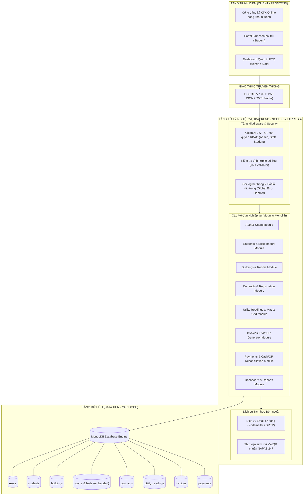

---

## 3.2. Biểu đồ hoạt động (Activity Diagram)

Các biểu đồ hoạt động được chuẩn hóa theo mô hình phân làn bơi đa tác nhân (**Swimlanes / Partitions: Tác nhân người dùng – Giao diện/Hệ thống – CSDL/Dịch vụ ngoài**) với đầy đủ nút khởi đầu (start node `●`), nút kết thúc (end node `⦿`), các điểm rẽ nhánh điều kiện (decision diamonds `◇`), hoạt động xử lý và luồng dữ liệu hai chiều.

### 3.2.1. Biểu đồ hoạt động "Nộp đơn đăng ký KTX Online công khai"

Quy trình nộp đơn đăng ký KTX trực tuyến công khai dành cho sinh viên mới / sinh viên chưa có tài khoản trên cổng thông tin KTX HaUI:

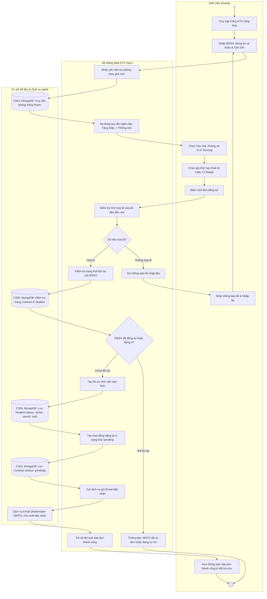

---

### 3.2.2. Biểu đồ hoạt động "Xét duyệt đơn KTX & Cấp tài khoản tự động"

Quy trình Cán bộ KTX thẩm định hồ sơ, thực hiện câu truy vấn nguyên tử một bước (`findOneAndUpdate`) để khóa giường chống Race Condition, tự sinh tài khoản người dùng, phát hành 02 hóa đơn tài chính và gửi email kích hoạt cho sinh viên:

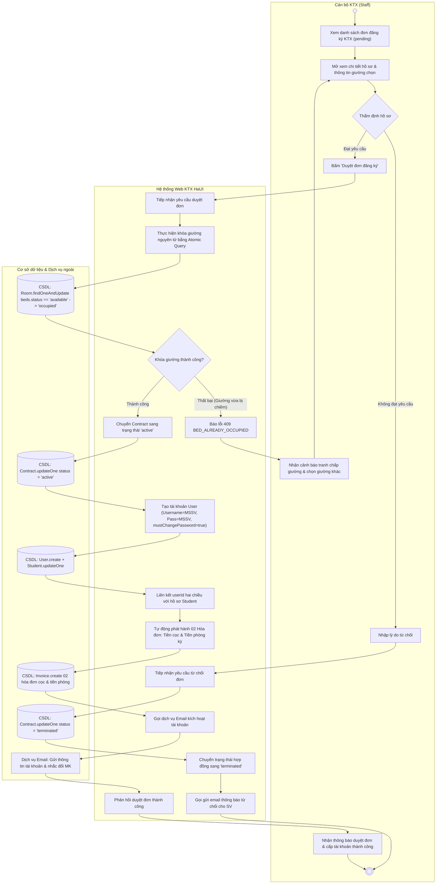

---

### 3.3.3. Biểu đồ hoạt động "Thanh toán hóa đơn qua mã VietQR động"

Quy trình thanh toán hóa đơn trực tuyến áp dụng chung cho Hóa đơn cá nhân và Hóa đơn điện nước chung của phòng (đại diện phòng thanh toán qua mã VietQR động, hỗ trợ đối soát qua Webhook hoặc thủ công):

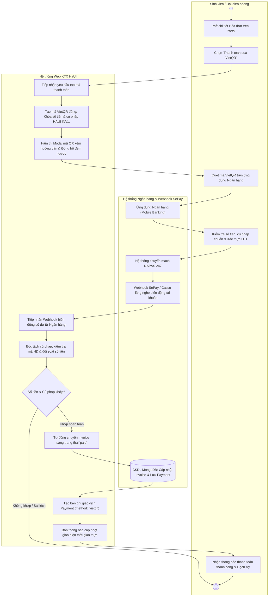

---

### 3.3.4. Biểu đồ hoạt động "Trả phòng & Thanh lý Hợp đồng KTX"

Quy trình kiểm tra công nợ, kiểm kê tài sản hư hại, quyết toán tiền cọc, giải phóng giường và chấm dứt hợp đồng KTX:

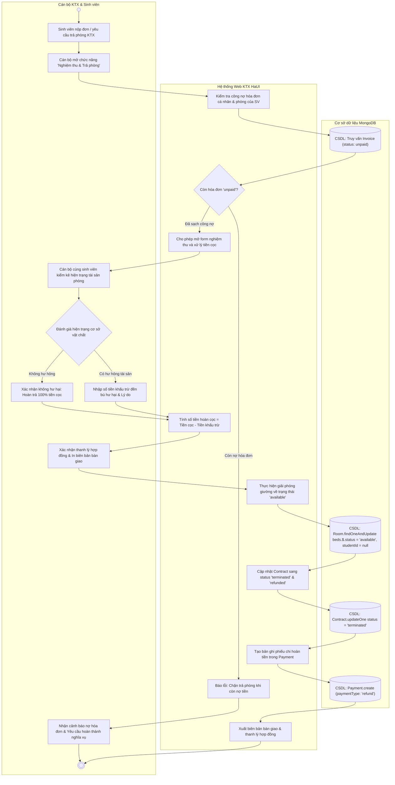

---

### 3.3.5. Biểu đồ hoạt động "Quản lý Tòa nhà"

Biểu đồ hoạt động của use case **"Quản lý Tòa nhà"** được thiết kế chuẩn theo mô hình phân làn (Swimlane Diagram) với 2 cột tương ứng với 2 tác nhân/thực thể tham gia: **CanBoKTX** (Cán bộ KTX / Quản trị viên) và **HeThong** (Hệ thống phần mềm), bao gồm đầy đủ các luồng nghiệp vụ: xem danh sách & tỷ lệ lấp đầy, thêm mới tòa nhà, cập nhật thông tin tòa nhà và thay đổi trạng thái hoạt động (kèm kiểm tra điều kiện sinh viên đang cư trú).

#### Biểu đồ PlantUML (Định dạng Đen - Trắng chuẩn Báo cáo / Khóa luận):

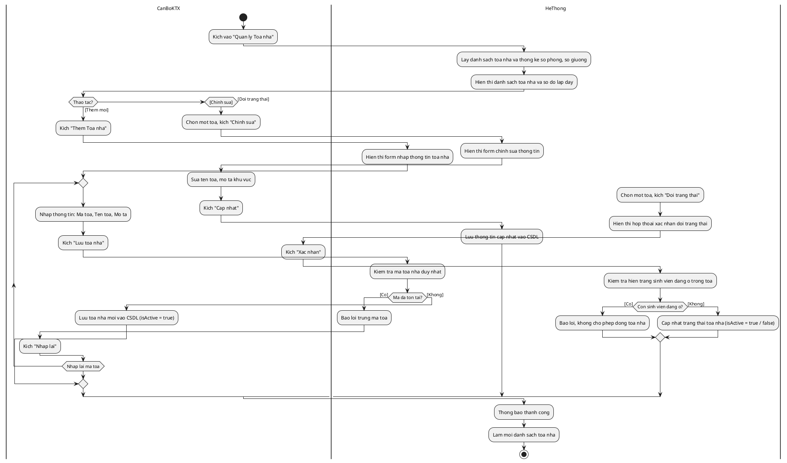

#### Biểu đồ Mermaid (Hiển thị trực quan trên Markdown):

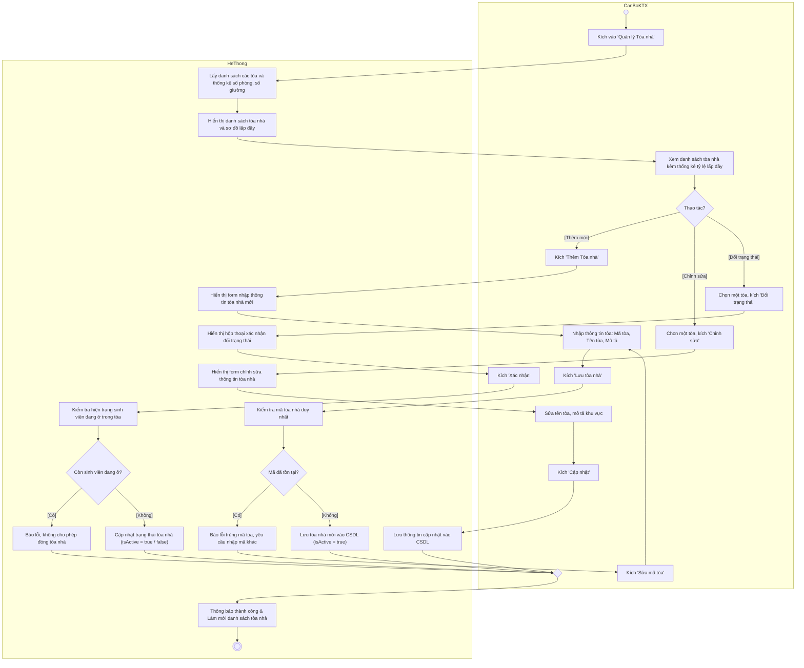

---

## 3.4. Biểu đồ trình tự (Sequence Diagram)

Các biểu đồ trình tự được chuẩn hóa theo đúng khuôn mẫu phân rã lớp 3 tầng chuẩn UML (**Actor $\rightarrow$ Boundary UI $\rightarrow$ Control Controller $\rightarrow$ Entity Data Models & Services**), các thông điệp có số thứ tự đánh số rõ ràng `1:, 2:, 3:...`, tên hàm/phương thức có tham số cụ thể, và các luồng phản hồi phân tách bằng nét đứt `-->`.

### 3.4.1. Biểu đồ trình tự "Nộp đơn đăng ký KTX Online công khai"

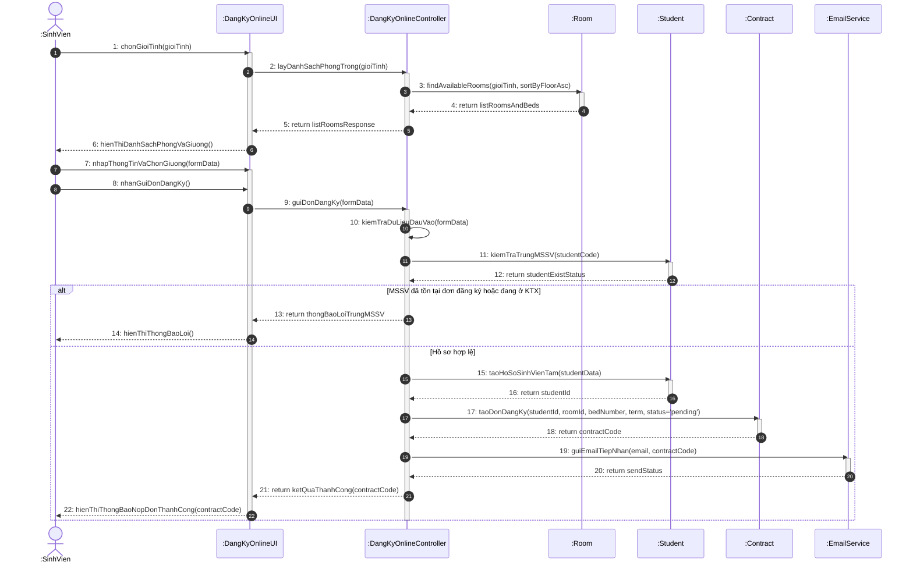

---

### 3.4.2. Biểu đồ trình tự "Xét duyệt đơn KTX & Cấp tài khoản tự động"

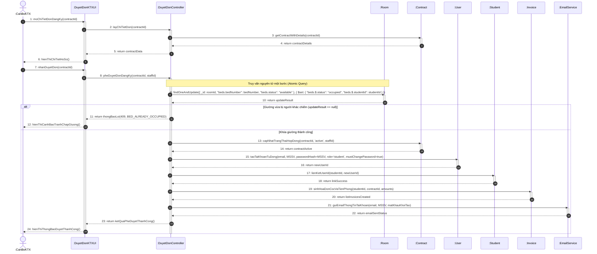

---

### 3.4.3. Biểu đồ trình tự "Thanh toán hóa đơn qua mã VietQR động"

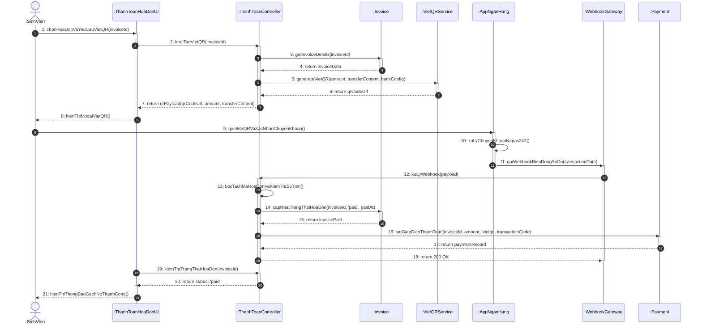

---

### 3.4.4. Biểu đồ trình tự "Trả phòng & Thanh lý Hợp đồng KTX"

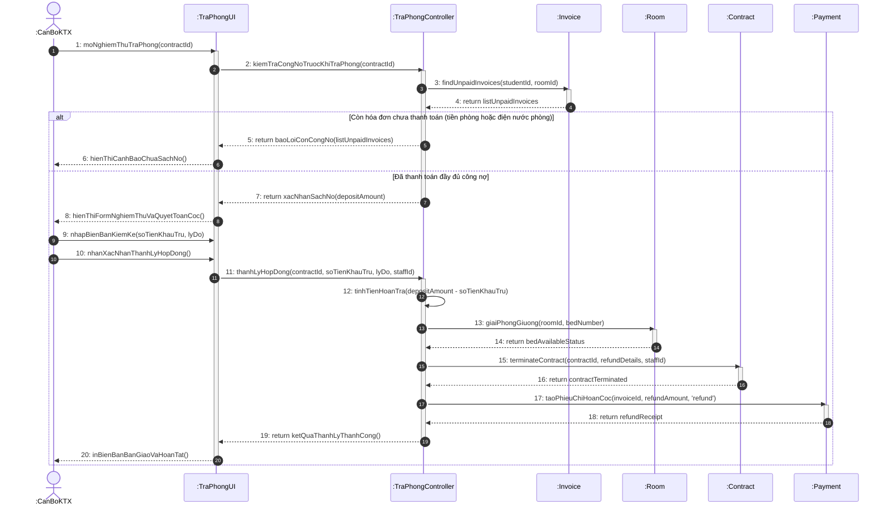

---

### 3.4.5. Biểu đồ trình tự "Quản lý Tòa nhà"

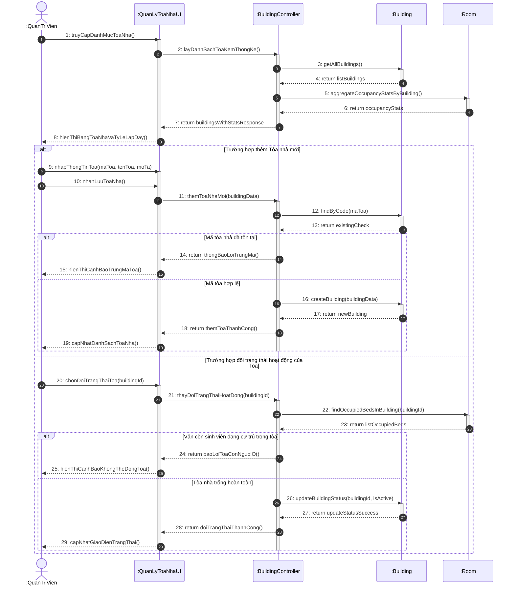

---

## 3.5. Thiết kế cơ sở dữ liệu

Cơ sở dữ liệu của Hệ thống Quản lý Ký túc xá Đại học Công nghiệp Hà Nội (HaUI - DMS) được thiết kế và cài đặt trên nền tảng **MongoDB**, quản lý thông qua **Mongoose ODM**. Mô hình dữ liệu gồm **8 collections cốt lõi** (`users`, `students`, `buildings`, `rooms`, `contracts`, `utility_readings`, `invoices`, `payments`), loại bỏ các bảng trung gian rời rạc (`room_types`, `beds`, `fee_types`, `residencies`), nhúng trực tiếp mảng giường vào phòng để tối ưu hóa tốc độ truy vấn và hỗ trợ khóa giường nguyên tử một bước (`findOneAndUpdate` kết hợp `$elemMatch`).

---

### 3.5.1. Mô hình thực thể – mối quan hệ (ERD)

Sơ đồ ERD phản ánh đầy đủ 8 thực thể cốt lõi cùng khóa chính (PK), khóa ngoại (FK), khóa duy nhất (UK) và bản số quan hệ khớp 100% với mã nguồn Mongoose thực tế:

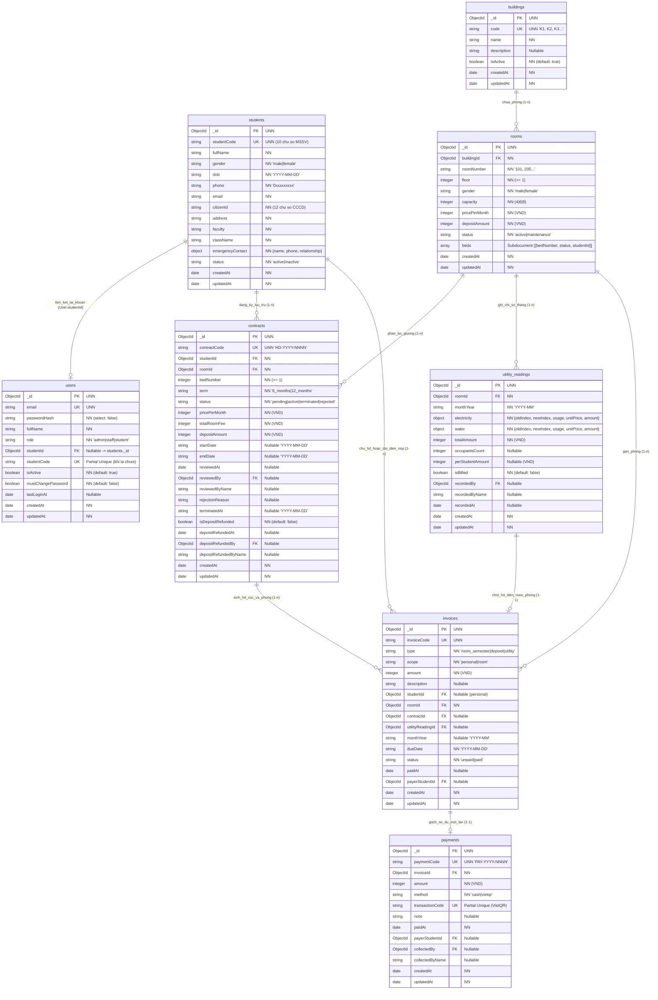

---

### 3.5.2. Đặc tả chi tiết 8 bảng dữ liệu (Collections)

*Quy ước ký hiệu ràng buộc:* **PK** (Khóa chính) · **FK** (Khóa ngoại) · **UK** (Khóa duy nhất) · **NN** (Bắt buộc) · **UNN** (Duy nhất & Bắt buộc).

#### 1. Collection `users` (`src/modules/auth/user.model.js`)
| Tên trường | Kiểu dữ liệu | Ràng buộc | Mặc định | Diễn giải chi tiết |
|---|---|---|---|---|
| `_id` | ObjectId | PK, UNN | Tự sinh | Khóa chính người dùng |
| `email` | String | UK, UNN | — | Email đăng nhập (`lowercase`, `trim`) |
| `passwordHash` | String | NN | — | Mật khẩu băm `bcrypt` (10 rounds, ẩn khi truy vấn `select: false`) |
| `fullName` | String | NN | — | Họ và tên hiển thị (tối đa 150 ký tự) |
| `role` | String | NN | — | Phân quyền 3 cấp: `'admin'`, `'staff'`, `'student'` |
| `studentId` | ObjectId | FK, Nullable | `null` | Liên kết hồ sơ `students` (khi `role = 'student'`) |
| `studentCode` | String | UK (Partial) | `null` | MSSV để sinh viên đăng nhập trực tiếp bằng mã sinh viên |
| `isActive` | Boolean | NN | `true` | Trạng thái hoạt động (`false` = bị khóa) |
| `mustChangePassword` | Boolean | NN | `false` | `true` khi mới cấp tự động hoặc vừa reset mật khẩu tạm |
| `lastLoginAt` | Date | Nullable | `null` | Thời điểm đăng nhập gần nhất |
| `createdAt`, `updatedAt` | Date | NN | Tự sinh | Dấu thời gian hệ thống |

#### 2. Collection `students` (`src/modules/students/student.model.js`)
| Tên trường | Kiểu dữ liệu | Ràng buộc | Mặc định | Diễn giải chi tiết |
|---|---|---|---|---|
| `_id` | ObjectId | PK, UNN | Tự sinh | Khóa chính hồ sơ sinh viên |
| `studentCode` | String | UK, UNN | — | Mã số sinh viên HaUI gồm đúng 10 chữ số (`/^\d{10}$/`) |
| `fullName` | String | NN | — | Họ và tên sinh viên |
| `gender` | String | NN | — | Giới tính: `'male'` hoặc `'female'` (ràng buộc xếp phòng `BR-01`) |
| `dob` | String | NN | `null` | Ngày sinh định dạng `'YYYY-MM-DD'` |
| `phone` | String | NN | — | Số điện thoại 10 số bắt đầu bằng `0` (`/^0\d{9}$/`) |
| `email` | String | NN | `null` | Email cá nhân nhận kết quả xét duyệt và thông tin tài khoản |
| `citizenId` | String | NN | `null` | Số CCCD gồm đúng 12 chữ số (`/^\d{12}$/`) |
| `address` | String | NN | `null` | Địa chỉ thường trú |
| `faculty` | String | NN | `""` | Khoa / Viện đào tạo |
| `className` | String | NN | `""` | Lớp sinh hoạt |
| `emergencyContact` | Object | NN | `null` | `{ name: String, phone: String, relationship: String }` |
| `status` | String | NN | `'active'` | Trạng thái hồ sơ: `'active'`, `'inactive'` |
| `createdAt`, `updatedAt` | Date | NN | Tự sinh | Dấu thời gian hệ thống |

#### 3. Collection `buildings` (`src/modules/rooms/building.model.js`)
| Tên trường | Kiểu dữ liệu | Ràng buộc | Mặc định | Diễn giải chi tiết |
|---|---|---|---|---|
| `_id` | ObjectId | PK, UNN | Tự sinh | Khóa chính tòa nhà |
| `code` | String | UK, UNN | — | Mã tòa nhà in hoa (`K1`, `K2`, `K3`, `K4`...) |
| `name` | String | NN | — | Tên hiển thị tòa nhà |
| `description` | String | Nullable | `""` | Mô tả vị trí, khu vực |
| `isActive` | Boolean | NN | `true` | Chặn tắt hoạt động nếu còn sinh viên đang lưu trú trong tòa |
| `createdAt`, `updatedAt` | Date | NN | Tự sinh | Dấu thời gian hệ thống |

#### 4. Collection `rooms` (`src/modules/rooms/room.model.js`)
| Tên trường | Kiểu dữ liệu | Ràng buộc | Mặc định | Diễn giải chi tiết |
|---|---|---|---|---|
| `_id` | ObjectId | PK, UNN | Tự sinh | Khóa chính phòng KTX |
| `buildingId` | ObjectId | FK, NN | — | Liên kết tòa nhà (`buildings`) |
| `roomNumber` | String | NN | — | Số phòng (duy nhất trong cùng tòa: `{ buildingId: 1, roomNumber: 1 }`) |
| `floor` | Number | NN | `1` | Số tầng (`>= 1`), phục vụ sắp xếp ngăn xếp tầng thấp trước |
| `gender` | String | NN | — | Phân loại phòng: `'male'` hoặc `'female'` |
| `capacity` | Number | NN | — | Sức chứa cố định: `4`, `6` hoặc `8` chỗ |
| `pricePerMonth` | Number | NN | `500000` | Đơn giá thuê 1 tháng / 1 sinh viên (VNĐ) |
| `depositAmount` | Number | NN | `500000` | Tiền đặt cọc tài sản của 1 sinh viên (VNĐ) |
| `status` | String | NN | `'active'` | `'active'` (hoạt động) hoặc `'maintenance'` (bảo trì) |
| `beds` | Array | NN | `[]` | Mảng giường nhúng `1..capacity`: `{ bedNumber: Number, status: 'available'\|'occupied'\|'maintenance', studentId: ObjectId\|null }` |
| `createdAt`, `updatedAt` | Date | NN | Tự sinh | Dấu thời gian hệ thống |

#### 5. Collection `contracts` (`src/modules/contracts/contract.model.js`)
| Tên trường | Kiểu dữ liệu | Ràng buộc | Mặc định | Diễn giải chi tiết |
|---|---|---|---|---|
| `_id` | ObjectId | PK, UNN | Tự sinh | Khóa chính đơn đăng ký / hợp đồng |
| `contractCode` | String | UK, UNN | — | Mã hợp đồng `HD-YYYY-NNNN` |
| `studentId` | ObjectId | FK, NN | — | Sinh viên đăng ký (`students`) |
| `roomId` | ObjectId | FK, NN | — | Phòng đăng ký / lưu trú (`rooms`) |
| `bedNumber` | Number | NN | — | Vị trí giường trong phòng (`>= 1`) |
| `term` | String | NN | — | Kỳ hạn thuê: `'6_months'` hoặc `'12_months'` |
| `status` | String | NN | `'pending'` | Lưu trong DB: `'pending'`, `'active'`, `'terminated'`, `'rejected'` (`'expired'` suy ra lúc đọc khi quá `endDate`) |
| `pricePerMonth` | Number | NN | — | Đơn giá tháng chốt tại thời điểm duyệt (VNĐ) |
| `totalRoomFee` | Number | NN | — | Tổng tiền phòng cả kỳ: `pricePerMonth * (6 hoặc 12)` (VNĐ) |
| `depositAmount` | Number | NN | — | Tiền cọc phòng (VNĐ) |
| `startDate`, `endDate` | String | Nullable | `null` | Ngày bắt đầu & kết thúc hiệu lực (`'YYYY-MM-DD'`) |
| `reviewedAt` | Date | Nullable | `null` | Thời điểm xét duyệt / từ chối |
| `reviewedBy`, `reviewedByName` | ObjectId / String | Nullable | `null` | Cán bộ xử lý đơn (`users`) |
| `rejectionReason` | String | Nullable | `null` | Lý do từ chối đơn |
| `terminatedAt` | String | Nullable | `null` | Ngày thanh lý trả phòng (`'YYYY-MM-DD'`) |
| `isDepositRefunded` | Boolean | NN | `false` | Đã xác nhận hoàn trả đủ tiền cọc sau thanh lý (`BR-08`) |
| `depositRefundedAt` | Date | Nullable | `null` | Thời điểm hoàn cọc |
| `depositRefundedBy`, `depositRefundedByName` | ObjectId / String | Nullable | `null` | Cán bộ xác nhận hoàn cọc |
| `createdAt`, `updatedAt` | Date | NN | Tự sinh | Dấu thời gian hệ thống |

#### 6. Collection `utility_readings` (`src/modules/fees/utility-reading.model.js`)
| Tên trường | Kiểu dữ liệu | Ràng buộc | Mặc định | Diễn giải chi tiết |
|---|---|---|---|---|
| `_id` | ObjectId | PK, UNN | Tự sinh | Khóa chính bản ghi chỉ số (duy nhất theo `{ roomId: 1, monthYear: 1 }`) |
| `roomId` | ObjectId | FK, NN | — | Phòng chốt chỉ số (`rooms`) |
| `monthYear` | String | NN | — | Tháng chốt định dạng `'YYYY-MM'` |
| `electricity` | Object | NN | — | `{ oldIndex, newIndex, usage, unitPrice, amount }` |
| `water` | Object | NN | — | `{ oldIndex, newIndex, usage, unitPrice, amount }` |
| `totalAmount` | Number | NN | — | Tổng tiền điện + nước của cả phòng (VNĐ) |
| `occupantsCount` | Number | Nullable | `null` | Số người đang ở thực tế lúc bấm chốt phát hành |
| `perStudentAmount` | Number | Nullable | `null` | Mức tiền chia bình quân tham khảo mỗi sinh viên (VNĐ) |
| `isBilled` | Boolean | NN | `false` | `true` sau khi đã lập hóa đơn phòng (khóa sửa đổi) |
| `recordedBy`, `recordedByName`, `recordedAt` | ObjectId / String / Date | Nullable | `null` | Cán bộ và thời điểm ghi chỉ số |
| `createdAt`, `updatedAt` | Date | NN | Tự sinh | Dấu thời gian hệ thống |

#### 7. Collection `invoices` (`src/modules/fees/invoice.model.js`)
| Tên trường | Kiểu dữ liệu | Ràng buộc | Mặc định | Diễn giải chi tiết |
|---|---|---|---|---|
| `_id` | ObjectId | PK, UNN | Tự sinh | Khóa chính hóa đơn |
| `invoiceCode` | String | UK, UNN | — | `INV-YYYY-NNNN` hoặc `INV-UTIL-<TÒA>-<PHÒNG>-<YYYYMM>` |
| `type` | String | NN | — | `'room_semester'`, `'deposit'`, `'utility'` |
| `scope` | String | NN | — | `'personal'` (cá nhân) hoặc `'room'` (hóa đơn điện nước cả phòng) |
| `amount` | Number | NN | — | Số tiền phải thu (VNĐ) |
| `description` | String | Nullable | `""` | Nội dung khoản thu |
| `studentId` | ObjectId | FK, Nullable | `null` | Chủ hóa đơn (`personal`); để `null` với hóa đơn `room` |
| `roomId` | ObjectId | FK, NN | — | Phòng gắn với hóa đơn |
| `contractId` | ObjectId | FK, Nullable | `null` | Liên kết hợp đồng (`deposit`, `room_semester`) |
| `utilityReadingId`, `monthYear` | ObjectId / String | Nullable | `null` | Liên kết bản ghi chỉ số và tháng (`utility`) |
| `dueDate` | String | NN | — | Hạn thanh toán `'YYYY-MM-DD'` |
| `status` | String | NN | `'unpaid'` | `'unpaid'` hoặc `'paid'` |
| `paidAt` | Date | Nullable | `null` | Thời điểm thanh toán thành công |
| `payerStudentId` | ObjectId | FK, Nullable | `null` | Sinh viên thực nộp (chủ hóa đơn hoặc đại diện phòng) |
| `createdAt`, `updatedAt` | Date | NN | Tự sinh | Dấu thời gian hệ thống |

#### 8. Collection `payments` (`src/modules/payments/payment.model.js`)
| Tên trường | Kiểu dữ liệu | Ràng buộc | Mặc định | Diễn giải chi tiết |
|---|---|---|---|---|
| `_id` | ObjectId | PK, UNN | Tự sinh | Khóa chính biên lai phiếu thu |
| `paymentCode` | String | UK, UNN | — | Mã phiếu thu `PAY-YYYY-NNNN` |
| `invoiceId` | ObjectId | FK, NN | — | Hóa đơn được gạch nợ (`invoices`) |
| `amount` | Number | NN | — | Số tiền thu đủ 1 lần (VNĐ) |
| `method` | String | NN | — | `'cash'` (tiền mặt) hoặc `'vietqr'` (đối soát chuyển khoản) |
| `transactionCode` | String | UK (Partial) | `null` | Mã giao dịch ngân hàng đối soát VietQR (chặn gạch nợ trùng) |
| `note` | String | Nullable | `""` | Ghi chú thu tiền |
| `paidAt` | Date | NN | `Date.now` | Thời điểm thu tiền |
| `payerStudentId` | ObjectId | FK, Nullable | `null` | Sinh viên nộp tiền |
| `collectedBy`, `collectedByName` | ObjectId / String | Nullable | `null` | Cán bộ xác nhận thu tiền |
| `createdAt`, `updatedAt` | Date | NN | Tự sinh | Dấu thời gian hệ thống |
